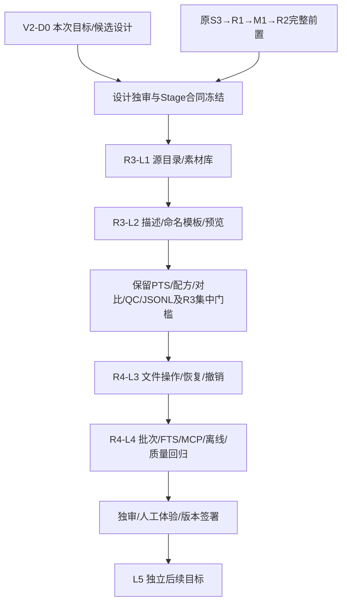

# LVW · V0–V3 当前设计汇编

由 tools/build_full_spec.py 从 docs 生成；单一产品坐标读取 plans/execution-control.json。设计与候选不代表产品已验收。

<!-- source: docs/00_POSITION_AND_ADR.md -->

# 00｜定位、状态权威与架构决策

LVW = Visual Prompt & Creative Asset Service。核心是“观察什么、想创造什么、怎样表达给生成器、哪些人工版本可复用”。不做第二个导演工作台。设计覆盖V0–V3，本次文档交付不代表任一产品版本已经开发。

| 系统 | 权威数据 | 允许交接 | 不允许 |
|---|---|---|---|
| Navia | 显式保存的知识/引用/来源 | 用户授权的摘要、引文、证据引用 | 浏览器凭据、默认原媒体/路径读取 |
| Narralens | 项目、脚本、生产镜头顺序、复检/审批、最终交付 | brief和参考进入，Prompt建议返回 | LVW写生产审批/剪辑/交付状态 |
| LVW | 视觉观察、推断、用户证据、创意、Prompt/配方修订 | 版本化建议/编译结果/引用 | 复制所有素材，冒充知识/史实权威 |
| Ollama/ComfyUI | 推理与生成执行 | 请求、任务、受控工件 | 接管生产项目状态 |
| Codex/Claude Code | 开发和受控工具使用 | 合同内API/MCP调用 | 成为必须在线的生产运行时 |

## 冻结决策

- ADR-01：V0为Comfy工作流MVP；V1独立服务；V2资产；V3集成，边界按版本生效。
- ADR-02：V1起模块化单体FastAPI+SQLite+受管小工件+单GPU执行槽；不引入消息集群。
- ADR-03：V0原生Comfy UI；V1–V3 React+TS+Vite/CSS Modules；Node仅构建。禁止Gradio/NiceGUI。
- ADR-04：默认已有Ollama/gemma4:26b；实际能力以目标机digest与探测为准。Prompt Assistant V0复用、V1对照，不重复下载模型。
- ADR-05：raw/机器建议/人工修订隔离；四来源域和未知值一直保留；模板编译为纯CPU。
- ADR-06：无人审通过状态作为内部编辑/保存/导出的前置；不追加NSFW过滤。模型未答不等于系统判断违规。
- ADR-07：引用优先，不复制原片；结构化资产版本、权限、索引、迁移做实，不构建海量媒体平台。
- ADR-08：V2 MCP官方SDK，按开工版本与客户端实测锁定；V3外部合同是提案，必须映射真实接口。
- ADR-09：升级软件与数据分开，模型外置复用；V0增量包，V1独立运行包，V3完整恢复测试。
- ADR-10：引用旧测试编号但不继承PASS。V0不替代V1，模拟不替代GPU/离线/真实对端。
- ADR-11：V1 首个可保留垂直切片 `R1a` 提前到 V0.1/V0.2 之前实施；它使用最终 React/FastAPI 同源架构，不新增 V0-Min.1，不改变任何版本门禁，详见[路线决策](docs/23_V1_EARLY_FRONTEND_SEQUENCE.md)。

## 优先级

最新用户授权 > 本文件ADR > 当前plans/contracts/config > 当前docs > 只读legacy。发现同级矛盾先记录ADR，不自行扩大范围。V0的无数据库不削减V1修订/V2资产；V0依赖Comfy不改变V1独立运行。提前实现不等于提前验收：`R1a` 只提供 V1 早期切片，V1 正式 PASS 仍受完整累计门禁约束。

- ADR-12（2026-11-11，用户已批准）：V1增加R22最小多镜头分析，Stage V1-M1依赖R1骨架并先于R2最终收口；R13完整切镜/长片/资产增强仍属V2。既有V1二十一项保留，新增MS01–MS08，V1累计29项、V2累计38项、V3累计47项；原始历史收据不改分母。具体接口候选在docs/31及plans/v1-multishot-contract.json，经独审/协调者Gate0后激活，不编辑旧R1切片冻结包。
- ADR-13（同日用户指定）：Codex持有设计、合同和裁决权；ClaudeCode通过Orca可见隔离窗口实现、自检、输出收据；另一隔离实例审查；人类体验与发布签署保留。无额度/未登录进入明确阻塞，不暗中换供应商或由root批量代写。

- ADR-14（2026-11-11，CHANGE-V1-S2-HANDOFF-01已获用户批准）：仅为V1开发衔接，S3的S2前置可由原S2九项机器/独审证据＋当前621b1bf统一前端实际人签满足，按plans/tasks.json的S3-V1-ONLY-S2-HANDOFF-01逐字段/哈希核验。旧S2保持7/8未签，旧版本发布义务不变。只改变这一条准入谓词，不减少S3十二项、Q01/MS质量或资源门限，不自动激活产品Gate0。

## ADR-15｜2026-11-12 V2视觉素材理解与整理

用户已授权新增未来V2目标及详细设计，采用同一单体共享观察，增加源目录、事实描述修订、CPU命名、精确计划和唯一文件写owner。原件写入仅V2登记scope+有效确认例外；不扩大当前V1权限。详见[ADR-15](docs/adr/ADR-15-V2-LIBRARY-NAMING.md)、[目标](docs/33_V2_PRODUCT_REBASELINE.md)和[详细协议](docs/34_V2_LIBRARY_ARCHITECTURE.md)。候选18项追加到现有38/47得到56/65，设计未激活；原29项V1、旧收据/失败/人签不变。

## ADR-16｜2026-11-15 开发反馈与辅助义务分层

用户已批准[交付流程修订](docs/adr/ADR-16-DELIVERY-FLOW.md)。定向验证前置、辅助非关键诊断在严格条件下可独审列Minor、证据差异复用立即生效；最小职责拆分及垂直切片依赖逐包准入。最终189/产品29、硬安全、历史结论与必要人签不变。旧STATIC_ONLY组件约束由新版本packet逐候选替代，不修改旧冻结文件。

---

<!-- source: docs/01_PRD.md -->

# 01｜PRD：从反推MVP到创作资产服务

## 目标用户与任务

Windows 4090/32GB单人创作者：将参考图片/短片或纯文字意图，转为可编辑、可追溯的视觉描述和下游Prompt。主题包括纪录片、写实、科幻、科普、电影质感、风格化。前两项强调来源；后几项允许创作扩展但不伪装为观测事实。

成功标准是少重复推理、少重复描述、人工稿不丢失、资料可复用，非“更自主的Agent”或“恢复原始seed”。静图不能证明连续动作；采样视频不能证明未被观察的片段；图像风格不能证明历史身份/科学结论。

## 版本化范围

| 版本 | 核心用户故事 | 数据与体验 |
|---|---|---|
| V0-Min | 上传单图→本地反推→人工编辑→复制/TXT/JSON | 最简 ComfyUI 会话闭环；无业务数据库；视频与发布硬化后移 |
| V0.1 | 增加短视频固定四帧与基础资源控制 | 受控本地抽帧、取消/晚到和资源释放 |
| V0.2 | 增加离线迁移、增量包、安装卸载回滚和完整质量 | 原 V0 十二项发布级门槛；旧 `V0` 为其兼容别名 |
| V1 | 选模式→分析/手写→锁定字段→编译→保存修订 | 轻React、独立服务、SQLite最小修订，CLI |
| V2 | 镜头切分→检索资产/配方→批量复用→Agent调用 | 时间/来源/关系/FTS5、批处理恢复、MCP |
| V3 | Navia授权证据→Narralens brief→Prompt建议→受控生成交接 | 引用、版本协商、跨进程资源和集成状态 |

## 完整需求清单

R01本地媒体受控导入；R02真实视觉分析及raw；R03无模型人工路径；R04六模式；R05四目标编译；R06四来源域/镜头结构；R07不可变修订/锁定/ETag；R08 SQLite和引用工件；R09 HTTP/CLI/React；R10资源/取消/卸载；R11离线/文件安全；R12导出/迁移；R13 V2切镜与PTS；R14资产/FTS5/配方；R15 MCP；R16批量恢复幂等备份；R17 Navia；R18 Narralens；R19 Comfy；R20 V3迁移及E2E。

另补R21：参考属性对比、非破坏性QC候选与分镜/JSONL导出（V2），承接更早讨论的业务场景。

这些旧ID不删除；具体验收、版本和任务在`plans/requirements.json`。另有V0-R01–R12，描述V0同类最小能力而非提前宣称R01–R20实现。

## 输入输出

V0/V1默认图片JPEG/PNG/WebP≤20MiB、40MP；短视频MP4/MOV≤256MiB、60s、单帧≤8294400像素。格式与解码器实测；默认4帧、图长边1024、视频帧长边768。超限提示截短，不静默只分析前段。V2长片通过引用和分段流式处理，默认≤2h、20GiB，不全量上传到浏览器内存；V3沿用而非重复存媒体。

V0四输出：自然中英、图像Prompt、视频Prompt、标签。V1四目标：natural、image（自然描述/SD标签两种rendering）、edit（generic/Qwen适配）、motion（generic/H3适配）。**FLUX优先自然描述，不等同SD标签**。专用后端模板是配置，不新增第五套推理管线。负向词可空，目标不支持时只作用户备注。

## 纯人工闭环

没有参考/没有模型/模型未答都能创建草稿。编译不调用LLM；英文缺失不假装已翻译。已保存人工修订只读；重分析仅出新建议，显式采纳才能产生新版本。内容备注不产生任何审批权限。

## 不做

自动版权判定、人物真实身份识别/跨镜头身份追踪、史实自动认证、浏览器爬取/下载平台、全功能剪辑、模型训练、生成器权重管理、多用户SaaS、无限长片全理解、自动NSFW审核、通用Shell Agent、向量数据库、多前端框架。推荐候选项不能悄悄变为必装组件。

## 业务质量

V0独立标注10图+6片；V1起12图+6片覆盖六模式，所有模式至少2张图，全部原始结果参与评分。单样本5维0–2分，≥8且无关键幻觉才可用；V0图≥8/10、片≥5/6，V1图≥10/12、片≥5/6。24模式×目标是确定性编译组合测试，不等于24项视觉质量已合格。V2/V3继承并增时间/集成场景。

## 2026-11-11批准的V1补充

R22：短视频自动建议镜头边界、人工拆合/校正、每镜头独立抽帧和人物/场景/简单动作证据、逐镜头草稿/提示词及清单导出。沿用60秒/256MiB/源8294400像素，最多12镜头，每镜头1–4实际不同帧（通常2–4，短段少帧明确标注）。人物仅可见人数/外观/姿态，不识别真实身份或承诺跨镜头追踪。动作必须有时间/帧证据，观察/推断/未知分域；像素差不能当动作识别。渐变/叠化先提示疑似供校订，不承诺复杂转场恢复。整体四帧路径继续保留。完整资产库、长片、ASR、MCP仍后置。见docs/30–32；新八项叠加原二十一项，旧质量阈值不降。

## 2026-11-12｜V2目标增量（ADR-15）

产品定位补充为本地优先的视觉素材理解与整理工作台。R23–R30覆盖本地源引用/登记、描述与来源unknown、确定性命名、预览确认、同卷不覆盖文件操作、恢复撤销、稳定检索和大素材离线人工路径。DJ及通用图视频为核心，BPM/调性/曲名/识人/ASR与联网查询不纳入。

V2用户路径为登记→分页扫描→分析或手工→中英模板→预览/编辑/CSVJSON→精确确认→apply→日志/undo。上传副本不具有原件写授权；未知身份/日期不可AI补齐。保留原R13/R14/R15/R16/R21义务、V1/R22短片限制与已签范围。详细范围及候选指标见[33](docs/33_V2_PRODUCT_REBASELINE.md)，实现边界见[34](docs/34_V2_LIBRARY_ARCHITECTURE.md)，固定候选用例见[35](docs/35_V2_LIBRARY_EXECUTION_AND_ACCEPTANCE.md)。新增需求/指标尚非运行批准或产品验收。

---

<!-- source: docs/02_UX_TARGET.md -->

# 02｜目标体验、状态和门限

## V0：工作流而非平台

两个工作流“图片反推”“视频反推”，输入/规则/建议/工作稿四分组；已有面板优先，缺口才加原生JS。独立人工编辑/导出不得接在可能失败的模型节点之后。典型≤5个主要操作；4帧预览附采样时间与“未分析音频”。会话未导出关闭会丢失，要提示；不暗中建立localStorage资产库。

## V1：单页工作台

左参考预览，中间观察/推断/证据/创作字段，右机器建议和人工稿，底部版本/导出。上传→模式/目标→分析→采纳/修改→保存复制。无模型时同页保留所有人工能力。非空草稿采纳需要确认；冲突时显示差异和另存，不最后写覆盖。输入规则和高级资源参数折叠。

## V2：资产库 + 配方 + 任务

工作台之外增加Library，按文字、标签、类型、来源、配方过滤。结果卡显示可复用Prompt版本、源可用性、镜头范围。选中资产→引用已有修订或创建分支；删除是可恢复的归档/引用解除，不删原片。Recipe编辑产生新版本；批量任务按项失败、恢复、不阻断手工编辑。没有向量索引时明确叫“文字/标签检索”。

## V3：项目群交接

Integration页显示Navia授权范围、Narralens源镜头版本、Comfy工作流版本、建议/执行/接收状态。对端离线则排队或保留待交接稿；不伪报已交付。授权只约束数据与机器操作，不是内容审批。Prompt建议和Narralens最终采纳分开；只有后者掌握生产状态。

## 全局状态体验

queued/preparing/running/partial/succeeded/failed/cancelling/cancelled/interrupted分清。resource_state独立，取消反馈不意味着GPU已停。明确错误、重试范围、保留了什么。模型结果到达只进建议区；手动工作稿依靠draft_epoch/etag保护。日志不要给假百分比。

## 可测门限（设计值，不是实测）

| 指标 | V0 | V1–V3 |
|---|---|---|
| 点击/取消反馈 | ≤1s | ≤1s |
| 等待提示 | ≤2s | ≤2s |
| ≤20000字编辑/复制反馈 | ≤1s，导出≤2s | 同左；保存API P95≤500ms（不含大文件hash） |
| 默认热模型单图/4帧 | 各10次P95≤180/300s；另报冷加载 | 同左，超过需正式ADR而非隐性缩输出 |
| 超时 | 分析420s硬上限；释放另测 | 单窗口420s；批量按窗口，不能把2h片视为单窗口 |
| GPU | 总峰值<23GiB；21GiB为优化目标 | 同左；不把网络锁当驱动级隔离 |
| 内存 | 系统可用RAM≥2GiB | 同左；LVW+子进程/Ollama汇总Private Bytes≤26GiB作为补充预算 |
| 资源释放 | 已停止计算后30s内/api/ps消失且GPU回到空闲基线+1GiB，3次采样 | 同左；取消≤60s仍未停则RESOURCE_BUSY，人工仍可用 |
| 前端 | 1280/1920桌面、原生200%可达 | 360/768/1280/1920，200%不隐藏核心操作 |
| 资产查询 | 不适用 | V2起1000引用，P95≤500ms，结果首屏≤1s，虚拟/分页不冻结 |
| 包迁移 | 同宿主中文/空格目录 | V1新目录/用户；V3干净Windows宿主与数据恢复 |

测试模型默认卸载；热基准临时保持加载并结束后恢复配置。P95采用nearest-rank，10次即第10个，样本数必须披露。无伪造吞吐/计时。更大数据量/8帧/8192 ctx是另测配置，不是默认承诺。

## 原型解释

`prototype/index.html`可切四版本、六模式、四目标、选择本地预览、模拟成功/取消/模型不可用、修改并导出设计示例。醒目标记“演示”，不运行真实模型；原型不是节点图或React实现。本包浏览器检查只证明原型本身。

---

<!-- source: docs/03_ARCHITECTURE.md -->

# 03｜架构设计：连续演进，不重复建系统

## V0拓扑

```text
ComfyUI原生界面/已装Prompt Assistant
  ├ 图片→受控缩放 ─┐
  ├ 视频→有限抽帧 ─┼→Ollama→raw/建议→显式采纳
  └ 人工稿→CPU四输出→复制/导出（独立路径）
                        推理调用finally→释放检查
```

最多一个LVW薄扩展。Comfy为宿主，Ollama为执行。无业务持久队列/数据库。平台上传、现有历史和临时帧落盘必须披露。不得把整个视频先载入GPU张量再挑4帧。

## V1–V3目标拓扑

```text
React静态dist ── 同源HTTP ─┐
CLI / V2 MCP stdio ────────┼→ FastAPI / Application Service
V3对端适配 ────────────────┘      ├ Compiler（CPU纯函数）
                                 ├ Revision / Asset / Evidence
                                 ├ Job Coordinator（单GPU槽）
                                 └ SQLite Repository / 文件工件
                                    │
                       CPU预处理→Ollama VisionProvider
                       V2分镜 / V3 Comfy执行适配
```

浏览器不直连Ollama，不拿绝对路径/凭据；MCP薄代理到同一服务，不因多客户端启动多份GPU Worker。V1关闭Comfy仍可运行；V3只有生成任务才依赖Comfy。

## 代码边界

`domain/{PromptSpec,compiler,revision_policy}`不依赖HTTP/Comfy；`services/{media,analysis,assets,jobs}`持有业务；`adapters/{ollama,comfy,navia,narralens}`隔离协议；`repositories/sqlite`唯一写权限；`api/cli/mcp`入口共享服务。前端只管理展示和草稿状态，不复制后端事务规则。

V0提取的模板/预处理/结果合同可迁移；Comfy节点ID、插件路由、session graph不是正式业务对象。输入output schema版本需转换，不把V0 run_id当revision_id。

## 控制面与执行面

CPU编译/保存与GPU队列独立。V1 SQLite记录job/attempt，进程崩溃标interrupted、显式重试；V2才提供批量续跑策略/lease/恢复。写入时CAS检查attempt_id和cancel_epoch；结果原子发布，人工修订append-only。

V3 GPU协调只约束所有接入协作租约的生产者；不控制未接入的外部Comfy/Ollama。发现未知占用返回RESOURCE_BUSY，不能kill其他进程。对端队列和本地job要有分别的id，不制造分布式“恰好一次”承诺。

## 数据权威与缓存

媒体本体引用默认归来源系统；hash标识内容，asset_id标识业务引用。模板版本、模型digest、采样、输入hash形成analysis_key；结果缓存只供显式复用、不得覆盖人工稿。更新模板产生新key，不能命中旧结果伪称已用新模板。

## 部署单元

V0增量工作流/薄扩展；V1一个Python服务（含静态前端）+已有Ollama；V2增加同应用模块而非新数据库服务；V3按需启用外部适配。无Redis/MongoDB/独立向量库/大Agent运行时。Node仅构建，所有浏览器资源本地。


## 2026-11-11批准的V1范围与角色修订

V1新增SceneRevisionOwner、FrameEvidenceOwner与有界持久化父子任务，单体/SQLite/单GPU不变。 权威执行索引见[新版V1计划](docs/30_V1_REVISED_EXECUTION_PLAN.md)、[详细架构/合同](docs/31_V1_DETAILED_ARCHITECTURE_AND_CONTRACTS.md)、[验收与Orca协作](docs/32_V1_ACCEPTANCE_AND_AGENT_WORKFLOW.md)。本节覆盖此前“自动切镜全部只在V2”的范围表述，不回填任何产品PASS。

## 2026-11-12｜V2共享视觉事实与安全文件操作

同一FastAPI/SQLite增加SourceRegistry、AssetDescriptor、NamingCompiler、RenamePlanner、FileOperationService/Journal。最后一项是唯一原件写owner；Repository仍是唯一数据库写边界。浏览器/MCP只用ID与相对展示位置，无新桌面/数据库/微服务。最终V1持久任务与修订须以真实交付核验后复用；现有内存字典不当作库。

analysis_key的template版本指**分析模板**；命名模板仅参与plan_hash，改命名模板不重推理。创作输出不升级事实；源文件业务ID、物理身份与内容hash分离。native no-replace、短事务intent/文件动作/event、恢复及反向计划完整规范在[34](docs/34_V2_LIBRARY_ARCHITECTURE.md)。候选设计未激活，原件写权限不从V1继承。

## 2026-11-15 最小职责分离

ADR-16/docs36将native平台原语、run生命周期、证据记录、测试夹具清理分清唯一owner。保持同一FastAPI/SQLite/Ollama单体；先逻辑隔离及最小夹具helper提取，允许文件范围由新packet冻结。不得把本设计当成生产broker重写或提前引入V2/V3平台的授权。

---

<!-- source: docs/04_ROADMAP.md -->

# 04｜V0–V3迭代目标与门禁

| 版本 | 阶段 | 出门能力 | 出门证据 |
|---|---|---|---|
| V0-Min | V0-S0~S1 | 单图反推、独立人工四输出、复制/JSON/TXT | V0-A01/A03/A04/A05/A08 全 PASS |
| V0.1 | V0-S2 | 增加短视频四帧、文件安全、资源与取消 | 累计 V0-Min + A02/A07/A09/A10 全 PASS |
| V0.2 | V0-S3 | 增量包、迁移回滚和完整质量 | V0-A01~A12 全 PASS；旧 V0 兼容别名 |
| V1 | R0复核、R1、R2 | React/FastAPI/Ollama、六模式四目标、修订、离线独立包 | A01~A12、F01~F05、Q01、X01~X03；V0合同回归 |
| V2 | R3、R4 | 真实PTS、资产/FTS5/配方、MCP、批处理恢复 | A13~A17、F06、X04~X06；V1累计回归 |
| V3 | R5a、R5b、R5c（旧R5细拆） | 三对端交接、资源协调、升级回滚、E2E | A18~A22、F07、X07~X09；V1/V2累计回归 |

Q01为独立质量；X为对旧包未细化风险的补强，并非取消旧A/F。精确门禁见plans/release_gates.json。文档版本2.0≠产品V2。

## 当前批准的实施顺序

V0-Min 验收后，优先执行 `R0 → R1a`，先形成采用最终 V1 架构的单图简易前端；随后执行 `V0-S2 → V0-S3`，再完成 `R1 → R2 → R3 → R4 → R5a → R5b → R5c`。`R1a` 是实现切片而非新产品版本，详见[决策 23](docs/23_V1_EARLY_FRONTEND_SEQUENCE.md)。

这项调整只改变开发优先级，不改变上表的版本能力、累计验收和发布顺序。允许前序版本尚未正式出门时实现无依赖代码，但 V1 不得在 V0 合同映射、R1/R2 和 V1 固定分母全部通过前宣称 `V1_ACCEPTED`。

## 进入与退出

V0-S0是探测不是产品验收，禁止用完整发布项卡住开工。V0-Min 收缩决策界定其历史签署范围；当前交付目标读取 execution-control，V0.1/V0.2 不得反向阻塞 V0-Min 出门，但其风险和用例继续保留。V1前复核完整 V0.2 转换和独立API；旧Prompt Assistant只作对照，不再是依赖。V2迁移保留所有已保存revision_id和hash。V3仅在真实授权/对端合同可调用时完成相关E2E，模拟能解阻开发不能通过发布。

可在前序受阻时实现无依赖功能，但不能提前宣称整个版本通过。项目负责人已明确批准 `R0/R1a` 提前实施；其后的跨里程碑推进仍以冻结 Stage Packet、授权边界和固定门禁为准。

## 不继承什么

不继承旧报告PASS、不把4帧近似升格为精确PTS、不把工作流JSON改名为API服务、不把本地检索当语义模型、不把返回Prompt当视频已生成、不把外部任务提交成功当Narralens已采纳。

## 范围升级

候选新模型、超出V2有界引用库的平台化海量图库、Linux二进制、多用户、语义向量检索、ASR、自动剪辑不属于V0–V3必选。出现真实需求再ADR；不得为“完整”把它们加到默认依赖。工期由目标机基线与实际burn-down修订，不写虚构保证日期。

## 执行状态与待决优化

完整子阶段和证据边界见 [24｜执行总纲](docs/24_EXECUTION_MASTER_PLAN.md)，实时完成度只在 `plans/execution-control.json`。本章是版本路线，不表示每阶段已经执行。S2 仍是当前产品 Stage；计划审阅不切换 Stage。

[25｜提速提案](docs/25_PLAN_OPTIMIZATION_PROPOSAL.md) 全部为待批准项，不能反向修改本章门禁、docs/22–23 已签范围或原失败。V0.2 仍需全部十二项；完整 V1/V2/V3 固定分母分别为21/30/39项。


## 2026-11-11批准的V1范围与角色修订

批准顺序在R1后R2前加入V1-M1；S2/S3依赖保留；V2完整R13仍保留。 权威执行索引见[新版V1计划](docs/30_V1_REVISED_EXECUTION_PLAN.md)、[详细架构/合同](docs/31_V1_DETAILED_ARCHITECTURE_AND_CONTRACTS.md)、[验收与Orca协作](docs/32_V1_ACCEPTANCE_AND_AGENT_WORKFLOW.md)。本节覆盖此前“自动切镜全部只在V2”的范围表述，不回填任何产品PASS。

## 2026-11-12｜未来V2目标与候选分母

[ADR-15](docs/adr/ADR-15-V2-LIBRARY-NAMING.md)采用R3-L1源素材库、R3-L2描述/命名预览、R4-L3文件操作恢复撤销、R4-L4批次/FTS/MCP/离线及质量回归，保留原R3/R4全部子项。当前可完成V2-D0设计，不激活V2业务，原S3→R1→M1→R2顺序与进度不变。L5监控/auto apply/文档/更多容器/跨卷另定。

本章21/30/39为早期快照，ADR12后的canonical基线为29/38/47；本次候选为29/56/65，未激活前不能据旧范围签扩展V2/V3。工作包依赖与新增用例见[35](docs/35_V2_LIBRARY_EXECUTION_AND_ACCEPTANCE.md)；任何指标/运行预算/真实目录仍待绑定，旧硬门限不降低。

## 2026-11-15｜交付路线执行增量

用户已批准[ADR-16](docs/adr/ADR-16-DELIVERY-FLOW.md)与[docs36执行修订](docs/36_DELIVERY_WORKFLOW_REBASELINE.md)。O1/O2/O6立即作用于新候选的执行规则，O3最小拆分、O4依赖审计及O5有限pilot逐包准入；本节覆盖此前把全部优化一概写成未批准的表述，但不追溯批准docs25的安装树校验次数或性能样本缩减方案。正式R1/M1/R2退出顺序、Stage完成数、189组件及29产品最终分母、真实质量/资源/授权/人签不变。实际开发前置按plans/v1-workpack-development-map.json逐项Gate0验证，不以路线表直接启动产品运行。当前优化组件packet的精确命令/候选/guard/预算仍待root封存ACK。

---

<!-- source: docs/05_BUILD_PLAN.md -->

# 05｜完整开发计划与实现交付

权威清单`plans/tasks.json`给每项依赖、产物、关联需求/用例、实现步骤与阶段出门。下表是阶段范围目录；实际执行拆分、完成度、V0全覆盖、进入/退出与失败恢复见 [24｜执行总纲](docs/24_EXECUTION_MASTER_PLAN.md)。未冻结的后续 Stage 不称为可直接执行；准确命令、候选与授权需在其 Gate0 补齐。

| 阶段 | 实现工作 | 交付 |
|---|---|---|
| V0-S0 | 只读盘点/备份、模型单图+4帧、节点注册/参数/许可与取消卸载探测 | inventory、node-bindings、baseline、依赖锁候选 |
| V0-S1 | 独立人工编辑导出优先，图片预处理/真分析/建议分离/四输出 | 图片UI/API图、人工流程、模板及导出 |
| V0-S2 | 视频上传/限量解码、采样预览/时间性质、请求级资源锁/清理 | 视频UI/API图、资源与异常测试 |
| V0-S3 | 冻结质量集、断网/迁移/回滚/性能，最小增量包 | 真实验收、使用说明、可逆补丁 |
| R0 | 新独立服务接口探测，复用V0模型模板，确认正式依赖/许可 | 复用审计、架构差距与数据映射 |
| R1a | 最终架构的单图简易前端：受控上传、分析状态、raw/建议/人工稿、四输出、复制/导出 | 可保留 React 页面、FastAPI 最小合同子集、定向测试 |
| R1 | React SPA、FastAPI合同、人工镜头、CPU编译、SQLite和受控导入 | 实际前后端、单元/API测试、模板矩阵 |
| R2 | Ollama真推理、异步job/CAS、修订/导出、Windows便携包 | V1运行包、CLI、API和累计验收 |
| R3 | PySceneDetect/真实PTS、长片分窗、资产链接/FTS5/配方、Library | V2资产/时间功能、迁移DDL、检索实测 |
| R4 | MCP薄工具、批量/lease/幂等恢复、备份/restore | 真客户端、故障注入、V2运行包 |
| R5a | 外部能力握手、Navia显式证据导入、Narralens建议与冲突 | 双端合同与真实安全测试 |
| R5b | Comfy工作流allowlist/参数映射/收据/单GPU协作 | 真生成交接、超时不重复提交与取消隔离 |
| R5c | 集成UI、迁移/回滚/离线三系统E2E、最终交付 | V3运行包、兼容表、可复核审计包 |

当前优先顺序不是上表编号的简单串行，而是：`V0-S1(PASS) → R0 → R1a → V0-S2 → V0-S3 → R1 → R2 → R3 → R4 → R5a → R5b → R5c`。R1a 不产生独立发布版本；其代码必须直接进入 R1/R2，不能另建一次性前端或临时 API。机器可读依赖与推荐顺序见 `plans/tasks.json`。

## 每阶段统一步骤

先更新环境/变更清单；实现合同与测试；产物校验；单位/集成/真实场景分层执行；失败修复复跑；报告实际PASS/FAIL/BLOCKED/NOT_RUN。合同先冻结再让前后端并行；同卡硬件测试串行。功能开发、环境准备和外部依赖阻断分别计量。

## 实施目录

```text
lvw/
  v0_patch/{custom_nodes,workflows,templates,scripts}/
  backend/app/{api,domain,services,repositories,adapters,cli}/
  frontend/src/{features/workbench,features/library,features/integrations,api,components}/
  mcp_bridge/              # 业务服务薄代理，无第二GPU worker
  contracts/ templates/ migrations/
  tests/{unit,contract,integration,e2e,hardware,offline,security,quality}/
  scripts/{build,diagnose,backup,restore,rollback}/
  reports/ manifests/
```

V0交付真实workflow；本设计包不伪造具体节点。正式代码生成Pydantic/OpenAPI/TS类型，合同变更做双向一致性测试。编译/导出不受GPU队列影响。入站文件安全和人工版本保护优先于美化UI。

## 交付与停止

每版本都给可运行产物、锁定依赖、用法、升级/卸载、测试和证据；不能只有截图。V3支持对端不可用时人工工作，不用扩大本项目边界消除外部阻断。所有缺口进入risk register；不修改旧成功证据来覆盖当前失败。

## 2026-11-05 执行文档整合

- `docs/24_EXECUTION_MASTER_PLAN.md`：覆盖全部 V0-R01–R12、S0–S3与提前的R0/R1a，列明剩余批次、owner、文件范围、Oracle、证据、清理与人工门限；V1–V3按同一栏位扩展。
- `plans/execution-control.json`：唯一当前坐标与 development_outline 子阶段完成度；tasks/requirements/cases 的初始状态不是运行看板，不能用它们否认已签署结果或补造 PASS。
- `docs/25_PLAN_OPTIMIZATION_PROPOSAL.md`：颗粒度、重复回归、安装树校验、压力轮数和修复预算的精确差异；均等待项目负责人批准。

本次只完善文档和用户要求的停止报告格式。原Stage、四权分离、质量阈值、固定分母与运行程序未改变，不因补文档额外重建治理平台。


## 2026-11-11批准的V1范围与角色修订

V1-D0设计/工具→原前置→R1四包→M1三包→R2四包；每Stage集中验收、一个实现owner。 权威执行索引见[新版V1计划](docs/30_V1_REVISED_EXECUTION_PLAN.md)、[详细架构/合同](docs/31_V1_DETAILED_ARCHITECTURE_AND_CONTRACTS.md)、[验收与Orca协作](docs/32_V1_ACCEPTANCE_AND_AGENT_WORKFLOW.md)。本节覆盖此前“自动切镜全部只在V2”的范围表述，不回填任何产品PASS。

---

<!-- source: docs/06_ACCEPTANCE.md -->

# 06｜全阶段验收计划

## 判定与证据

PASS实际执行达标；FAIL执行未达标；BLOCKED缺可验证前置；NOT_RUN未执行。每个用例有前置、步骤、断言、测试类型、证据和资源指标，机器真源在plans/acceptance_cases.json。所有产品状态初始NOT_RUN。

必须记录git/环境/插件/模型digest、配置、样本哈希、命令/截图/输出及哈希、计时和资源。模拟测试只证明逻辑分支，不能证明真实推理质量、断网无外联、GPU停止、外部项目可用。发布检查器可检查证据结构，不能证明人为证据真实。

## 验收分层

1. 单元：确定性编译、6×4组合、Schema、时间换算、CAS冲突、权限判定。
2. 集成：真实SQLite、文件/媒体处理、API错误、崩溃与恢复；故障注入显式标识。
3. UI：对应真实V0宿主或React产品，键盘/缩放/响应式、工作稿保护。
4. 硬件/离线：Windows4090、已有Gemma4、图+4帧，loopback保留的外联阻断和观测。
5. 业务质量：独立标注的原始模型结果；不以修改后结果自证模型正确。
6. 跨项目：V3真Navia/Narralens/Comfy版本和权限，不能用HTTP mock通过。

## 版本门槛

V0-Min 固定五组：V0-A01/A03/A04/A05/A08。V0.1 累加 A02/A07/A09/A10；V0.2 累加 A06/A11/A12，等于原 V0 十二组。旧 V0 门槛作为 V0.2 兼容别名保留。V1原A01–A12/F01–F05+Q01+X01–X03；V2 A13–A17/F06+X04–X06；V3 A18–A22/F07+X07–X09。所有版本继承前序正式合同回归，详细集合见release_gates。

## 业务评分

每样本主体/环境、光线/构图/风格、动作/时间或静图不虚构、事实/创作分离、Prompt可用性五维各0–2。≥8/10且零关键幻觉才可用。V0图8/10、视频5/6；V1起图10/12、视频5/6。禁止把未提供的真人身份、年代/地点、科学结论写成确定事实。原始响应与人工稿分别评分；样本/评分表测试前冻结，由用户或独立人员签注。

V2切镜算法独立评估：至少20个人工标注切点+连续镜头，±2源帧容差，precision/recall各≥0.90；困难淡入/闪白失败必须展示并可人工校订。PTS“精确”指实际帧时间基映射，不表示算法切点永不错误。

## 性能与离线方法

各10次热模型图/视频；P95 nearest-rank，第10值；冷加载各另报。1s或更细采样总GPU与系统可用RAM，Private Bytes标明进程集合。默认自动卸载，热测试后恢复配置。仅图像响应HTTP结束不证明模型卸载；用/api/ps+显存稳定3次采样。

断网冷启动：预置权重/依赖保留，浏览器缓存清理；阻断非loopback出站、观测连接尝试，首屏/分析/编辑/导出全测。只被防火墙拦住但不断尝试外联不算该配置通过，需隔离无关联网插件后重测。

## 迁移与负例

跨目录/用户名、中文路径、WAL活跃快照、包篡改/zip-slip/符号链接、缺素材重绑定、schema升级失败回滚。原始媒体hash不变；所有revision_id/content_hash相同；不要只复制.db遗漏WAL。

## 发布结论

Vn_ACCEPTED要求该版本全部必选及累计回归PASS。V0-Min 不要求视频质量集；它只证明最简单图与人工闭环。V0.1/V0.2 才分别承担视频和完整发布质量。缺独立质量最多ENGINEERING_READY/QUALITY_PENDING；缺对端V3_INTEGRATION_BLOCKED。NOT_RUN/FAIL/BLOCKED/PASS_CANDIDATE_FOR_REVIEW不能当PASS；诊断性optional用例须在执行前声明而非失败后改为可选。

## 执行覆盖与变更边界

V0 全部十二项的生产 owner、Oracle、负例和清理映射见 [24｜执行总纲](docs/24_EXECUTION_MASTER_PLAN.md)。最新运行进度与历史签署分别读取 execution-control 与原收据；本文件的“初始 NOT_RUN”不覆盖真实签署。

[25｜提速提案](docs/25_PLAN_OPTIMIZATION_PROPOSAL.md)中的轮数/校验策略尚未批准，现行门限保持不变。对A09方法的任何后移必须新版本化、明确披露S2与S3的证据分工，不能三次冒充十次P95，也不能改写历史NO_GO。


## 2026-11-11批准的V1范围与角色修订

V1原21项保留，加MS01–08为29；V2/V3继承38/47；原Q01阈值与样本分母不降。 权威执行索引见[新版V1计划](docs/30_V1_REVISED_EXECUTION_PLAN.md)、[详细架构/合同](docs/31_V1_DETAILED_ARCHITECTURE_AND_CONTRACTS.md)、[验收与Orca协作](docs/32_V1_ACCEPTANCE_AND_AGENT_WORKFLOW.md)。本节覆盖此前“自动切镜全部只在V2”的范围表述，不回填任何产品PASS。

---

<!-- source: docs/07_SECURITY_AND_THREATS.md -->

# 07｜攻击者视角与安全边界

| 攻击/失败路径 | 影响 | 必须防线与用例 |
|---|---|---|
| 图片字幕/网页/模板提示注入 | 诱导执行命令/泄漏资料 | 将内容视为数据、无tools给VLM；MCP白名单；V0-A07/A08/X01/A15 |
| 任意路径、UNC、重解析、zip-slip | 越界读写/破坏工作区 | resolve+允许根、拒绝链接、无shell拼接；A08/X03/X09 |
| 巨幅/长片/压缩炸弹 | OOM/磁盘满 | 像素/时长/字节/帧/临时配额/子进程超时；V0-A07/A10 |
| 本地网页跨源请求或DNS rebinding | 未授权调用loopback | 校验Host/Origin、随机本地会话token、非GET写操作鉴权；X01 |
| 供应链自动更新/插件联网 | 隐私外泄/环境损坏 | 固定版本hash、离线资产、增量patch和回滚；A09/X02 |
| 取消/重复提交/重启晚到 | 错写人工稿/重复生成 | attempt fencing、CAS、幂等键payload hash、unknown状态；A07/A16/X08 |
| 多系统写同一镜头/审批 | 状态冲突、不可追溯 | 明确权威、只返回建议、ETag/源版本；A19/X07 |
| 史实/科学幻觉 | 误导内容 | 四来源域+unknown+人工证据；Q01/A12/A22 |
| 人审备注变成执行门禁 | 卡住创作 | 不建approval_required内容字段，手工路径永在；V0-A08/A01/A05 |
| GPU租约与实际资源脱节 | 外部任务被误停或OOM | 协作者锁+实际检测，不控制未接入客户端；A20/X08 |

应用默认只绑定127.0.0.1，拒绝非预期Host/Origin；不要为了插件CORS方便开`*`。本地token存操作系统当前用户可读配置，不在日志/导出出现。上传生成受管ID，不让浏览器提交任意绝对路径；登记来源根须本机操作和授权。

没有内容审核器≠没有授权。Navia“显式保存/授权”是资料访问边界，不是审查题材。Narralens自身生产复检仍由它负责，LVW不篡改也不复制。文件/网络保护不能被“人工负责NSFW”当作移除理由。

无通用Shell、任意URL抓取、任意Comfy工作流执行、直接SQL MCP。日志默认不含原图base64、完整私人Prompt、cookie、绝对路径；诊断包脱敏且显式导出。第三方源码/模型/素材许可证各自核验，不作自动法律结论。

---

<!-- source: docs/08_API_AND_CONTRACTS.md -->

# 08｜HTTP / MCP / 数据合同

`contracts/openapi.json`列出V1–V3端点及版本；`contracts/lvw.schema.json`是核心数据初始合同；`contracts/mcp-tools.json`列V2工具；`contracts/integration-contracts.json`定义V3提案与能力握手。实施后Pydantic为运行时真源，CI验证生成OpenAPI/TS和设计合同兼容，禁止三份手写Schema互相漂移。

## 通用语义

HTTP成功`{data,request_id,schema_version}`；错误`{error:{code,message,retryable,details},request_id}`。请求ID由服务生成/校验并贯穿日志，不能作为业务幂等键。202表示已受理，不表示完成。列表cursor+limit≤100，结果按稳定id排序。健康端点不泄漏路径。

写操作校验本地token与Origin；GET可按部署策略保护。POST jobs/revisions/import/handoff需Idempotency-Key；同键同规范化payload返回已有结果，同键不同payload 409 IDEMPOTENCY_CONFLICT。V1 job键在记录生命周期内永久唯一，V2/V3交接键至少保留项目记录生命周期，不以短缓存代替。

镜头GET带ETag；PUT必须If-Match，缺失428、不匹配412；旧包409冲突统一迁移为标准条件失败412，并保留error.code=REVISION_CONFLICT给旧客户端解释。逻辑版本/幂等冲突仍409。删媒体只归档自己的引用，不删外部源文件。

## V1

health/capabilities；受控multipart media；创建/读取/更新shots；analyze job、poll/cancel；CPU compile；append-only revisions、TXT/JSON export；CLI与HTTP共业务。保存revision须绑定shot当前etag，事务内快照+hash，旧revision无PUT/DELETE。

## V2

asset list/query/links、scenes及人工时间边界、recipe revisions、batch/retry、backup/export/import。MCP工具8个：capabilities、search_assets、get_asset、analyze、get_job、cancel_job、compile_prompt、save_revision。参数只接受ID/受控规则，不收任意路径；客户端启动薄代理到已有LVW服务，无第二worker。

## V3

capability handshake、Navia evidence import、Narralens brief/suggestion receipts、Comfy allowed workflow jobs、integration status、project package import/export。接收拒绝附带额外凭据/不允许字段，授权scope必须与具体来源匹配。版本不兼容返回CONTRACT_UNSUPPORTED；不能猜测对端接受字段。

## 不当承诺

MCP SDK的存在不代表生产工具实现；OpenAPI是设计合同不是运行中的API；工作流设计别名不是Comfy class_type。Ollama structured output只约束语法，不证明事实正确。不得把浏览器SDK可读路径行为当原始HTTP可接受路径；HTTP图像发送编码内容，路径只留本机服务。


## 2026-11-11批准的V1范围与角色修订

旧canonical合同与R1切片packet不静默改；候选overlay由Codex独审后Gate0激活。 权威执行索引见[新版V1计划](docs/30_V1_REVISED_EXECUTION_PLAN.md)、[详细架构/合同](docs/31_V1_DETAILED_ARCHITECTURE_AND_CONTRACTS.md)、[验收与Orca协作](docs/32_V1_ACCEPTANCE_AND_AGENT_WORKFLOW.md)。本节覆盖此前“自动切镜全部只在V2”的范围表述，不回填任何产品PASS。

---

<!-- source: docs/09_SOURCES_AND_ASSUMPTIONS.md -->

# 09｜来源、事实与待验证项

## 实际依据

本轮读取了legacy内v1.0.0/v1.1.0原ZIP及其PRD、架构、计划、合同、验收、原型；完整sha在sources/baselines.json。更早的LocalVisionWorkbench/ReuseDesign原件本轮不可读取，继承对话中已明确的决定并在覆盖表标识，未声称逐文件核对它们。

用户盘点：Windows、i7-13700KF、4090/24GB、32GB、ComfyUI、Prompt Assistant、Ollama/gemma4:26b。我们没有连接该Windows主机；tag/vision/吞吐/显存/插件API都必须V0-S0确认。模型文件有视觉层不自动等于能作为聊天模型使用，不把H3 conditioning权重当可替换VLM。

## 本次查阅的官方文档（2026-10-27）

- Ollama Chat: https://docs.ollama.com/api/chat — format、options、keep_alive、模型响应。
- Ollama structured outputs: https://docs.ollama.com/capabilities/structured-outputs — 视觉模型同样可用Schema。
- Ollama running models: https://docs.ollama.com/api/ps — 当前加载模型与size_vram。
- ComfyUI routes: https://docs.comfy.org/development/comfyui-server/comms_routes — prompt/queue/object_info/history/interrupt；具体插件路由另查本机。
- MCP官方README: https://raw.githubusercontent.com/modelcontextprotocol/python-sdk/main/README.md — 当前文档使用MCPServer、Python3.11+、stdio等；不凭此固定未经实测的小版本。

这些事实不证明目标主机版本支持全部参数。来源与本机证据冲突时采用实际兼容适配并记录版本，不盲升整套软件。

## 设计决定而非测量

资源/延迟/质量门限、SQLite表、API、版本流程、GPU协调、项目群协议都是本包设计，须实现验证。Navia/Narralens现有接口未知，只定义LVW侧提案；对端缺失不能用Mock通过V3。

## 不在本轮执行

真实Comfy图、Gemma4、4090、Windows离线包、独立金标准和跨项目E2E。本轮仅文档/合同/例子/DDL和HTML设计演示校验，报告严格分开。

---

<!-- source: docs/10_OPEN_SOURCE_REUSE.md -->

# 10｜复用/引用决策与部署成本

| 组件 | V0 | V1 | V2/V3 |
|---|---|---|---|
| ComfyUI / Prompt Assistant | 已装优先；规则/分析/原生UI，经核验薄补丁 | 对照/可许可规则，非运行前置 | V3 Comfy仅生成执行 |
| Ollama / Gemma4 | 唯一已有VLM | 原生API直接调用 | 延续；不默认多模型 |
| FFmpeg/ffprobe/Pillow | 宿主已有，有限抽帧 | 随运行包的已验证二进制/依赖 | 真PTS/长片分窗 |
| React/TS/Vite | 不引入 | 独立可维护SPA | Library/Integrations |
| FastAPI/Pydantic/httpx/SQLite | 不另起服务 | 单体业务服务/修订 | 同库演进FTS5 |
| PySceneDetect | 非必需 | 非必需 | V2切镜，PTS另取 |
| 官方MCP SDK | 不装 | 不必需 | V2薄代理，不手写协议 |
| Open Image Prompts | 不必装 | 可手动参考 | V2可选只读风格/CLI，不默认下载全图库 |

复用不等于复制整个仓库。Prompt Assistant的规则/文本清理/num_ctx默认/云回退需要读取已装版本；仅迁移有许可且必要的部分。优先一个模型、一套产品Python、一份运行时；Comfy既有环境不克隆到新服务。

拒绝Gradio/NiceGUI；不为本项目引入Dify/FiftyOne/MongoDB/Redis/向量库/多Agent框架。不是声称这些项目不好，而是当前没有相应必要性。Node只构建；运行不pip/npm、无现场CUDA编译、无默认权重下载。V0包≤20MiB（不含素材/权重）；V1核心运行时预算≤2GiB，实际若超出需在依赖ADR列明，不以伪造体积达标。模型外置不计入应用包。

R0复用表记录版本、接口、许可证、额外进程/包体、已验证测试和REUSE/WRAP/BUILD/DEFER/REMOVE。不得根据网上README把已装插件的行为标PASS。检索档案不是视觉推理，风格卡不是生成效果保证。

---

<!-- source: docs/11_FRONTEND_ENGINEERING.md -->

# 11｜前端工程与界面原型

## V0

原生Comfy工作流/同源JS面板，输入、规则、raw/建议、人工稿四组。复制/导出脱离GPU链；必要独立纯CPU人工图或JS Blob导出。只读ShowText不算可编辑。raw不能经自动清理器覆盖用户稿。默认不localStorage持久化，平台现有缓存/历史另披露。

## V1–V3

React+TypeScript+Vite+CSS Modules，同源FastAPI托管dist；构建产物本地，不使用CDN图标/字体/分析脚本。开发Vite代理仅开发用，生产无Node服务，无通配CORS。初期React hooks/fetch即可；路由/状态库仅有实际需求时ADR，不重复前端框架。

### R1a 提前切片

R1a 先交付同一工程中的单页工作台，只开放单图上传、单次分析、状态/错误、raw与结构化建议、显式采纳、四输出编辑、复制和TXT/JSON导出。它不是设计原型，也不是独立于V1的临时站点。目录、组件、API client、样式令牌和构建链必须可被R1–R5直接扩展。

R1a 不提前建设Library、Integrations、批量、MCP、多项目或完整修订历史。可以先实现最终API的最小子集，但浏览器不得直连Ollama；任务轮询、错误码和响应字段必须与正式合同一致，后续R2补齐CAS、取消晚到和恢复时不更换前端调用语义。

```text
src/
  api/{client,types}.ts
  features/workbench/{MediaInput,AnalysisPanel,ShotEditor,PromptOutputs,RevisionHistory}.tsx
  features/library/{Search,AssetList,RecipeEditor}.tsx
  features/integrations/{ConnectionStatus,SourceReferences,HandoffReceipts}.tsx
  components/{Button,Field,Alert,Dialog,EmptyState}.tsx
  styles/{tokens,base}.css
```

工作稿带dirty flag和etag；建议到来不改变草稿；明确采纳/另存。切换模式/目标只重新编译，不能隐式调用模型。文件预览URL及时revoke；媒体不全量base64放React state。耗时操作poll带退避、AbortController与卸载清理，取消poll不伪装取消服务器任务。

F01–F07对应真实产品测试，见plans。键盘能操作所有关键控件，焦点清楚；360px核心动作无横向隐藏，200%可滚动操作；长中文字、错误、空状态必须覆盖。

## 原型说明

HTML预览示意设计和交互，不是生产React代码，不连接模型。四版本页面展示范围差异、六模式、四输出、人工输入与异常兜底、资产和集成样例。所有演示数据显式标记；上传仅在浏览器本地预览，模拟分析不分析图片内容。

---

<!-- source: docs/12_CHANGELOG_AND_COVERAGE.md -->

# 12｜全部已知基线的归并与变更

## 读取与继承

| 来源 | 本轮状态 | 处理 |
|---|---|---|
| Prompt Service DesignPack v1.0.0 | 原ZIP可读，已归档 | 逐文件映射；S0–S11保留来源 |
| Prompt Service DesignPack v1.1.0 | 原ZIP可读，已归档 | R01–R20/A01–A22/F01–F07保持ID；R0–R5继续 |
| 最早LocalVisionWorkbench/ReuseDesign包 | 原ZIP本轮不可读 | 对话需求继承，不能声称逐文件完整审阅 |
| 已同意的V0方案 | 对话及当前草案 | 新V0-S0–S3/V0-R/V0-A独立前缀，全量纳入 |

机器表`plans/legacy_file_map.json`覆盖两个原包的每一个文件；`plans/legacy_id_map.json`覆盖旧ID。`plans/requirement_coverage.json`覆盖需求→任务→用例→文档→合同。旧验收证据只归档，不转换为当前PASS。

## 消除的冲突

- 不再把V0无数据库写成整个项目永不持久化；V1修订、V2重资产保留。
- 不再把Comfy宿主写成V1运行前置；V0快落地，V1独立服务。
- 不再把未来V1–V3仅放到“后续目录”；本包有完整实现、API、DDL、验收和UI。
- SD标签与FLUX自然描述分开；V0四视图与V1四目标存在明确转换，不反复运行视觉模型。
- 卸载节点不能只位于失败节点之后；取消状态与GPU资源独立。
- 旧409版本冲突按If-Match改为412，幂等/逻辑冲突仍409；客户端迁移有说明。
- 旧MCP具体小版本不强制继承；按官方SDK和真实客户端锁定。
- 视频V0近似采样、V2真实PTS，严格保留time_basis。
- 旧V1 12图+3片升级为12图+6片；增加Q01质量门禁而非把性能等同质量。
- V3外部接口未核实，候选合同不是实现事实；提交不确定时不盲目重复生成。

## 历史探索功能如何处置

历史来源卡/摄影研究→R06/R17；Prompt版本→R07；本地检索/配方→R14；参考片vs生成片对比→V2属性对比（X06）；技术质检/数据导出→V2诊断候选/JSONL与分镜导出（X06）；图/视频真正生成→R19调用外部，不自建模型。人脸身份、自动史实认证、ASR、跟踪/分割、上色修复、向量检索、独立剪辑→明确非目标/可选后续，非悄悄删除。

本包完整性是针对可见需求与可读基线的可追踪覆盖，不是声称能预知尚未提供的仓库与隐含需求。新发现差异需追加ADR、测试和映射。

## 2026-11-05｜执行计划审计与完整V0收口文档

新增 docs/24，覆盖V0全部十二需求/用例、S2剩余门限、S3所有交付批次及V1–V3扩展大纲；新增 docs/25，仅提出待批准的颗粒度/成本/门限方案。修正README过期坐标与docs/13“V2才持久任务”的冲突，保持V1既有SQLite合同。development_outline与每次停止大纲要求固化在唯一坐标和AGENTS，不另建任务平台。

登记用户批准的ORACLE-CORRECTION-01完整范围，同时遵从其“先审阅计划再推进”的暂停：无ACTIVE子授权、无目标机探测、无模型/媒体/浏览器运行。未变更产品代码、合同、Stage分母、硬门限或实现流程；提案等待单独批准。文档覆盖不等于所有运行命令/后续Stage packet已冻结，S0历史NO_GO保持，R0仅R1a单图前置被覆盖，S2/S3未验收。

---

<!-- source: docs/13_V0_IMPLEMENTATION.md -->

# 13｜V0实现方案：最简图片／视频反推

> 历史范围沿用 docs/22：V0-Min 单图/人工，V0.1 视频/资源，V0.2 离线/回滚/完整质量。2026-11-05 的全量执行清单与十二项追踪见 [24｜执行总纲](docs/24_EXECUTION_MASTER_PLAN.md)；当前阶段、完成度及暂停原因只读 execution-control，不从本章历史标题推断。

本章只定义V0；不削减后续V1–V3。真实工作流由目标机生成。


这里的名称是**职责别名**，不是保证存在的ComfyUI class_type。节点真实名称/版本/输入输出由S0绑定。

## W-I 图片

```text
本地图片输入 → 旋转/色彩/像素限额 → 已装PA视觉调用 → raw + suggestion
                       ↓                  ↓finally
              预览/源hash/参数          Ollama释放核验
                                          │
建议区 ──用户采纳──→ 人工稿 ──CPU四视图──→ 复制/TXT/JSON
```

输入最多1张图。EXIF方向显式处理；RGBA透明以配置背景合成或明确保留策略；不静默丢失原始颜色解释。来源hash对原文件计算，预处理尺寸单独记录。

## W-V 视频

```text
本地视频上传 → ffprobe限额/可解码检查 → 按时间顺序有限抽帧
                                        ↓
                   4个缩小帧 + 时间性质 + 源hash
                                        ↓
                        PA多帧规则 / 同源薄适配
                                        ↓
                          raw/建议 → 人工稿/导出
```

默认4帧均匀分箱中心；短片不足4个可区分帧允许少帧但警告，不能复制同帧冒充多个观察。较长/快切只保证采样可追踪，不给“完整分镜”的标题。超60s要求用户先截取，不背地只看前60s。

现有视频节点若先把全部帧加载为tensor，即使最后选4帧也不合格。采用受控FFmpeg按需解码，最大待推理帧8、默认4。V0不装PySceneDetect作为必需。

## W-M 人工（独立于W-I/W-V成功）

```text
人工文本/上次导出 → 编辑 → 本地格式整理 → 复制/导出
```

无Ollama、推理失败、取消待清理都可运行。只有Comfy本身完全不可用时V0界面不可用，此时依赖已导出的文本；不承诺系统崩溃仍能提供UI。人工支路不能连接到必须执行的VLM节点。导出按钮应原生JS或独立纯CPU路径，不入GPU执行队列。

## 真实工作流交付要求

UI JSON与API JSON必须由同一个真实图生成；图中只有已安装/已随补丁提供的节点。载入无missing node，测试输入到输出可复跑。附`node-bindings.json`及上游版本；不能把本包`workflow_specs/*.json`改名为UI工作流来交付。

资源释放必须在调用者清理路径，非只在“正常输出之后的节点”。视频时间/错误/模型digest由代码填写，不让模型编造。


```text
ComfyUI 原生页面 / Prompt Assistant 面板
 ├─ 图片上传 → 受控缩放/规范化 ───────┐
 ├─ 视频上传 → ffprobe→有限抽帧/顺序 ├─ 现有PA视觉节点/经核验薄适配
 └─ 独立人工稿 → 格式整理→复制/导出  │              ↓
                   ↑                │  本地Ollama /api/chat
                   └── 显式采纳 ← 原文/建议         ↓
                                 finally清理→/api/ps与显存核验
```

## 1. 模块与新增边界

ComfyUI 负责上传、工作流可视化、已有任务执行；Prompt Assistant 尽量承担模型调用与规则。Ollama 独占模型执行。LVW 只补输入限额、统一结果、人工稿保护、受控导出与任务资源边界。

若现有节点完整满足合同，零额外扩展；否则增加 `custom_nodes/lvw_v0_bridge/` 一份包，使用宿主已有依赖/标准库。必要的原生JS面板从同源加载，无Node运行服务。不把整份PA代码复制成新项目，先核许可证。

## 2. 运行与结果状态（仅会话内，不建持久队列）

分析状态：`idle → preparing → running → succeeded | partial | failed`；取消经 `cancelling`，释放经独立 `resource_state`。会话临时 `run_id` 每次不同，当前run token不匹配的结果只可被丢弃或显式查看，不能改稿。

`resource_state = unknown | busy | releasing | released`。`cancelled`表示产品不再接收该结果，**不代表已停止GPU**；下一任务只有在资源确认释放后进入。宿主/后端崩溃不自动恢复任务，重开需显式重试，这属于V0边界。

会话工作稿维护 `draft_epoch`；每次用户改写递增。结果只进suggestion区，“采纳”显式创建新的草稿内容。导出记录是机器建议还是人工稿及来源run_id，允许纯手工 `run_id=null`。

## 3. 单 GPU 与取消清理

只允许1个LVW视觉请求，ComfyUI自动队列模式对本工作流关闭。锁只约束本扩展；不能宣称它控制其他独立生成工作流或Ollama客户端。使用者先暂停外部GPU任务；发现竞争提示并阻止本次分析，不强制杀进程。

推理调用自身使用 `try/finally` 请求清理。成功请求用 `keep_alive=0`；错误/取消时对本次模型做经本机验证的显式卸载，并轮询`/api/ps`。若存在别的用户请求，不能主动卸载或终止对方任务；报告资源占用及人工处理办法。

不能仅把“Unload Model”节点放在推理节点后：上游异常时它可能永不执行。关闭HTTP连接也不能直接判定停止计算。控制返回不等于驱动显存回收，二者分别验收。

## 4. 多帧处理

默认按视频时长取4个均匀分箱中心（例10s：1.25、3.75、6.25、8.75），不是承诺精确PTS。导出target_time和actual_pts（若可可靠取得），`time_basis`固定写明来源。V0允许目标时间近似；不可用平均fps反算结果冒充真实时间。

每次按顺序解码/缩小一帧，最多4帧进入模型；最多8帧是需另外实测的高级配置。不能一次载入整片HD帧tensor。变帧率、快切、画面内文字和音频均有局限，notes显式说明。重复帧不可伪造新时间内容。

## 5. 四输出与事实/创作分离

一个视觉调用返回观察、推断、未知和可用提示词/关键词。轻量CPU整理可同时生成四个视图；换格式无需再次推理。不能从纯中文通过确定性模板声称自动高质量翻译，英文应来自原始模型字段或用户输入，缺失需显示缺失。

单张静图的运动提示词属于 `creative_additions`，模型猜测的焦距/年代属于 `inferences`。负向词与生成器能力无关时可留空，不自动承诺某个下游工作流支持。

## 6. 后续架构

V1改为独立React/FastAPI/Ollama，不依赖Comfy进程；迁移templates/schema/测试集和纯函数，不迁移Comfy节点状态成为HTTP业务模型。V1已有最小SQLite修订/任务记录，V2再扩展批量恢复和资产，V3才跨项目执行。详见本包 docs/14_V1_IMPLEMENTATION.md。


权威任务源为 本包 `plans/tasks.json`。阶段冒烟与完整发布验收分开；S0不得要求尚未实现的导出/完整离线包先PASS。

## V0-S0｜本机基线与节点绑定

只读核对：Windows实际内存、显卡/驱动、ComfyUI版本与Python、PA安装目录/commit/配置/许可、Ollama端点和模型digest、FFmpeg。备份涉及文件并保存哈希，记录已有工作流加载状态。

读取真实节点注册信息，核实图像/视频输入、文本展示/编辑、取消/卸载、输出类型。分别运行真图和4帧最小分析；对比插件与必要的原生Ollama调用，仅用来选最小路径。检查PA实际发出的num_ctx/输入尺寸，不能只信UI值。

产物：`reports/runtime-inventory.json`、`reports/node-bindings.json`、`reports/reuse-audit.md`、baseline日志。只有read-only inventory通过才允许修改。模型阻断时仍能做S1人工部分，不得据此宣布V0完成。

## V0-S1｜图片与独立人工路径

先提供无模型可用的草稿编辑、复制、TXT/JSON导出；再接图片预处理和真模型。若原生面板没有可编辑输出，仅一个薄扩展补齐；不能要求用户另装通用UI平台。

固化默认规则和4输出，raw/建议/人工稿分离。捕获正常、格式无效、模型未回答、超时；错误不扔掉已有结果。输出的机器字段可空，导出仍是合法JSON且带状态，不伪造成功。

真实交付：`workflows/image_reverse_prompt_v0.ui.json`、对应 `.api.json`、`manual_prompt_v0.ui.json`或等价已验原生面板。测试图片输入、4输出、无模型导出、原图不变、注入和超限。

## V0-S2｜视频有限抽帧与资源控制

优先复用已安装视频加载节点，但需先证明解码与内存有界；否则调用已有FFmpeg实现CPU受控采样。上传/探测/抽帧都必须在本机完成；远程URL不作为输入。

显示4帧与时间性质，生成视频描述及运动推断；保存采样顺序与哈希。完成请求级锁、取消晚到、finally卸载/释放监测，验证下一任务不能抢入。真实交付视频UI/API工作流。真视频至少包括静态、跟拍、快切、VFR；高级8帧不通过就不开放，不能默默降级且仍标8帧。

## V0-S3｜完整验收、封装、回滚

冻结10图+6视频质量集，完成12组验收。限制外联、保留loopback，重启宿主/浏览器/Ollama再测试；只清浏览器应用缓存，不删除预置模型权重。记录外联尝试，不仅记录“被防火墙挡住所以没成功”。

资源测试将冷启动与热模型分开；检查默认卸载后恢复空闲。复用环境增量包换到含中文/空格的新路径安装，工作流导入、模型复用与导出正常；卸载本扩展并回滚配置后，原有Comfy工作流仍能打开运行。

最终产物：版本锁/节点依赖表、模型引用而非权重副本、实际工作流、必要扩展与静态JS、templates、diagnose/install/rollback、README_V0、tests及实际验收证据。工具和依赖只在构建准备时安装，正式运行不联网拉包。

## 目标交付目录（逐项状态见总纲，目录存在不代表已验收）

```text
LVW_V0_RuntimePatch/
  README_V0.md
  workflows/{image_reverse_prompt_v0,video_reverse_prompt_v0}.{ui,api}.json
  workflows/manual_prompt_v0.ui.json    # 或已验独立人工面板
  custom_nodes/lvw_v0_bridge/           # 仅确有缺口才提供
  templates/   contracts/   config/
  scripts/{diagnose,install,rollback}.ps1
  manifests/{versions,node-bindings,licenses,sha256}.json
  tests/   reports/                    # 无私密素材默认打包
```

## 修改与依赖纪律

保留用户未提交修改；不强行git reset/全局pip升级。标准库/宿主已装依赖优先；新依赖必须给出缺口证据并锁版本，不能隐含装FFmpeg大包或复制模型。改动在独立扩展实现，确须修PA才提供可逆小patch与文件原哈希校验。

---

<!-- source: docs/14_V1_IMPLEMENTATION.md -->

# 14｜V1实现方案：独立服务与版本

## R0：从MVP转独立运行

复用V0模板、样本、模型配置、预处理纯函数与已知失败；直调Ollama的图/4帧再测。确认Structured Outputs支持；不支持则保留raw和PARSE_PARTIAL，不自动换云。关闭Comfy后测试，证明独立性。模板搬运记录原许可。

R0 在当前批准顺序中紧接已验收 V0-Min，不再等待 V0-S3。它只复核独立服务所需接口、复用边界、依赖和许可；不得把尚未完成的 V0.1/V0.2 发布项改写成已通过。

## R1a：单图简易前端提前切片

R1a 在 R0 后、V0-S2 前执行，使用最终 React/FastAPI 工程交付第一条可用产品路径：受控单图上传→本地 Ollama 分析→raw/观察/推断/未知与建议→显式采纳→人工编辑四输出→复制/TXT/JSON。模型离线、失败或超时时，人工编辑与导出仍可用。

后端只实现正式 OpenAPI 的必要子集，不新增临时 endpoint；浏览器不直连 Ollama。分析采用单 GPU、单请求的有界执行，保留 job 身份和明确终态，使 R2 能在不改变前端调用语义的前提下补齐 attempt/CAS、取消晚到、幂等和恢复。R1a 不宣称完整修订、CLI、便携包、视频、资产库或 V1 PASS。

## R1：人工优先骨架完成

FastAPI同源SPA、受控媒体multipart streaming、ShotSpec、六模式/四目标、纯CPU编译先落地。SQLite foreign_keys/WAL；shot可更新、revision append-only、job记录。初始DDL见contracts/storage.sql，生成迁移而非运行时随意改表。已存在介质hash相同可复用内容引用但业务asset不同。

R1 复用并扩展 R1a，不另建前端。React和CLI共用Application Service。人工新建无媒体shot；保存传If-Match；同事务读取当前etag、验证、插入revision、更新head。冲突412显示当前版本，不覆盖。revision hash只针对规范化内容，服务器时间/随机ID不参与内容相同判定。

## R2：模型与任务

submit分析获得202；单worker领取queued，分配attempt_id/lease_token，输入预处理和Ollama请求。请求一律本地固定base_url；不传工具或外部URL。format校验后保存raw/parsed，partial可带建议。模型返回不写人工revision；用户采纳再保存。

cancel：queued直接终止；running设置cancel_epoch并关闭/停止当前调用，资源仍busy直至实际释放。终结CAS必须匹配attempt_id+epoch；晚到丢弃。异常try/finally卸载并轮询，不能仅依赖下游节点。默认并发1，竞争外部GPU返回RESOURCE_BUSY。

V1进程重启把running标interrupted，不自动重放，用户显式retry新attempt。幂等submit同键同载荷返回原job；同键异载荷409。取消/保存幂等各有作用域，不能重用一个键覆盖不同动作。

## 编译和目标映射

从四来源域和人工锁定字段生成目标文本，按用户锁定>镜头>场景>项目配方>模板>机器建议合并；冲突列表可见。natural输出中英已有内容；image选自然或tags；edit输出源保持/变更/约束；motion输出主体动作/相机/节拍/时长。缺事实留unknown，缺英文留待补，不额外偷偷调用LLM。

## 导出与便携

TXT/JSON/轻项目包显式导出；V0 JSON导入创建新的来源和revision，不能假称V0已保存不可变版本。发布包包含便携Python、FFmpeg、dist、依赖锁/许可；模型仍外置。no npm/pip运行安装。中文路径、无开发工具宿主、恢复和断网验收。

## 测试与产物

24组合编译、API/Schema/类型、ETag/幂等/取消、原图不变、无模型编辑、真实推理/资源、12图+6片、便携包。R1/R2所有产物必须是代码和真实测试，不以HTML设计稿代替React。


## 2026-11-11批准的V1范围与角色修订

新增V1-M1依赖R1，提前R2最小子任务但R2最终恢复/包/29项收口保留。 权威执行索引见[新版V1计划](docs/30_V1_REVISED_EXECUTION_PLAN.md)、[详细架构/合同](docs/31_V1_DETAILED_ARCHITECTURE_AND_CONTRACTS.md)、[验收与Orca协作](docs/32_V1_ACCEPTANCE_AND_AGENT_WORKFLOW.md)。本节覆盖此前“自动切镜全部只在V2”的范围表述，不回填任何产品PASS。

---

<!-- source: docs/15_V2_IMPLEMENTATION.md -->

# 15｜V2实现方案：结构化创作资产与Agent

## R3：镜头与时间

视频导入引用+hash，ffprobe/解码器读time_base、start_pts、best_effort_timestamp，帧索引保存实际PTS和time_base分子分母。规范时间t=(pts-origin_pts)*num/den，存整数ticks与有理数，展示ms四舍五入；片段[start,end)。VFR禁止frame_index/平均fps充当真时间。

PySceneDetect给候选切点，再映射实际解码帧；缺失/不单调PTS标time_unverified并可人工校订，不能伪造精确。人工改边界新版本保留旧，Prompt证据引用具体scene_revision。每镜头有限窗口，最多8帧需配置实测；长片只保留活动窗口，释放解码buffer，不线性增长内存。

## R3：资产、检索、配方与对比

asset是引用+类型+来源权限；content hash去重不是删除源文件依据。media、scene、prompt_revision、style_recipe组成关系；library搜索文件名/人工标签/描述/来源，FTS5明确不是视觉语义检索。中文采用经目标SQLite验证的trigram/确定性分词方案；不支持时降级有界LIKE并说明，1000引用性能仍需达标。

style_recipe append-only、版本化字段/锁定/来源；模板改动不修改旧Prompt。属性对比使用同一schema和双方版本，显示observed/inferred/unknown，**不是身份或真实性鉴定**。QC只输出黑帧/冻结/模糊候选、算法参数和采样证据，不自动删除或拒绝素材。导出分镜CSV/Markdown/JSONL+manifest+来源域；机器标签不冒充人工标注。

## R4：任务恢复

batch拆child job，独立状态、父进度是已终结项/总数；失败项不回滚成功项。claim用原子事务，lease过期转interrupted，重试新attempt；写入fencing令牌。临时工件在attempt目录，成功同卷原子rename后事务注册；重启扫描未注册临时文件按保留期清理，绝不删引用工件/原片。

明确at-least-once调度+幂等提交，不承诺任意副作用exactly-once。SQLite一次writer串行，busy_timeout/有限重试；磁盘满回滚并保留人工工作稿提示。备份通过SQLite backup API一致性snapshot，manifest哈希，先校验再restore。

## R4：MCP

8白名单工具见合同，stdio桥接已有服务，schema复用Pydantic；只传资产/镜头ID，不允许任意路径/SQL/Shell/URL。授权scope对应读/分析/修订，不包含内容审查。长任务立即返回job_id，后续poll/cancel，不占用会话直到视频完成。实际Codex或Claude Code客户端发现、调用、错误/取消测试必做。

## V1升级

迁移前backup，事务DDL加表/索引，原revision ID/hash不变，重建可重建的FTS索引。中途故障回旧代码+旧库。资产缺失显示offline_missing，用户选择根目录重绑定后hash校验，不偷偷联网补文件。

## 产物

时间与镜头模块、资产/配方UI、迁移SQL、数据导出、batch/recovery、MCP桥接、测试/兼容报告。关键验收A13–A17/F06/X04–X06，累计V1回归。


## 2026-11-11批准的V1范围与角色修订

R22短视频切镜/逐镜头子集提前到V1-M1；V2仍承担完整R13、长片、资产/FTS/配方等，不能用MS01替代完整A13/X04。 权威执行索引见[新版V1计划](docs/30_V1_REVISED_EXECUTION_PLAN.md)、[详细架构/合同](docs/31_V1_DETAILED_ARCHITECTURE_AND_CONTRACTS.md)、[验收与Orca协作](docs/32_V1_ACCEPTANCE_AND_AGENT_WORKFLOW.md)。本节覆盖此前“自动切镜全部只在V2”的范围表述，不回填任何产品PASS。

## ADR-15增量实施：本地视觉素材命名与整理

R3/R4承载新核心目标，不另建桌面应用/资源平台。新增源根与原片引用、独立描述修订和unknown、CPU模板、精确审阅计划、唯一文件写owner/journal、同卷归档/恢复/冲突撤销。最大12镜头的shot_batch不用于千文件；最终V1通用持久任务需重核实际交付。

详细生产路径/权限/状态机/故障与迁移见[34](docs/34_V2_LIBRARY_ARCHITECTURE.md)，原/新工作包映射、30样本设计和RN01–RN18见[35](docs/35_V2_LIBRARY_EXECUTION_AND_ACCEPTANCE.md)。R3-L1/L2、R4-L3/L4是原阶段内有序包，PTS/配方/QC/JSONL/MCP/备份及累计V1回归不删。候选V2分母56，不用旧30或38项宣称新范围完成。

source_root/source_file/asset_source_binding、description/template/rename_plan revisions、file_operation/event增量DDL与API只存在候选目录。原件注册与写scope通过可信本地入口，浏览器不接任意绝对路径；Windows原生no-replace/文件ID必须真实验证，不能用WSL字符串或os.replace。取消/崩溃/undo均保留日志与部分成功，恢复DB必须再协调外部文件。L5与真实运行权限不在本次设计落盘范围。

---

<!-- source: docs/16_V3_IMPLEMENTATION.md -->

# 16｜V3实现方案：项目群薄适配

## R5a：合同发现与能力握手

记录每个对端实际版本、连接方式、接口、权限、字段、支持功能和兼容测试hash。请求带contract_version、caller_id、correlation_id、source_revision、idempotency_key。缺字段/不支持版本显式错误，不通过“随便JSON”容忍猜错。合同提案见contracts/integration-contracts.json，不假设对端已实现。

### Navia → LVW

只接收用户显式保存且授权范围内的evidence包：稳定knowledge_ref、citation_id、source_url、quote/summary、source_hash、consent_scope、rights_note。source_url只作引用，不自动fetch。cookie/token/本地绝对路径/原始媒体不允许字段；需要图像时独立授权导入受控asset，不从引用反解浏览器存储。保存来源与撤销/失效状态；撤销不篡改历史已发布revision，但新使用警示并遵循访问范围。

### Narralens ↔ LVW

入站project/shot外部ID、源版本、brief、reference_ids、目标/约束；LVW建立映射，不复制全项目。返回建议ID、prompt_revision_id、compiled内容、证据/未知、基于哪个shot版本。Narralens独立决定采纳；旧shot版本建议不能自动写入新shot。重放同幂等键返回同建议，收到采纳回执只记录receipt，不改变生产审批。

## R5b：Comfy生成交接

只允许冻结workflow_id+workflow_hash+节点版本，参数映射仅允许提示词/受控媒体ID/已批准种子与尺度等白名单，不接受任意节点JSON、脚本节点参数或路径。LVW解析到受管中转目录；模型权重缺失明确BLOCKED，不自动下载。

提交记录先落outbox；成功存external_prompt_id再查询history/queue。响应丢失而不知是否提交时状态SUBMISSION_UNKNOWN，按受支持的关联标识/历史人工或程序核对后再决定，**不能自动重试产生重复视频**。Comfy不提供原生幂等保证时不宣称exactly-once。

取消只删自己的待执行队列项；若/interrupt是全局当前任务，只在确认当前prompt归本请求并独占该执行槽时调用，否则报告CANCEL_UNSAFE而不是误杀其他任务。/free不代表Ollama卸载，两者分测。

GPU协调由协作生产者共用租约+心跳+fencing，外部非协作客户端只能检测和提示。停止推理、确认释放，再授予生成；租约过期但GPU仍忙不能盲目启动。LVW只映射执行任务，不重建导演工作流或剪辑器。

## R5c：UI、恢复与E2E

集成页显示授权、可用/不兼容/待交接/已接收/执行中/未知，按钮可见而非“全绿成功”。外部离线不锁人工稿。完整E2E：授权Navia引用→Narralens brief→LVW分析/人工修订→建议回执→受控Comfy工件→Narralens引用，验收只检查LVW责任范围与端到端交接，最终视频剪辑质量仍Narralens负责。

升级/回滚包括代码+匹配DB+模板+工作流映射，外部版本不兼容拒绝自动继续。干净Windows宿主离线部署、旧数据迁移、磁盘/进程故障重放、隐私字段不外泄全部记录。

## 发布

A18–A22/F07/X07–X09全PASS及V1/V2回归。对端不可用或缺真实工作流仅可INTEGRATION_BLOCKED；模拟合同通过不是V3_ACCEPTED。生成质量不靠一次成功执行自证，保留Narralens的复检责任。

---

<!-- source: docs/17_DATA_AND_VERSIONING.md -->

# 17｜数据、来源和版本设计

## 实体及权威

V0仅一次run/会话draft/显式导出。V1：media_ref、shot、model_run、prompt_revision、job/attempt。V2：asset_link、scene_revision、recipe_revision、batch、FTS、backup_manifest。V3：external_link、evidence_ref、outbox、handoff_receipt、workflow_allowlist。SQL是建表起点，版本化迁移和字段校验由实际实现补齐，不把设计DDL称为完整数据库实现。

shot_id是可编辑工作对象；revision_id不可变；prompt_id/模型任务ID不混用。analysis结果带model_digest、template_hash、input_hash、config_hash、采样记录；raw不可自动覆写。null表示未知，不用空字符串伪装已确认。人工锁定字段优先，模板升级不传播到既有revision。

## 四来源域

observation来自可见内容及对应帧；inference有不确定解释；user_evidence有来源引用与权限；creative_intent是用户扩展。引用来源不证明真实；史实/科学确认由用户依据外部资料承担，不自动“已验证”。静图运动只能在creative_intent。

## 时间与关联

frame_index是显示顺序，source_pts/time_base才是真时间；time_basis=sample_target或decoded_pts。scene [start,end)并带版本。下游Prompt引用scene_revision和evidence而非可变“当前镜头”。迁移不得将V0近似time改成精确。

## 修订与删除

append-only revision事务保存规范内容hash（UTF-8、排序key、数字格式固定）。shot head通过ETag CAS更新；已有revision没有更新删除API。用户删除资产默认tombstone/解除引用，原始媒体不删除；独立隐私清理工具在用户授权下按引用图删除LVW自有工件与相应记录，并生成不含内容的审计清单，不伪称append-only永久不可依法清理。

## 项目包

manifest列schema_version、app_version、IDs、内容hash、模板hash、媒体相对引用/可选复制、许可/来源备注；禁止绝对路径、凭据和任意代码。轻包不含模型/原片；完整包只含显式选择的媒体。校验所有路径、压缩比/解压上限、哈希、Schema、外键和来源授权后事务导入。

ID碰撞同hash复用，不同hash拒绝或生成映射并保留原ID，不能最后写覆盖。升级迁移先snapshot；回滚旧代码和对应snapshot，不能旧代码打开新schema硬撑。


## 2026-11-11设计1.1优先覆盖

用户批准V1-M1提前scene_revision最小子集、父子固定计划与内部lease/token终结CAS；原“scene/batch/lease全属V2”只指完整增强。V1细则以docs/31–32和候选Schema/迁移为准：元数据/不可变计划有真实存储载体，旧canonical DTO不变，V2完整R13/A13/X04/通用batch与恢复仍保留。

## ADR-15｜V2原件位置与不可变事实

新增source_root/source_file/asset_source_binding、asset_description_revision、naming_template_revision、rename_plan_revision/item、file_operation/event与旧名历史。source_file业务ID/卷文件ID/hash独立；相同内容不同路径不合并。当前位置经FileOperationService短事务更新，原Prompt/Scene/revision内容与hash不改。临时stage后同样登记实际source_file定位，避免环形改名时DB唯一目标路径仍占旧名。

描述与人工head/CAS、不可变计划和精确选择确认、外部文件journal镜像及DB备份恢复边界见[34](docs/34_V2_LIBRARY_ARCHITECTURE.md)。候选DDL不代表已部署，迁移版本依最终V1实际schema确定。旧Job和batch DTO不改，新LibraryTask是同一持久job/attempt上的领域投影。

---

<!-- source: docs/18_MODEL_AND_PROMPTS.md -->

# 18｜模型、规则和Prompt实现

默认复用用户已有Ollama gemma4:26b；本机报告不是实际验证。tag可能移动，验收锁digest。Heretic/H3编码器文件不直接当聊天VLM；新模型只在明确质量/兼容缺口并批准后引入。无自动fallback到云或下载权重。

## 单次分析

安全读图/EXIF/色彩/透明合成→限制长边/像素→视频附时间性质→系统规则+六模式+用户意图→Ollama /api/chat→raw→Schema解析→机器建议。外层run_id/hash/模型/时间由代码填，不让模型生成。format仅校验形状，不确认事实。

默认num_ctx4096、num_predict1536、temperature0.2、单并发、4帧；8帧/8192必须单独实测。thinking参数仅在/api/show证明支持时配置，不臆造参数；默认不保存内部思考字段。超时/解析异常不无限重试、不重复抄问绕过模型行为。

## 模式与模板

六模式文件只设视觉观察重点与创作边界。统一四来源域后，CPU compiler根据目标做结构排列和字段取舍。每次编译存模板版本/hash和warning。用户锁定优先；合并冲突返回提示。图像自然语言与SD标签分开；edit/motion专用模型适配确认后才启用，不用名字冒称已对接。

R1a 的六种视觉模式必须真实进入模型消息，不能只写结果元数据。内容处理提供 `standard`、`faithful`、`adult-art`、`medical` 四个固定预设；用户可追加最多 800 字的低优先级分析偏好。固定 system prompt、JSON Schema、事实/推断/未知边界不能被图片文字或用户偏好覆盖。`adult-art` 对确认成年人的美术裸体和成人 NSFW 使用客观、非评判语言；年龄不确定进入 unknowns，不得擅自认定成年或色情化。

模型输出中英缺一项就标缺失，不能靠拼接宣称翻译准确；允许用户手填或显式新建润色任务（非V0必需）。negative仅来自用户/模板兼容配置，不反推“原图真实负向词”。

## 模型未回答

明显声明不提供内容可记MODEL_REFUSAL/DECLINED，不能因某词或空字段自动判违规；不确定记NO_USABLE_OUTPUT。UI保留raw、建议、人工稿。没有NSFW分类/审批；文件/访问安全继续生效。

## 工具复用

PA已有规则通过许可证与本机版本核查后使用；输出cleaner不得修改raw/人工版本。OIP风格卡可选，只读参考不作为事实来源或模型能力。生成器不支持的参数留notes，不能造成错误参数请求。

---

<!-- source: docs/19_DEPLOYMENT_AND_MIGRATION.md -->

# 19｜打包、本地部署与迁移

## 三种交付强度

V0：依赖已验证宿主的增量包，workflow+必要扩展+规则+绑定/安装/回滚。不复制Comfy/PyTorch/模型；同机重定位测试，不宣称任意机器即用。

V1：Windows便携Python/FFmpeg/前端dist/锁定依赖+启动诊断，外部已有Ollama与模型作为明确前置。无Node/npm/pip运行安装、无现场编译、无模型下载。venv不能未经验证直接当可移机运行时。

V2/V3：软件、数据、模型分开，项目轻包/完整包、SQLite一致性备份、升级/回滚、新用户/干净宿主验证。Linux发行不是V1必选；需要时单独按ABI构建，不能复制Windows二进制。

```text
LVW/
  releases/<version>/{python,app,frontend/dist,bin}
  launcher/ config/ manifests/
  data/{catalog.sqlite,artifacts,temp}
  projects/ exports/ backups/ reports/
# Ollama模型外置，项目包只记digest，不重复存权重
```

## 安装与诊断

检查OS/驱动、端口、写权限、剩余磁盘、FFmpeg、依赖hash、模型存在和能力、SDK版本。仅修改当前应用允许目录，保留用户未提交变更。供应链目录列license/SBOM、原始来源和可逆patch。运行禁止自动更新/拉包；依赖缓存只属于构建阶段。

## 离线

禁外联并观察尝试，保留127.0.0.1；预置权重不清除。浏览器无CDN字体/图片/分析脚本；Ollama云功能按实际版本关闭，插件云provider/回退禁用。所有配置需实测，不把开关当安全沙箱。

## 数据迁移和回滚

SQLite backup API取一致性快照，不只复制正在写的.db。备份manifest、hash、schema、模板和工件引用；先在新目录restore+integrity_check+foreign_key_check+计数/修订hash核对再切current。业务数据不放release内。升级失败恢复旧代码+匹配旧库；保留用户升级后新导出文件，不删除外部原媒体。

新机器媒体通过用户选根重绑定相对路径与hash，缺失可人工编辑但不能假称可回看。模型可复用按digest检验，不以同tag当相同权重。隐私导出不含凭据、绝对路径或默认全片。

## 预算

V0≤20MiB增量目标；V1核心≤2GiB目标，模型/用户媒体不计；超预算需依赖清单与批准而非默默增包。运行用户手动clone=0、pip/npm=0、CUDA编译=0。V3验证完整恢复时间并报告实测，不预先写无法支持的RTO。

---

<!-- source: docs/20_RELIABILITY_AND_OPERATIONS.md -->

# 20｜可靠性、故障恢复与运维

## 状态机

job: queued→preparing→running→succeeded/partial/failed；取消经cancelling→cancelled；重启残留→interrupted；显式retry新attempt。resource: unknown/busy/releasing/released。job终止不等于resource released；新的GPU任务需二者条件满足。UI显示当前attempt和可重试原因，不无限轮询。

V0会话内run_id/draft_epoch；V1持久attempt+cancel_epoch；V2lease/fencing+batch；V3外部receipt/outbox。对相同Idempotency-Key不同payload拒绝；晚到attempt不允许写shot head/revision。

## 提交和副作用

纯分析可重试但保留旧run；不可变修订用唯一业务键防重复。工件先临时目录、完成哈希、原子rename、事务登记；失败清理只针对本attempt。外部Comfy响应未知不自动重试，先reconcile。不存在任意跨系统恰好一次保证。

## 取消

UI≤1s反馈；停止/卸载单独观测。V0 Comfy全局interrupt不能误伤其他工作流；V3确认所有权后才能用。HTTP断连不是GPU已停，查询/api/ps及显存。取消60s未停止标资源仍占用，人工操作不锁；记录诊断，不kill用户进程。

## 资源与重试

单GPU任务；超限输入在预处理前拒绝，CPU预处理流式。可恢复网络断连最多一次**显式或受控**重试，仅在确认无外部副作用时；OOM不自动提高ctx/无限换模型，推荐降低配置由用户确认。驱动异常/磁盘满错误可读，数据事务回滚。

## 观测

每请求request_id，业务job/attempt/asset/revision/external_id；日志默认元数据不含私密正文。指标load/preprocess/infer/compile/queue/release时长、GPU/AvailableRAM、错误码、取消终态；诊断包显式导出脱敏。记录stage_report与证据hash，不用日志“success”自证结果正确。

## 运维命令目标

`diagnose`只读；`backup`一致性snapshot；`restore --dry-run`先校验；`migrate --plan`展示版本；`rollback`切软件+匹配数据；`clean-temp`仅LVW临时根且不碰活动lease；`export-project`显式范围。这些是实施命令合同，不是本包已提供生产命令。


## 2026-11-11设计1.1优先覆盖

用户批准V1-M1提前scene_revision最小子集、父子固定计划与内部lease/token终结CAS；原“scene/batch/lease全属V2”只指完整增强。V1细则以docs/31–32和候选Schema/迁移为准：元数据/不可变计划有真实存储载体，旧canonical DTO不变，V2完整R13/A13/X04/通用batch与恢复仍保留。

---

<!-- source: docs/21_RISK_AND_CHANGE_CONTROL.md -->

# 21｜风险、决策与变更控制

| 风险 | 触发证据 | 处理，不扩大范围 |
|---|---|---|
| 当前PA/模型能力不匹配 | 真图/4帧失败 | 最小薄适配；仍失败BLOCKED，不马上装一堆模型 |
| 4090峰值超预算 | 实测OOM/ctx自动膨胀 | 硬限制输入/ctx，单任务；配置修改留ADR |
| 质量不满足 | 独立评分未过 | 改模板/样本错误定位，保留原测试；不删失败样本 |
| V0手工依赖模型节点 | 断Ollama不能导出 | 独立CPU面板/流程，不能用文档教用户绕过作为通过 |
| V2资产库变成复制媒体平台 | 文件/DB急增 | hash引用/分页/缓存配额；不默认上外部DB |
| 对端合同不存在 | V3握手失败 | 薄适配本地完成，真实E2E BLOCKED，不接管对端开发 |
| 插件或模型许可不清 | 缺许可/来源 | 不复制相关资产；保留用户已有调用，交付标许可待核 |
| 本地Agent用云模型 | 数据流越界 | 区分开发助手与运行时；离线目标必须本地执行方 |
| 多份旧计划冲突 | 同ID指向不同门槛 | 当前master为准，legacy只读，crosswalk更新 |

任何范围/技术栈/硬门限改变需ADR：problem、evidence、options、chosen、compatibility、migration、tests、approval。不得因为失败将P0改optional；不得悄悄新增自动内容审核。开发者可以修不改变合同的bug，但需重跑受影响用例。

终态：V0/V1/V2/V3_ACCEPTED、ENGINEERING_READY/QUALITY_PENDING、INTEGRATION_BLOCKED、NOT_ACCEPTED。文档检查通过只叫DOCS_VALIDATED。每阶段留下未完成项和原因，避免“设计完成”变成“产品可用”。

## ADR-15新增风险与停止边界

原件误覆盖/丢失、预览后替换、junction/并发目标争抢、环形临时态、DB与外部文件不一致、事实编造和第三方工程路径失效列为V2核心风险。采用native no-replace/稳定句柄、独占写owner、持久intent、逐项协调/反向计划、原ID/hash守恒、映射导出和保留needs_attention。

参见[34](docs/34_V2_LIBRARY_ARCHITECTURE.md)、[35](docs/35_V2_LIBRARY_EXECUTION_AND_ACCEPTANCE.md)。任何源根/预算/模型运行都需未来明确授权，不因本次产品意图扩用V1母授权。新增质量/性能数值为PROPOSED_PENDING_PILOT；安全义务不得放宽，独审/人工签署保留。

---

<!-- source: docs/22_V0_MIN_REBASELINE.md -->

# 22｜V0 目标收缩决策：V0-Min / V0.1 / V0.2

状态：**APPROVED**<br>
批准人：项目负责人<br>
批准日期：2026-10-28<br>
变更原因：原始目标是尽快交付最简本地工作流；此前 V0 同时承担视频强化、完整质量矩阵、安装回滚和发布硬化，范围过重。

## 当前目标：V0-Min

用户在现有本机 ComfyUI 中完成一条最小闭环：

```text
固定本地图片 → 受控预处理 → 本地 Ollama → raw + suggestion
                                      ↓ 显式采纳
                              人工稿 → 四输出 → 复制/JSON/TXT
```

V0-Min 固定验收分母保持为 `V0-A01,V0-A03,V0-A04,V0-A05,V0-A08`。所有项目必须在同一 product candidate 上通过，独立审查 Fatal=0、Major=0，并取得人工签署。`NOT_RUN/BLOCKED/SKIPPED/PASS_CANDIDATE_FOR_REVIEW` 均不等于 PASS。

### V0-Min 非目标

- 视频上传、VFR、快切和受控四帧抽样。
- 10 图＋6 视频质量矩阵。
- 取消竞争、长期性能和完整资源压力矩阵。
- 跨中文/空格路径安装、完整卸载回滚和发布增量包。
- V1 独立 React/FastAPI 服务。

这些能力没有取消，只是后移。

## 后续分期

| 目标 | 新增范围 | 累计验收 |
|---|---|---|
| V0-Min | 图片、人工稿、四输出、失败不覆盖、无审批前置 | A01/A03/A04/A05/A08 |
| V0.1 | 最简视频四帧、文件安全、资源与取消 | V0-Min + A02/A07/A09/A10 |
| V0.2 | 离线迁移、增量包、安装卸载回滚、完整质量 | V0.1 + A06/A11/A12，即原 V0 十二项 |

旧 `V0` 发布门槛作为 `V0.2` 兼容别名保留，历史证据和失败不改写。

## checkpoint-01 证据边界

checkpoint-01 的原始终态继续保持 `NO_GO / CASE_PRIVACY_VIOLATION`。独立复审确认五项产品结构事实均达到 `PASS_CANDIDATE_FOR_REVIEW`，但 raw service log 过采集 traceback，且路径扫描器把 URL scheme 误判为盘符路径。目标收缩不能把该历史 NO_GO 改成 PASS。

V0-Min 门禁可以引用经独立复算的非泄漏结构事实，但必须：

1. 排除 raw service-log 内容。
2. 离线修正日志最小化与路径扫描器。
3. 对修正候选重新做独立离线审查。
4. 由 root 形成新的 V0-Min gate decision。
5. 人类明确签署 V0-Min 产品体验；这不自动授权 V0.1/V0.2。

默认不重跑 checkpoint-01。只有新的冻结门禁明确要求新鲜 live 证据时，才另行申请一次性授权和新证据槽。

## 验收后的路线更新

2026-10-28，项目负责人进一步批准优先开发 V1 的可保留单图简易前端切片 `R1a`，再回到 V0.1/V0.2。这不修改本文件已经签署的 V0-Min 范围、证据或结论，也不新增 `V0-Min.1`；完整决策见[23｜V1 简易前端提前实施决策](docs/23_V1_EARLY_FRONTEND_SEQUENCE.md)。

---

<!-- source: docs/23_V1_EARLY_FRONTEND_SEQUENCE.md -->

# 23｜V1 简易前端提前实施决策

状态：**APPROVED**<br>
批准人：项目负责人<br>
批准日期：2026-10-28

## 背景

V0-Min 已完成单图与人工稿的 ComfyUI 最小闭环，但普通用户仍需安装节点、导入工作流并操作节点参数。原计划直到 V1 才提供 React/FastAPI 独立产品界面，导致已验证的能力缺少直接可用的产品入口。

## 决策

不新增 `V0-Min.1` 产品版本，不把一次性 HTML 页面塞回已经签署的 V0-Min。将 V1 的第一个可保留垂直切片命名为 `R1a`，在 V0.1/V0.2 之前优先实施：

```text
V0-Min 已验收
→ R0 独立服务复用复核
→ R1a 单图简易前端
→ V0-S2 / V0-S3 补齐视频与发布硬化
→ R1 完成六模式、修订和正式业务骨架
→ R2 完成任务、取消、CLI与便携运行包
→ V2
→ V3
```

`R1a` 采用最终 V1 技术路线：React + TypeScript + Vite + CSS Modules，同源 FastAPI/Application Service，浏览器不直连 Ollama。其最小用户路径为：

1. 上传一张受控本地图片。
2. 提交本机 Ollama 分析并看到运行、失败和超时状态。
3. 分开展示 raw、观察、推断、不确定项和机器建议。
4. 显式采纳后编辑中文、英文、负向等四类输出。
5. 复制并导出 TXT/JSON。
6. 模型不可用时仍可使用人工稿和导出。

`R1a` 可以使用最终 `/api/v1/media`、`/api/v1/jobs/analyze`、job 查询、编译和导出合同的最小子集；不得创建随后废弃的临时 API。正式 job CAS、取消晚到、不可变修订、SQLite 完整事务、CLI和便携包仍在 R1/R2 完成。

## 门禁边界

- 本决策只改变实现优先级，不改变 `plans/release_gates.json` 中任何固定分母或 PASS 条件。
- `R1a` 完成只能声明 `V1_EARLY_SLICE_READY_FOR_REVIEW`，不能声明 `V1_ACCEPTED`。
- V1 正式出门仍要求 R1/R2、V1 全部分母及 V0 合同映射累计回归。
- V0.1 视频、V0.2 安装回滚与完整质量没有取消，只在执行顺序上后移。
- V2/V3 的范围、依赖和正式门禁不变。

## 禁止的捷径

- 不用静态演示 HTML、Gradio 或 NiceGUI 代替生产 React。
- 浏览器不直接访问 Ollama，不持有绝对路径或凭据。
- 不用 `localStorage` 冒充资产、修订或任务数据库。
- 不在前端复制后端状态机、编译规则和事务权威。
- 不启动第二套业务服务、数据库或 GPU worker。
- 不因提前交付界面而缩小 V0.1、V0.2 或 V1 的累计验收。

## 结果

简易页面成为 V1 正式前端的第一版，后续扩展而非重写。代价是 V0.1/V0.2 的实施时间后移，且在 V0.2 累计门禁补齐前，即使 R1a 可用也不能把整个 V1 判为通过。


## 2026-11-08 已批准：最小图视频统一验收切片

用户批准docs/27：在R1提前实施U1后端视频、U2统一页面/启动器、U3真实组合与独审，再请求统一核签。复用现有React/FastAPI和既有OpenAPI；必要取消属于R2提前子集。完整R1/R2义务及所有版本分母不变，旧S2仍7/8未人工签署。当前状态与证据仅以plans/execution-control.json为准；11段人工留样保持NOT_RUN。Comfy界面不再是本次人类必须使用的验收入口。


2026-11-11批准追记：CHANGE-V1-S2-HANDOFF-01允许S3的V1专用准入依据旧S2机器/独审＋已签统一前端；旧Comfy人签仍PENDING、旧S2仍7/8。保持原依赖顺序，用明确predicate区分V1开发准入与旧V0发布，原验收和历史不改写。

---

<!-- source: docs/24_EXECUTION_MASTER_PLAN.md -->

# 24｜开发执行总纲：V0 完整收口与 V1–V3 扩展

> 当前执行顺序与分工已按用户批准刷新，见[docs37](docs/37_DELIVERY_EFFICIENCY_SPEC.md)和[docs38](docs/38_EXECUTION_PLAN_REFRESH.md)；本章历史快照保持，正式完成数不回填。


修订日期：2026-11-06。性质：现有范围的执行文档整理；不激活新 Stage、不批准发布、不修改冻结合同或门限。

## 入口、权威与完成度

无命令启动入口：根目录 `启动LVW.lnk` / `LVW.exe`，说明见[启动器](launcher/README.md)。该辅助启动增量不修改当前Stage分母或替代人工签署。

验收报告与新视频入口：[逐项报告、原测试视频与11段未跑LVW的留样](验收报告与盲测视频.html)。新样本预期已冻结，只辅助人工判断，不替代S3质量集或改变Stage分母。

人工体验与记录入口：[根目录人工验收指南](人工验收指南.html)，启动及验收说明见[docs/26](docs/26_MANUAL_ACCEPTANCE_GUIDE.md)。该辅助页不改固定分母、不代签。

先读 `plans/execution-control.json`，再读本章、当前 Stage Packet 和对应实现章节。产品需求、用例、发布门禁分别以 `plans/requirements.json`、`plans/acceptance_cases.json`、`plans/release_gates.json` 为准。实现设计见 docs/13–20；历史范围决策见 docs/22–23。`plans/tasks.json` 是依赖/范围目录，其中初始 NOT_RUN 不是实时进度；实时进度只保存在 execution-control 的 development_outline，与证据路径绑定。

本章是执行索引，不复制第二套合同或当前坐标。下表是2026-11-06审计快照；后续每次停止时从 execution-control 重列大纲并标出当前 Stage。文末过往运行更新保留历史，不再作为待授权或待执行指令。当前 S2 已到人工门槛，机器/独审通过不等于人工签署。

完成度使用“已完成子项/列明子项”，不把不同复杂度子项换算为工时百分比。分别报告实现、机器验收、独立审查、人工签署；文件存在、测试数量和旧候选通过都不能替代当前产品验收。未审计代码不能武断标为未实现；应写“未完成正式交付/验收，需复用审计”。

| 顺序/交付 | Stage | 子阶段与本次快照 | 正式完成条件 |
|---|---|---|---|
| V0 基线探索 | V0-S0 | 探索记录已归档；历史 NO_GO 保留 | 不补造 S0 PASS；按 docs/22 后续签署边界解释 |
| V0-Min | V0-S1 | 人工、图片、合同、证据/审查、人工签署 5/5 完成 | 已签候选 1d48142…；仅 V0-Min |
| V1 前置复核 | R0 | 独立单图路径 1/2；完整复用/许可清单未单独确认 | 已签 R1a 覆盖其前置单图路径；不补签完整R0/Q01/视频 |
| V1 早期切片 | R1a | 正式子集/前后端、真图、失败与服务控制、审查、人工签署 5/5 完成 | 已签 df4943ce…；仅单图切片 |
| V0.1（当前产品 Stage） | V0-S2 | WP00–04及WP05新鲜完整九项、WP06隔离独审已完成，共7/8；人工签署与签署后Git同步待完成 | 同一有效候选累计九项、独审 Fatal=0/Major=0、人工签署 |
| V0.2 / 旧 V0 | V0-S3 | 包/回滚、独立质量集、离线检查、真实累计验收、独审、人工签署 0/6；已有文档准备 | 累计十二项与完整增量包，签署后才能声称 V0.2 |
| V1 | R1 | 受控媒体/人工镜头、六模式四目标、SQLite/修订/导入、组合回归与阶段审查 0/4 正式交付 | 扩展 R1a；对应 R1 用例，不冒充完整 V1 |
| V1 | R2 | 异步任务/CAS/取消、真实图视频与质量、CLI/导出/便携包、累计独审/人工签署 0/4 正式交付 | V1 的 21 项固定分母及 V0 合同映射 |
| V2 | R3 | 真实 PTS/切镜、资产/FTS5/配方、参考对比/QC/JSONL、阶段验收 0/4 | A13/A14/A17/F06/X04/X06 对应能力 |
| V2 | R4 | MCP、批量/lease/幂等、备份恢复、V2 累计验收签署 0/4 | V2 累计 30 项；无真客户端不能冒充通过 |
| V3 | R5a | 对端握手、Navia 证据、Narralens 建议/冲突、阶段真验收 0/4 | 不接管对端数据权威 |
| V3 | R5b | Comfy allowlist/映射、收据/outbox、GPU/取消协作、阶段真验收 0/4 | 不自建生成模型，提交不确定不重复生成 |
| V3 | R5c | 集成 UI、升级回滚、三系统 E2E、V3 独审/人工签署 0/4 | V3 累计 39 项，真实对端和权限齐备 |

当前目标仍是完整 V1；V2/V3 是完整路线内的后续目标，不在现有 V1 母授权内。R0/R1a 提前顺序沿用 docs/23，不重做已签前端，不把 V0 原生工作流迁成第二套长期前端。

## V0 范围、输入输出与非目标

V0-Min 提供单图→本地模型→raw/建议→显式采纳→人工四输出→复制/TXT/JSON；V0.1 增加最简短视频、文件边界与资源/取消；V0.2 补离线、增量安装/回滚、质量验证。V0 无持久任务数据库，Comfy 不可用时不保证界面可用；独立 React 服务是 R1a/V1 路线。

图片 JPEG/PNG/WebP，≤20 MiB/40 MP，长边≤1024；视频 MP4/MOV，≤256 MiB/60s，源单帧≤8294400 像素，默认四帧、送模型长边≤768。短片只有 1–3 个不同时间点可少帧并警告，不复制同帧。8 帧高级配置未验证，不开放。原媒体不变，记录源 hash、尺寸、实际采样时间性质和局限。精确长片分镜、ASR、训练、下载模型、任意网络输入、资产库、V2/V3 对端集成均不是 V0 交付要求。

四输出为自然中英、图像 Prompt、视频 Prompt、标签，负向可空。静图运动属于创作补充，不当成观测；英文缺失明确展示，CPU 格式化不能伪装翻译。用户稿与 raw/建议分离，分析失败、拒答、重试、取消和晚到均不得自动覆盖人工内容。不增设 NSFW 审核/审批，不承诺本地模型永不拒答。

## V0 全部需求覆盖与执行责任

下表覆盖全部 V0-R01–R12 / V0-A01–A12。每项必须有生产入口、驱动、Oracle、负例、持久终态/原始证据和清理。正式阈值仍由当前合同与冻结 packet 决定；此表不是降低或扩展分母的授权。

| 需求/用例 | Stage / 生产 owner | 测试与明确 Oracle | 失败/清理与交付 |
|---|---|---|---|
| R01 / A01 图片真实输入 | S1；ControlledImageOwner → LVWImagePromptBridge → 本机 Ollama | 原 hash 不变；EXIF/透明/像素限额；公开工作流真模型返回 raw/建议；S2 累计回归 | 超限/损坏不启动推理；错误保留人工稿；image UI/API 图与来源元数据 |
| R02 / A02 视频有限抽帧 | S2；video_input/decoder/process → LVWVideoPromptOwner | 静态/跟拍/快切/VFR；实际顺序、PTS/time base/hash 可复算；受控解码，真 Provider 调用 | 0/5 帧、重复/倒退时间、短片少帧有明确终态；自有解码子进程/快照清理；video UI/API 图 |
| R03 / A03 四输出合同 | S1，S2 累计；core/manual 与原生 JS | 相同建议切换/导出不新增视觉调用；Schema 与落盘 JSON/TXT 回读一致 | 状态/卸载日志可追加，但原日志前缀与 chat 计数必须校验；不能接受日志改写 |
| R04 / A04 人工编辑导出 | S1，S2 累计；ManualDraftOwner | 无模型时 20,000 字编辑、复制、原子导出；不依赖 GPU 分支 | 导出失败保留稿/旧目标，无临时残留；人工 workflow/独立面板 |
| R05 / A05 异常不覆盖 | S1，S2 累计；state/run token/draft_epoch | 无效 JSON、拒答、超时、OOM、过期回调不得写稿；显式采纳 | 真实故障与合成负例分别标记；raw 保留且脱敏；无自动无限重试 |
| R06 / A06 断网增量迁移 | S3；打包/install/diagnose/rollback owner（待冻结） | 中文/空格隔离路径安装；断网冷启动；无非 loopback 外联尝试；回滚后旧工作流实际可用 | 部分安装、冲突、篡改 fail-closed；只动隔离根，不复制权重、不写永久配置 |
| R07 / A07 文件安全 | S2；video_files/upload/允许根 | 公共入口测 traversal、绝对/UNC、reparse、损坏/伪扩展、超大小/时长、提示注入 | 拒绝发生于 Provider 前；不能越界写入或清理，不执行媒体元数据内容 |
| R08 / A08 无审批前置 | S1，S2 累计；人工公开入口 | 空稿、无模型、任意普通内容备注均能编辑/导出合法 manual 结果 | 无内容审核节点/云回退/审批状态前置；不能把供应商拒答改写为成功 |
| R09 / A09 资源与性能 | S2；runtime/sampler/warm phase | 默认冷加载另报；热图10+热四帧10；nearest-rank P95≤180/300s；GPU<23552 MiB，RAM≥2048 MiB，OOM=0 | 已批准改为共享模型空闲/预测预算（当前required_free=19047MiB），运行峰值硬限不变；竞争停止不抢占；每秒采样含确定进程集合；热测试结束回默认卸载 |
| R10 / A10 取消卸载 | S2；request/resource owner → 公开取消 → native audit | 准备/推理取消；反馈≤1s；当前 packet 自取消起≤30s 物理释放；晚到不发布、不改稿 | 关闭 HTTP 不是停 GPU；/api/ps 空与显存回基线+1024 连续3次；仅本轮 PID/birth 可清理；不误杀 |
| R11 / A11 图片质量 | S3；独立预标注与评分 owner | 冻结10图，原始结果五维各0–2，≥8且无关键幻觉；至少8/10可用 | 未答/缺失占失败，不替换样本，不以人工改稿/模型自评通过 |
| R12 / A12 视频质量 | S3；独立预标注与评分 owner | 冻结6片，动作/运镜/局限；至少5/6可用，无关键幻觉 | 四类结构样本不能替代6片质量集；逐片原始证据与释放；不能拼接正例 |

V0-Min 的五项已签是历史范围结论，不表示最新 S2 候选也已通过它们。当前完整 S2 分母为 A02/A07/A09/A10，累计为 A01/A02/A03/A04/A05/A07/A08/A09/A10；S3 累计全部十二项。V1 质量是 12 图+6 片、10/12 与5/6，不与 V0 的10图混用。

## S2 剩余执行包：抵达下一个人工验收门限

正式 Workpack 沿用已有编号，不增加平行管理系统：

| 检查点 | owner / 修改范围 | 当前收口与退出 |
|---|---|---|
| WP-S2-00 冻结准备 | gate owner；现有 S2 packet/reports | 已准备；模型、样本、工具、进程、端口、预算、固定分母不可替换 |
| WP-S2-01 媒体 owner | implementer；扩展的 video 输入/解码与 tests | 已实现；full08原生解码/四类视频来源与时间线通过；内容质量评分仍属于S3 |
| WP-S2-02 公开视频路径 | implementer；video UI/API 图、workbench/JS 与 tests | 已实现；full08真实公开入口、模型与浏览器组合已闭合，人工体验待签 |
| WP-S2-03 安全与资源 | implementer；文件/请求/资源/取消/失败 owner 与 tests | 已实现；full08文件负例、取消2项、故障4项及物理释放矩阵均闭合 |
| WP-S2-04 离线收口 | CI；tools/tests/reports | 候选719c745…的offline44：541测试、5项检查和前后封存通过；不代表人工签署 |
| WP-S2-05 真验收 | CI；候选绑定的子授权、受控状态目录、脱敏 reports | full-v0-auto-08已完成新鲜累计九项9/9及warm20；五次完整依赖封存，两环境清理归档；原失败不重写 |
| WP-S2-06 独立审查 | 隔离只读 reviewer；候选/规格/原始证据 | 隔离实例s2_full08_stage_review独立重算，Fatal0/Major0/Minor0；完整覆盖与未重复解码像素等边界见full08独审报告 |
| S2 人工签署与同步 | 人类体验签署；gate owner 保存签署 | 机器与独审已通过；打开根目录人工验收指南.html启动真实产品体验，历史证据见reports/v0-s2/full-v0-auto-08/human-review.html；候选719c745…等待人工体验签署；签署后立即commit+push，非生产发布 |

本轮已执行的历史链路（当前只等待人工签署）：核对批准计划 → 接入已批准的一个新授权 slot/传输 → 最终后代候选离线门禁 → 新鲜 readiness → 正式 preflight/完整真实 sequence → 独立审查 → 提交 S2 人工验收。只增加这条链路必要的修复；不能临时加入新产品目标、第二套前端、框架或证据系统。

真实 sequence 复用已有协调器：累计图片/四输出 → 15项公开视频/安全 → 9项浏览器及取消/故障/离线人工 → 默认资源清理/归档 → 新鲜 warm 环境20次 → 完整九项复算。65次公开提交/83次 Provider 是现行上界，不能都理解为必然执行次数。没有九项完整终态就不生成 S2 通过结论。

初次文档修订时的历史准备状态（现已被full08结果取代）：当时补充授权请求的完整范围已获用户批准，但该文档批次仅登记批准，不发 ACTIVE 子授权，不探测 GPU、不读媒体、不启动服务/浏览器。计划审阅后的继续指令才解除 hold；同一范围无需再次请求重复批准。若采用下一章会改变候选权限/测试预算的提案，先记录变更及其与原授权的差异，不能把旧批准静默扩展。

## S3 全部开发工作：进入即能派生 packet 的清单

以下是完整的计划工作，不是已激活或已完成的 Stage。依赖 S2 正式签署；只有文档准备可以提前。冻结时把候选、实际复用路径、测试命令与样本 hash 填入 packet，不能边实现边临时发明门限。

| 批次 | 工作/唯一 owner | 允许范围与必须产物 | 验收/失败处置 |
|---|---|---|---|
| S3-P1 增量交付 | package implementer | LVW_V0_RuntimePatch 的 README_V0、scripts、manifests、工作流/模板/必要扩展；排除权重、私有媒体、密钥、运行目录 | 先复用审计；版本/节点/许可/hash 完整；干净构建可复算文件集合；缺依赖诊断不能暗中下载 |
| S3-P2 安装/回滚 | 同一实现 owner 连续完成 | 受控隔离根 install/diagnose/rollback，原文件 hash、操作账本、恢复点与卸载说明 | 冲突/部分写入/篡改/越界/回滚失败负例；失败不破坏旧环境；不修改现有永久配置；当前母授权范围不足时单列变更 |
| S3-P3 独立质量集与评分准备 | 独立标注 owner；实现者只提供执行器 | 非私有10图+6片、来源/授权/样本hash、五维rubric和预标注、不可用计分规则 | 先冻结标注再模型执行；样本不能因失败替换；已有体验审计只作选材/风险参考，不能冒充独立正式质量 |
| S3-P4 离线集中收口 | CI | 包结构、合同、安装负例、导出/回滚、V0累计回归；候选绑定收据 | 每个批次先定向；Stage结束一次完整离线检查，失败集中纠偏，不每改一文件全回归 |
| S3-P5 真实累计验收 | 受控 CI | 新子授权；离线冷启、中文/空格目录迁移、回滚、原工作流、质量16个样本、十二项总账 | 原始逐次结果、环境/资源、外联尝试观测、完整清理；现行母授权最多一次完整checkpoint+一次修正完整复验，额度不足停止 |
| S3-P6 独审/人工/交付 | reviewer → gate owner → 人类 | 重算12项、独立质量、无权重增量包、使用/卸载/回滚入口、候选/签署/完整文件清单 | Fatal/Major=0；人类仅作体验/质量/风险判断；签署后立即推送；缺质量仍是 QUALITY_PENDING，不声称V0.2或V1通过 |

安装/回滚命令与构建脚本目前尚无该目录的成套产物，不能给出假称可执行的命令。S3-P1/P2 交付命令、help、参数合同及测试；进入 Gate0 前填明准确入口和隔离根规则。详见 `reports/v0-s3/preparation-01.md`，它只保存历史准备，不是当前进度源。

## 测试、证据、成本和恢复的共同要求

实现内循环只运行变更 owner 的定向测试/合同负例；Stage集中验收再运行相关子树。仓库现有离线工具为 `tools/v0_s2_offline_checkpoint.py`，真实协调器为 `tools/v0_s2_stage_checkpoint.py`；二者不混用，不能在当前 hold 期间执行后者。本轮文档校验仅使用 verify_pack/verify_governance 和引用/分母交叉检查，不重新跑模型或461项产品测试。

每批实现收据保留改动、合同变化或none、命令/退出码、生产路径和风险。正式运行必须绑定 candidate/spec/acceptance_hash/gate/run/environment、样本、实际工具/model digest、原始日志及产物 SHA、明确分母、失败/未执行、资源与清理。模型文字说明只作导航，旧失败不改写。

新候选使受影响证据失效；现行完整真实候选不允许跨运行拼接或旧输出替换。只在既有冻结复用规则明确允许时复用不受影响证据。恢复先读唯一坐标与原终态，禁止因会话断开重启仍在执行的原运行，禁止对 lease.closed=1 的 slot 重放。未知进程/目录保留并报告，不强制杀删。

现有 V1 母授权与补充授权的界限继续有效：仅本机 loopback、非私有固定媒体、无云/付费/下载/可见浏览器/永久配置/误杀；每轮子授权和原始事实来自受控执行器。预算/权限/合同/独审边界触发即停；人工签署与最终发布不能代签。

## V1–V3 如何少量扩展此计划

沿用需求ID、owner、输入输出合同、工作批次、定向检查、集中验收、独审与签署八个栏目，不复制另一套系统。V1 扩展 docs/14 的服务/事务/任务细节；V2 扩展 docs/15 的PTS、资产、MCP和恢复；V3 扩展 docs/16 的真实对端合同与授权。各 Stage 只补实际文件允许范围、冻结样本/预算和准确命令；运行前实际依赖未满足仍不得省略 Gate0。

后续计划已有产品和合同基础，但没有逐 Stage 冻结过的执行包，不能称“文档已保证无人值守完成全部版本”。特别是 V3 的对端真实 API/权限、V2 新依赖和 V1 便携宿主必须到阶段前核实；这些属于有名有主的进入条件，不靠大量重写全项目 PRD 解决。

## 每次停止的固定输出

每次最终报告先列整个 V0–V3 大纲，列出各子阶段已完成/总数及当前Stage；随后保留原十字段：当前坐标、本批完成、最后通过门禁、当前阻塞门禁、全局路线位置、剩余工作、下一责任人、所需授权、证据目录、精确停止原因。完整大纲可压成表，但不能只给“整体约80%”。

状态从 execution-control.development_outline 和原收据取得，未复验不增加完成子项。S0历史NO_GO、R0仅前置子集、R1a仅单图、最新候选尚无完整九项，必须一直可见。按这个输出规则只是用户本次要求的报告固化；下一章的流程/门限优化没有因此被批准。

2026-11-05 资源准入复核：上次读数仍有19619MiB空闲，基于已观测18535MiB增量支持受监控尝试；不能把实现的4096MiB空闲环境假设解释为PRD或物理显存不足。纠偏与有限执行修正随后已获项目负责人批准，原V0实际ctx2048/predict768保持不变；旧失败不改写。

## 2026-11-05 当前事实更新：绑定生命周期修复

修正GPU策略后，offline29的482测试/5检查与三点真实准入通过。原未使用的full-oracle-correction-01已执行并终态NO_GO：图片/四输出和decoder局部成功，首个视频负例被缺失native profile阻断；实际显存峰值21493MiB，清理归档闭合。不得将它描述为显存不足或完整视频通过。

默认/warm绑定已改为服务readiness、身份、registry验证后独占写入；35项定向检查及隔离修复审查通过，完整离线复核另记offline30。新完整运行必须新增有限授权；旧slot已消费，旧授权已过期。P1–P5流程优化仍未批准。S2进度保持5/8，独审Stage与人工签署待完整九项；后续S3、R1/R2及V2/V3路线不变。

最终离线收口：候选5bb7c14，offline32的486测试/5检查及封存通过；offline30/31失败收据保留。当前等待AUTH-REQUEST-V1-S2-PROFILE-LIFECYCLE-01，完整范围见reports/v0-s2/authorization-s2-profile-lifecycle-01.request.json：一个新鲜有限准入、一个完整固定矩阵、零额外复验；未批准、未发ACTIVE子授权、未真实执行。

AUTH-REQUEST-V1-S2-PROFILE-LIFECYCLE-01已由项目负责人明确批准。新增接线限定一个resource-admission-profile-lifecycle-01和一个full-profile-lifecycle-correction-01，零额外复验；Stage packet1.0.35仅追加授权引用，产品合同、样本、门限和固定分母保持不变。先对接线后的最终候选做完整离线门禁，再创建候选/Harness/预算/清理绑定子授权。此前所有失败与过期授权保持原字节，不重新激活。

最新终态：候选29aada9的offline33为490测试/5检查通过；唯一full-profile-lifecycle-correction-01终态NO_GO。解码与10项文件安全负例通过，首个正常静态视频在GPU_FOREIGN_COMPUTE_PROCESS拒绝，视频Provider调用0；公开矩阵11/15局部通过，不代表完整九项验收。独立复算92文件与清理闭合，权限已过期。原记录未保存被拒PID，不能判定外部还是本轮Ollama，也不能断言显存不足。下一步只建议一次零推理/媒体/浏览器的有限归属诊断，待批准AUTH-REQUEST-V1-S2-COMPUTE-OWNER-DIAG-01；不默认再跑完整验收，不改变白名单或门限。S2仍5/8，后续路线及未批准P1–P5不变。

项目负责人新增统一授权：剩余全部V0阶段显卡使用与代码验证，不再逐次请求确认。唯一记录reports/authorization-program-v0-local-verification-01.json；范围内自动派生有候选/预算/清理绑定的一次性子运行，子运行结束不使母授权失效。替代旧相关逐次确认/授权次数上限，旧过期收据不复活。合同、固定分母、资源硬限、独审及人工签署保留；诊断不默认升级为生产发布。先执行既定零推理compute归属诊断，再根据真实证据修复和验证。

统一授权工程接线：tools/v0_verification_authority生成有限子运行，tools/v0_s2_automatic_verification可从母授权自动派生full-v0-auto-NN（保持完整离线门禁、固定预算、分母和资源/清理义务），完整checkpoint共享admission锁防跨slot并发。子终态不使母授权过期，历史slot与失败不重置。

零推理诊断02完成并清理：启动前27后台GPU PID，启动后仅新增本轮Comfy；NVIDIA独立原生XML快照报告27个C+G客户端。现有默认owner-PID排他检查会拒绝该桌面常态，且C+G标签不能证明高负载或显存不足；下一技术工作为准入策略语义复核，尚未放宽产品规则。S2仍5/8，不因诊断成功增加验收通过数。无需再为本范围GPU/验证向人类索要逐次授权。

本批离线收口：候选c0bc6b7，offline34的503项测试/5检查及封存通过；隔离审查Fatal0/Major0，诊断02与NVIDIA类型快照清理已复算。母授权ACTIVE，无逐次GPU/代码验证授权阻塞；技术待办为桌面共享GPU准入语义纠偏，S2产品真实验收仍NO_GO且5/8。人工体验/发布签署未被替代。

S2 WDDM纠偏（packet1.0.37）：实际原生driver_model=WDDM时容量准入与控制归属分离，原XML/CSV/工具hash留证且独立复算，owned/unowned不混淆；TCC与缺证明严格拒绝。Numeric gates、模型控制、杀进程归属、固定矩阵不变。独立代码审查Fatal0/Major0，41定向测试通过；最终集中离线与完整真实矩阵仍须完成。母授权自动派生full-v0-auto-NN，无逐次GPU/代码确认。

full-v0-auto-01终态NO_GO：WDDM生产路径已跑通三类正常视频，解码+全部文件安全通过；VFR首帧观察项505字符超过既有400门限，公开14/15。原响应/归档/清理均保留。修复补齐请求grammar原有数组item.maxLength400/100并简短提示，不改parser、数值资源/性能、模型参数或重试预算。48项定向与隔离审查通过；offline36与完整fresh full-v0-auto-02待执行，不缩小分母。


## 2026-11-06｜S2 抵达人工体验门槛

唯一坐标已更新为V0-S2/WP-S2-06/WAIT_HUMAN，S2为7/8。产品候选719c74559393a6489b2f630a1e0d3bc3303eb655；offline44的541测试/5检查通过，full-v0-auto-08同一新鲜运行累计9/9，public15/browser9/cancel2/fault4/cumulative5/warm20闭合，五次97078文件/15.81GB依赖封存与默认/热环境清理通过。隔离Stage独审Fatal0/Major0/Minor0，原始帧来源/时间线和既有FFmpeg结构对照已复算；未重新解码像素、未执行第六次全树重哈希及人工/质量范围边界明确保留。

实测热图P95=9.422秒、四帧视频P95=24.5秒；GPU峰21470MiB，最低RAM7443MiB。完整证据、独审、实际采纳/取消后/离线人工导出及人工材料位于reports/v0-s2/full-v0-auto-08/。这是机器与独审通过，不是人工体验签署或版本发布；结构样本不替代S3质量集，中文本次为空不伪装翻译。

项目负责人剩余V0显卡/代码验证母授权仍ACTIVE，无需逐次GPU确认；full08子授权已在终态过期。此处停止只因人工体验必须由人类确认。人工签署后立即保存签署并提交/推送Git；当前仅本地提交、不提前推送、不跨入S3业务实现。S3仍0/6，后续R1/R2及V2/V3路线不变。旧失败、过期授权及上文历史准备状态不复活，也不与full08拼接。


## 2026-11-08 已批准：最小图视频统一验收切片

用户批准docs/27：在R1提前实施U1后端视频、U2统一页面/启动器、U3真实组合与独审，再请求统一核签。复用现有React/FastAPI和既有OpenAPI；必要取消属于R2提前子集。完整R1/R2义务及所有版本分母不变，旧S2仍7/8未人工签署。当前状态与证据仅以plans/execution-control.json为准；11段人工留样保持NOT_RUN。Comfy界面不再是本次人类必须使用的验收入口。

## 2026-11-09｜统一授权与三轮真实语义复验

AUTH-PROGRAM-V1-LOCAL-02已明确批准，替代重叠范围逐候选GPU/代码确认并覆盖RUNTIME-01；母授权不随子终态过期。来源与预算见docs/28及request/approval，当前预算由外部SQLite执行账本和plans/execution-control.json导航。

本Stage已使用新母授权的1次集中验收+2次实际修正复验：live05/06/07各3模型动作，共9动作/178秒，均完整清理。最新d9759de真实图片/视频链路可运行，但视频背景位移仍被误判，独审9/10、Fatal0/Major1；当前不是人工核签入口。原始失败、修复后的统计单位及局部oracle纠偏分别保留。

R1本Stage有效完整槽3/3已用完，母授权仍ACTIVE，不能借总512模型动作剩余或旧grant启动live08。下一步先做技术路线复盘，不再仅改提示反复重跑；见reports/unified-media/temporal-route-reassessment-01.md。必要新增完整运行需预算增量裁决，不重新申请GPU基本能力、不降低固定分母或质量阈值。本节不是新路线实施/额度批准，也不改V0–V3范围。

## 2026-11-09｜可视残差输入离线候选

按“继续到人工验收”推进既有授权内离线工作，封存96e77ea：完整F源帧加明确标为派生的D相邻absRGB差异图，单PNG≤768和一次Provider不变。124项回归、最终34项定向、输入独审158与权限独审28通过；这是离线准备，不是新视频质量通过。

AUTH-BUDGET-V1-R1-RESIDUAL-01请求仅为该候选新增一次live08，原R1上限3→4、单轮8动作/1800秒、总512/8轮/24h不变；尚无批准文件或live08。执行器已实现默认拒绝、哈希/候选绑定和一次终态过期，批准前不执行真实运行。当前坐标仍以execution-control为准；本节不改变版本路线、验收分母或人工签署要求。

## 2026-11-09｜COMPLETE03执行与资源等待

用户明确批准剩余V1完整请求，已落approval且执行器/全局账本通过133组合回归与独审。原阶段次数硬上限已取消，旧消耗9动作/3完整轮保留；单run仍有限。live08已自动执行，无需旧增量grant，但Provider.acquire内部容量guard拒绝：GPUfree18839<19047，0模型/0有效完整槽，原生与API/browser/temp完整清理。18次有限资源等待仍未满足，本阻塞是WAIT_RESOURCE而非权限或全局预算。

已请求资源协调，不结束其他项目进程、不降低冻结阈值；资源满足后自动派生live09继续。S3文档准备已更新preparation-02，未激活/实现或跳过人签。当前状态以execution-control为准，不将历史语义失败或离线残差图当新候选通过。

后续有限资源检查再取12快照，累计30次均低于19047MiB，末次free12641MiB；当前需外部资源释放而非新增授权。COMPLETE03累计账本为9/1024动作、3/24有效完整轮、394/172800秒生产运行，全部子记录终态。资源可用后自动新建live09；本记录不在后台无限轮询。

## 2026-11-09｜GPU释放后的推进与新图像注册路线

live09资源波动拒绝；随后ready free19748，live10完整执行3模型/53秒并清理，真实语义仍9/10 NO_GO。新候选d3b4ddde保留F+D和一次Provider，新增通用有界灰度图像注册元数据，134回归＋23独立整数oracle及隔离源码审查通过；不预填样本运动答案、不将计算偏移当相机运动、不改raw或固定分母。

live11在lease前因free1329<19047拒绝，0模型/0有效完整槽；后续60次有限资源接力检查均未达标，末次free1133，未创建live12。全部本轮子记录和服务已清理，源候选已封存等待下一约2分钟GPU窗口直接验证，不再研发/重复授权。只读审查原native直接子进程无遗留。全局累计12动作/4有效完整轮/1102秒，COMPLETE03不因子终态过期；当前WAIT_RESOURCE，不是WAIT_AUTH/WAIT_BUDGET。

补充只读API声明盘点见reports/v1-completion-source-inventory-2026-11-09/；正式38操作包含后续版本，不能以8个literal匹配计算V1完成率或从route存在判功能通过。此为下一阶段文档准备，不进入未满足人工前置的业务实现。


## 2026-11-09｜自行资源回收授权与live12语义纠偏

用户明确本机可持续使用并授权自行显存释放。首次有限定位GPU已free21306MiB，无需额外停止进程；live12真实3模型动作/56秒/3lease释放和清理完成。独审仍9/10、Major1 UM04：模型读到了位移仍断言网格与红框相对位置不变、猜光照/压缩。本轮不是资源或权限阻塞，历史raw与失败完整保留。

新离线纠偏对所有实际源帧补充通用R-G/G-B/B-R对立色注册，与灰度同窗口/搜索/alias披露；不识别样本名称，不将色分量当物体答案。136项组合回归通过，新增等灰度异色运动、随机移动背景+固定彩色区域及静止负例；独审和新鲜真实候选仍须完成。固定分母/Schema/模型/硬限/人工留样保持，未授权或实施P1–P5流程优化。


## 2026-11-09｜live13与视频system路由修复

live13在9d9cdad真实完成3模型/64秒并清理，独审NO_GO9/10、Fatal0/Major1；新增色分量量值与源帧SHA全精确，不代表模型能正确使用。停止注册特征堆叠路线，转一次系统指令路由纠偏：图片原system不变，视频system追加版本化专则并纳入模板与启动build指纹。137回归通过，独立输入审查与fresh live14仍须按原UM10完成；不改Schema/分母/硬限/旧raw或人工留样。授权与显存不构成阻塞，无需重新确认。


### 2026-11-10｜R1 1.0.4 C1/C2 实现与离线检查（非真实通过）

按已独审的内部所有权纠偏继续 WP-R1-U3：模型单次接收全部源帧，仅生成逐帧外观与双语外观汇总；程序独立保留像素和有限注册测量，由 AnalysisService 标记来源后组合。原始回答不重写，错误时序原话仍失败，V0-A12/Q01 不豁免。单图路径与公共 Schema、固定验收分母及资源阈值均未变。

C1 初审发现 CPU 组合失败会清空已收到 raw，修复为保留原话并发布失败结果而不发布 parsed_spec；隔离复审 Fatal0/Major0/Minor0。集中后端152项、前端9项、类型/构建/治理自测通过，原始命令记录在 reports/unified-media/owner-split-c1-c2-offline-04/。这些是离线检查，不证明真实视频语义。

C2 读取哈希固定的1.0.4完整九样本清单，保留旧四样本前缀；七个真实负例检查HTTP、稳定码、媒体/临时文件/上传句柄清理及零模型调用；真实排队/准备/推理取消不得用CPU夹具代替。公开 AnalyzeRequest 与 ModelRun.config_sha256 从原请求独立重算。C2脚本及可选单源真实公开owner预检仍需独审，然后封存候选运行。上轮live14的7PASS/1FAIL/2BLOCKED与全部失败原证据保持，不以新离线结果补成通过。11段人工留样仍不送模型。当前推进不缺人批GPU或候选权限，下一人类门槛仍是统一前端实际体验签署。


### 2026-11-10｜统一图视频切片到达实际人工体验门槛

候选621b1bf386db71bfe08ca2f533fa8ec396b0504b：新鲜live15完整UM10/10，隔离独审Fatal0/Major0，原raw/4源帧/程序归因/配置/三取消/七拒绝/清理逐值复算。3模型/72秒，GPU峰22146MiB，RAM最低9333MiB，自有模型/API/浏览器及私有目录均退出清理；无须再批GPU、候选或代码。补齐共享视频内核与授权后的212CPU实际通过，其晚于live15的顺序偏离已保留并由独审判为非阻断。9前端、类型、构建和治理在前已过。

唯一当前坐标转R1/WP-R1-U3/WAIT_HUMAN，提前切片3/3机器与独审完成，人签仍空；完整R1仍0/4、S2仍7/8。请通过根目录人工验收指南.html使用LVW.exe打开统一页面，按human-signoff-request-live15.json体验/记录/实际签署。该签署不补签旧S2，不批准完整R1/V1或生产发布；11段留样未被开发模型调用。实际签署后立即保存与普通Git推送，再按已批准路线继续后续工作，不另要执行次数或显卡许可。


## 2026-11-11批准的V1范围与角色修订

当前产品WAIT_HUMAN保持；另设V1-D0离线设计准备线。V1正式范围增加M1三包；R1/M1/R2最终分别4/3/4子项，未实现仍记0。 权威执行索引见[新版V1计划](docs/30_V1_REVISED_EXECUTION_PLAN.md)、[详细架构/合同](docs/31_V1_DETAILED_ARCHITECTURE_AND_CONTRACTS.md)、[验收与Orca协作](docs/32_V1_ACCEPTANCE_AND_AGENT_WORKFLOW.md)。本节覆盖此前“自动切镜全部只在V2”的范围表述，不回填任何产品PASS。


### 设计1.1纠偏（2026-11-11）

独审原F1/11Major/10Minor保留，架构owner给出集中裁决待复核：旧generic batch/Scene/FrameRef兼容，新shot-batches/provenance/immutable plan和typed evidence有完整载体。父预算450*n+90(max5490)，正式轮cap72/21600且预留180秒清理，旧硬资源门限及29项不降；固定样本设计47镜头/18质量可复算但实际标签hash未取得。D0设计探针22通过仅结构/内存SQL，不能宣称产品Gate0。原工具漏洞b621297已在1.0布局独立复验关闭，新1.1还需实现者重新冻结校验器。


## 2026-11-11｜D0离线准备已收口，产品人工门槛仍保留

当前进度读取execution-control：V1-D0准备2/2，候选eea5663的独审233通过、Fatal0/Major0，Codex接纳非阻断Minor；结论见[裁决](reports/v1-redesign/d0-acceptance/decision.md)。docs30–32和D0 packet的审前状态为已封存设计快照，最新审查与收口状态以本裁决及唯一坐标为准；不修改旧候选以伪造已审核状态。该准备收口不激活产品Gate0，不完成R1/M1，也不冻结实际47镜头样本。

产品下一动作仍为621b1bf统一图视频切片的实际人工体验签署，入口见[人工指南](人工验收指南.html)，具体清单见[请求](reports/unified-media/human-signoff-request-live15.json)。不是缺GPU/代码/候选权限。人工签署后立即按AGENTS16提交并普通推送，再按S2/S3/R1/M1/R2的既有依赖继续；旧S2和完整V1/发布不能被该切片签署代替。


## 2026-11-11｜统一切片实际人工确认已记录

用户确认当前前端与基本视频反推OK，并明确要求作为统一切片人签落盘与普通推送。见[签署](reports/unified-media/human-signoff-live15.json)及[范围验收](reports/unified-media/accepted-slice-live15.json)。该签署候选621b1bf，仅统一切片，不回填历史S2或批准完整V1/发布；下一步核对S2/S3依赖与复用范围，再进入有准入证据的Stage。唯一坐标已移除该切片WAIT_HUMAN。


## 2026-11-11｜下一前置已核实：仅待V1依赖范围决策

统一切片人签与普通推送已完成。独审c810dea核实旧S2未签仍阻塞S3→R1→M1→R2。Codex不把旧S2改成8/8，提出[CHANGE-V1-S2-HANDOFF-01](reports/v1-next-stage-readiness/change-v1-s2-handoff-01.request.json)，仅申请V1开发衔接条件改绑，保留旧S2状态、S3十二项及所有质量/资源门限。当前WAIT_AUTH只指产品范围决策，不是重复GPU/代码许可；详见[裁决](reports/v1-next-stage-readiness/codex-decision-01.md)。尚未批准提案，不激活新产品Stage。


## 2026-11-11｜V1专用S2衔接已批准

用户批准CHANGE-V1-S2-HANDOFF-01并要求继续goal。批准见[记录](reports/v1-next-stage-readiness/change-v1-s2-handoff-01.approval.json)，应用见[决定](reports/v1-next-stage-readiness/change-v1-s2-handoff-01.approved-decision.json)。已解除该范围WAIT_AUTH；旧S2仍7/8，当前统一切片人签不改。下一步S3前置工具与有界素材盘点，再补齐独立质量集/标注、包装/回滚合同、精确命令和有限预算，冻结实际产品Gate0。

## 2026-11-12｜V2-D0目标与设计准备入口

本轮新增未来V2设计线，当前stage/target/WAIT_BUDGET与原outline计数不改。读取[33目标](docs/33_V2_PRODUCT_REBASELINE.md)、[34架构与文件操作协议](docs/34_V2_LIBRARY_ARCHITECTURE.md)、[35执行验收](docs/35_V2_LIBRARY_EXECUTION_AND_ACCEPTANCE.md)及[候选激活状态](plans/candidates/v2-library/activation.json)。R3-L1/L2、R4-L3/L4纳入原阶段，追加18项候选用例形成56/65，不把设计包或旧30/38门禁当新V2通过。

本章早期表格21/30/39是历史快照；当前生效基线29/38/47及V1在途状态以canonical plans和execution-control为准。V2-D0文档只证明设计准备，不完成R3/R4产品子项；需最终V1复用审计、独审、pilot、具体文件授权和StageGate0后才可业务实施。

## 2026-11-15｜执行索引增量

用户已批准[ADR-16](docs/adr/ADR-16-DELIVERY-FLOW.md)与[docs36执行修订](docs/36_DELIVERY_WORKFLOW_REBASELINE.md)。O1/O2/O6立即作用于新候选的执行规则，O3最小拆分、O4依赖审计及O5有限pilot逐包准入；本节覆盖此前把全部优化一概写成未批准的表述，但不追溯批准docs25的安装树校验次数或性能样本缩减方案。正式R1/M1/R2退出顺序、Stage完成数、189组件及29产品最终分母、真实质量/资源/授权/人签不变。实际开发前置按plans/v1-workpack-development-map.json逐项Gate0验证，不以路线表直接启动产品运行。当前优化组件packet的精确命令/候选/guard/预算仍待root封存ACK。

## R1持久化离线编码增量索引

[docs37](docs/37_R1_PERSISTENCE_SLICE.md)与[冻结包](reports/r1-persistence/packet-01/00-coordinate.md)细化已批准Workpack级准入；不改本章完整V0–V3路线或正式Stage依赖。当前进度/候选仍读取execution-control，内部编码通过不等于产品验收。

---

<!-- source: docs/25_PLAN_OPTIMIZATION_PROPOSAL.md -->

# 25｜任务颗粒度与提速提案（待批准）

日期：2026-11-05。状态：PROPOSED / NOT_ACTIVE。本章仅供项目负责人选择，不修改现行 Stage Packet、合同、授权范围、验收分母、门限或执行器。用户已批准的补充真实运行仍保持未消耗、等待计划审阅；不是本章的批准。

## 反思与证据

产品 Stage 拆分为 S1 图片、S2 视频与资源、S3 质量与包装总体合理。问题在执行颗粒度：过多技术补丁、验收工具和授权传输变更形成反复“封存→全回归→等待批准”的微循环，而产品主链迟迟未跑完。架构/门禁负责人此前代实现验收器，新增工具本身的兼容和证据约束也成为关键路径成本。

截至本次审计，S2 有25份离线checkpoint收据，22次离线通过、3次NO_GO；四个完整真实运行均NO_GO，整体九项从未完整闭合。最近一次只完成真实图片分析和四次公开提交，A03因把整个Provider日志比较相等而误判；清理又错误要求尚未启动的第二采样器。两处已修复且checkpoint25通过461测试，但没有因此得到S2真实PASS。

最近一次绑定覆盖97,078个安装文件、约15.81GB，启动前做了两份完整快照，其中后一份约872秒；模型单图调用约28.65秒。这里说明验证成本已明显高于已执行的产品功能时间，不据此推算完整运行总工期。旧失败还包括绑定错误/时间预算、junction身份判定、GPU准入。当前没有充分证据表明放宽极端产品场景是解决这些失败的主要方法。

## 提案与精确影响

| ID / 建议 | 变更内容 | 收益与风险 | 待批准后需做的事 |
|---|---|---|---|
| P1 / 建议批准 | 保留Stage和原WP编号；把同owner的小修复并入三个连续批次：产品路径、验收器/环境、交付收口；集中列完整纠偏包后再改，不每个工具独立人工交接 | 减少微循环和上下文成本；实现/独审仍隔离，跨Stage/公共合同/预算边界照常停 | 更新批次调度和WP内循环说明；单批定向测试，必要时Stage集中一次全回归；无产品门限变化 |
| P2 / 建议批准设计与离线验证 | 按变更影响区分“产品/执行字节”与“只改导航/坐标/终态摘要”；后者只校验受影响治理/清单，不重跑全产品测试；产品候选与文档提交SHA分别记录 | 避免坐标修复触发461项重复；若误分类可能漏测，必须fail-closed，真实候选/合同/工具/模型/样本变化绝不能归为文档 | 冻结文件分类与证据复用规则，测试非法分类负例；当前Harness并未实现该策略，不能倒推旧证据有效 |
| P3 / 建议先验证再决定 | 完整安装树校验从最多5次改为“campaign开始与结束2次完整快照”；各进程启动仍校验实际exe/DLL/模型/配置及原根身份，阶段边界检查受保护集合；发现变化立即废弃本次 | 可显著降低I/O，但仅靠mtime不安全，动态模块/DLL覆盖遗漏会削弱同源保证 | 先定义全部传递加载集合、只读/写入监测、重定向/替换攻击负例和授权变更；若不能保证同源，保留原完整校验。不能直接删掉三次检查 |
| P4 / 可选门限调整，非首选 | S2热测试由10图+10视频改为3图+3视频，逐次仍≤180/300秒，明确只报3次最大值/工程冒烟；真正10+10 nearest-rank P95仍在S3、V0.2和V1出门前完成 | 更快抵达V0.1人工体验；降低S2性能置信度，不能拿3次声称正式P95已达标 | 新ADR、A09版本化方法和S2/S3分工、更新合同引用/验收器/packet/授权；保留A09 ID但明确新语义。未批准之前10+10不变；不得悄悄缩分母 |
| P5 / 可选预算调整 | 原母授权已含每Stage1次完整+1次修正完整，不重复建设；建议额外预先列明少量代表性真链路的子运行次数/成本，并将技术性接入修复纳入明确的有限预算 | 降低重复授权交接；会增加可自动消耗的本机GPU时间，需用户接受 | 明确每类动作/总耗时/重试次数、候选变化与自动过期；不追溯增加已耗尽S2预算。当前补充只批准1完整/0额外重试，仍按原范围 |

P3 是供应链/同源验证策略变更，不能仅为快而采纳未证明的缓存。P4 是实际验收方法改变，即便用户表达“必要时可适当放松”，也应先批准这份具体差异再实施；不能用笼统意向解释为已降低门限。原“真实候选不能跨运行拼接”继续有效，P2不允许拿旧模型成功结果凑新候选。

## 不建议放宽的内容

- 人工稿不丢失、raw/建议/人工版本隔离、显式采纳、取消晚到不发布。
- 文件越界/执行、未知进程误杀、私有媒体/凭据、外联、授权边界与完整清理。
- 原始失败、固定样本身份、真实生产入口、关键幻觉和独立审查真实性。
- GPU<23552 MiB、可用RAM≥2048 MiB、OOM=0，以及未知资源不继续派发。当前实测已达到这些值，没有证据支持提高硬限。
- 取消反馈/实际释放硬限暂不放宽；最近失败没有证明它们不合理。若后续有真实超时，先定位控制开销而非直接把GPU仍在运行记成已释放。

## 推荐批准组合与下一人工门限

建议先批准 P1+P2（实现分批提交，合并为一次离线验证），P3仅批准设计/离线验证，暂不采用P4；P5的额外代表性运行预算留到后续Stage冻结时具体批准。这样不改产品范围或核心安全要求，先解决已证实的重复验证成本。若项目负责人更看重尽快试用视频，可单独批准P4的性能后移，但下一正式结论必须披露方法已变，不能沿用旧A09的P95声明。

批准后先给出新packet/变更差异、受影响测试和最终候选，不额外开一条“优化平台”建设线。优化若会推迟S2收口，优先按当前已批准的一次真实运行完成S2，只将优化用于后续Stage。P3不能成为抵达下个人工验收的新前置工程。

下一人工验收仍是S2/V0.1视频与人工工作流；S3的完整质量/增量包不反向阻塞该人工门限。人工体验不能代替当前九项机器证据和独审；可以提前提供明确标记的预览，但预览不计Stage验收。

## 批准与恢复的边界

请项目负责人明确选择“按现行门禁恢复”或批准上述具体P项（可分开选择）。未选择的P项保持PROPOSED。已有AUTH-REQUEST-V1-S2-ORACLE-CORRECTION-01无需重复批准同一范围；计划/优化审阅后解除用户hold即可。若选择项导致该请求禁止的产品/合同/预算变化，必须给出替代授权差异，由用户一并批准，不能静默套用旧运行授权。

本次交付只包括文档、坐标、批准登记及报告规则固化；没有实施P1–P5、没有改产品代码或真实运行。

## P6｜GPU准入语义纠偏（已批准；P1–P5仍待批准）

这项是修正实施假设，不是放宽PRD的23GiB运行硬限。删除固定“已用<=4GiB”与异步读数差<=128MiB的误拦截，改为同设备合法读数的保守free/模型预算；处理本机425MiB未归类差额，贯穿冷基线/取消/卸载证据，避免仅改外层。已有历史原始证据的只读回放支持当前19619MiB free进入受监控尝试；仍不足以签署完整视频/性能。

具体公式、profile、修改触点、边界/负例与可一并批准的一次准入/原未使用完整槽恢复见 `reports/v0-s2/change-request-gpu-admission-01.json`，原始复算见 `reports/v0-s2/gpu-policy-reassessment-01/receipt.json`。项目负责人随后明确批准具体纠偏与有限复验，依据批准决定实施；不复活旧scope，不要求用户按错误4GiB继续清理。实现绑定实际已有ctx2048/predict768，不提高原请求或误称设计4096为实测。

## 2026-11-15｜本次批准与旧提案的区别

用户已批准[ADR-16](docs/adr/ADR-16-DELIVERY-FLOW.md)与[docs36执行修订](docs/36_DELIVERY_WORKFLOW_REBASELINE.md)。O1/O2/O6立即作用于新候选的执行规则，O3最小拆分、O4依赖审计及O5有限pilot逐包准入；本节覆盖此前把全部优化一概写成未批准的表述，但不追溯批准docs25的安装树校验次数或性能样本缩减方案。正式R1/M1/R2退出顺序、Stage完成数、189组件及29产品最终分母、真实质量/资源/授权/人签不变。实际开发前置按plans/v1-workpack-development-map.json逐项Gate0验证，不以路线表直接启动产品运行。当前优化组件packet的精确命令/候选/guard/预算仍待root封存ACK。

---

<!-- source: docs/26_MANUAL_ACCEPTANCE_GUIDE.md -->

# 26｜统一图文与视频人工体验指南

更新：2026-11-08。当前路线为已批准docs/27的R1最小统一前端切片；机器、独审、人工状态与候选以plans/execution-control.json为唯一坐标。本指南不将旧S2机器证据转签为新路径，也不宣布完整R1/R2或V1通过。

## 一次启动，一页体验

1. 双击根目录LVW.exe或桌面“LVW提示词工作台”，点击“打开图文视频工作台”。保留服务窗口；以窗口显示的18765–18775地址为准。
2. 在“本地后端服务”查看API/Ollama/模型状态，点击“启动模型服务”，等待“启动中…”结束且分析按钮可用。服务启动、重置、关闭期间不允许发起新分析，人工稿仍可编辑和导出。既有模型为gemma4:26b；缺权重只报告，不自动下载。外部Ollama不能由本页强制结束。
3. 选择图片或视频，上传后看真实预览。图片支持JPEG/PNG/WebP，≤20MiB、4000万像素；视频支持MP4/MOV，≤256MiB、60秒、源单帧8294400像素。
4. 在人工稿先写一句文字，再分析。机器建议出现后旧稿应保留。视频默认取4个不同时间点，展示源PTS/时间基/哈希；极短片允许不足4帧并明确说明。当前不提供后端帧缩略图。
5. 看原始响应与事实/推断/未知、中英文、动作/运镜。显式点击“采纳到人工稿”，确认替换，再编辑、复制、导出TXT与JSON。切换图片/视频不应清空旧稿。
6. 新分析期间点击取消，等待任务终态和资源released。失败、取消、未采纳的新结果不应覆盖稿。资源unknown时不能把请求中止当作显存释放。
7. 关闭本页拥有的模型服务，继续编辑并导出。完成后先另存稿，再Ctrl+C结束本轮FastAPI服务。

## 验收记录与门槛

[人工验收指南HTML](人工验收指南.html)提供同候选记录、问题备注与JSON下载；点击复选框或下载文件不会提交正式签署。必要体验包括：统一启动、图片分析、视频分析与实际采样信息、显式采纳保护人工稿、编辑复制导出、取消不覆盖、模型关闭后仍可手工导出。

[验收报告](验收报告与盲测视频.html)区分本轮真实结果、CPU夹具与历史S2。11段人工留样的预期与视频哈希保持冻结，未由本轮模型运行；请自行选择素材体验并保存导出，不要求重复自动边界/回归检查。辅助留样不替代S3独立质量集。

人工核签前必须具备本切片冻结UM-01至UM-10、真实公开入口证据、清理证明和独立Fatal0/Major0。若机器仍阻塞或独审未通过，页面应明确显示“尚不可签署”，不能以旧记录顶替。

## 当前范围

该切片只交付最小图片/短视频统一页与必要任务取消。工作稿只保存在当前页面会话，刷新或退出前导出。四帧采样不保证覆盖所有镜头，不听取音频；模型可能漏检、拒答或误判，不能承诺内容质量全绿。

完整SQLite修订、资产库、批量、长视频切镜、ASR、MCP、正式便携包及S3/V1累计质量门禁均不在本次签署中。旧S2人工签署仍未发生。最终产品发布另行授权。

人工确认后保存签署记录，立即提交并推送对应阶段；未签署时只保留本地候选和真实证据。

---

<!-- source: docs/27_UNIFIED_MEDIA_FRONTEND_PROPOSAL.md -->

# 27｜图文与视频统一前端：最小可验收切片提案

状态：APPROVED。日期：2026-11-08。用户反馈：ComfyUI不熟悉，所给视频工作流缺少可见视频输入和结果展示，希望后续统一从前端验收。本文是现有R1/R2能力的提前切片提案，不激活新Stage，不修改S2历史证据和固定分母。

## 已核实的入口问题

- `lvw/backend/app/main.py`的capabilities明确只支持image；MediaStore只用Pillow处理JPEG/PNG/WebP；AnalysisService只调用单图Provider；React调用uploadImage，只有图片预览。因此不能仅改accept后缀或增加视频页签就声称视频接入。
- `video_reverse_prompt_v0.ui.json`仅包含LVWVideoPromptOwner。原生节点只有video_reference字符串、分析配置和raw/suggestion/metadata输出；输入文件选择、抽帧显示、raw/建议、人工编辑/导出由web/video_controls.js通过addDOMWidget动态注入，没有独立的视频输入和结果展示节点。
- 当前源码具有这些控件，并不证明用户实际Comfy会话已加载扩展。现场缺控件可能与扩展加载/版本/入口有关，未运行现场诊断，不能凭仓库判定唯一根因。应视为验收入口不可靠，不能归咎用户不熟悉节点操作。
- 既有完整OpenAPI已定义image/video MediaRef、jobs/analyze、job查询、model-runs与jobs/{id}/cancel。最小实现优先覆盖这些既有合同；不要新增废弃临时API。

## 推荐路线决议（已批准）

把既有R1的受控视频/人工媒体入口，以及R2中该入口必需的最小任务取消子集提前为一个统一前端交付批次。批准后先冻结该批次执行包，再实现、集中验证、独审，最后请人类在统一页面验收。保留当前S2 7/8及旧机器/独审事实；不要求用户为了“过门”先学习Comfy。不伪造S2人工签署，不宣称整个R1/R2或完整V1完成。

目标验收界面只有现有React + TypeScript + Vite / FastAPI平台。浏览器同源访问FastAPI，FastAPI经受控媒体/任务owner调用本机Ollama与CPU解码工具。视频验收无需启动Comfy、导入JSON或连接节点。Comfy原生工作流继续作为V0适配入口和兼容回归对象，V3薄集成计划保留。

不把FastAPI简单代理到Comfy当作V1独立前端完成；也不把Comfy节点图嵌入iframe或新增第二个临时HTML产品前端。

## 冻结的最小用户路径草案

1. 双击同一桌面图标，打开现有同一个前端地址。
2. 选择图片或视频，拖入/选择本地文件；显示真实原图或可播放的视频预览和大小/时长/格式检查。切换输入不清空已有人工稿。
3. 统一选择模式、内容预设和附加要求；图片单帧分析，视频沿用默认四个不同时间点的有界抽帧。显示实际帧数、时间、采样局限和进度，不将连续运动推断冒充全视频观察。
4. 在同一页展示raw、观察/推断/未知、机器建议、中文/英文/图像Prompt/视频Prompt/标签/负向字段，缺失和拒答如实显示；不能把英文复制成中文或把末帧描述假称全片总结。
5. 显式采纳，已有人工稿则确认替换；编辑、复制、TXT/JSON导出共享同一逻辑。结果只在当前任务/候选/采纳动作匹配时进入人工稿。
6. 同一页面查看服务状态、启动/重置/关闭本轮拥有的Ollama、取消当前视频任务。取消晚到和失败不覆盖稿；不能把关闭HTTP或浏览器Abort当成GPU已释放。

本批可先展示生产抽帧的实际时间与SHA元数据。完整OpenAPI当前没有帧缩略图取回路由；若要显示后端实际取帧图片，必须另列受控读取合同并批准，不能用浏览器另抽帧冒充生产实际帧。不为漂亮的缩略图先扩大本批合同。

## 复用与实现责任

| 工作包 | 具体交付 | 主要范围 |
|---|---|---|
| U1 后端视频接入 | 流式有界上传、真实容器/时长/像素检测、原源SHA、受控FFmpeg/PyAV、实际PTS、视频ModelRun、错误映射、最小任务取消与释放 | lvw/backend/app/{media,service,provider,models,main,config}.py及相应测试；必要共享核目录须在packet中明确 |
| U2 前端统一体验 | 图片/视频选择与预览、真实状态/进度/取消、统一raw/建议/人工稿、四输出和导出、服务面板与启动入口统一 | lvw/frontend/src及dist、前端测试、launcher及使用文档 |
| U3 集中收口 | 图片回归、视频入口/失败/取消/导出组合、真实代表样本、独立审查与人工页面指南 | 候选绑定的收据、隔离浏览器测试、现有合同覆盖矩阵 |

S2的VideoDecoder、PTS算法、路径限制与释放/取消思想可以复用，但当前default_video_decoder依赖folder_paths，默认tensor_builder依赖torch；原生接口还使用PromptServer。必须抽离/适配与验证，不能直接把整个Comfy插件导入FastAPI或暗中引入Comfy/PyTorch运行依赖。先复用审计，再决定共享核最小抽取范围，不顺便重构全部V0。

本批不包含完整SQLite修订/迁移、资产库、批处理、长视频分镜、ASR、MCP或V2/V3集成。完整R1/R2累计义务保留；必须分别报告“切片可用”和“完整Stage/版本通过”。

## 验收清单草案与证据边界

- 图片正例及原有单图服务/预设/失败回归通过。
- 视频从真实浏览器上传公开入口、分析、查询、显式采纳到导出闭合；不直接调用内部函数代替E2E。
- 展示源视频哈希、实际取样时间、原始输出与结果绑定；时长/大小/像素/损坏/伪扩展在Provider前拒绝，人工稿保留。
- 准备/推理中的取消、迟到响应、重分析/切换文件、模型不可用和服务失败都不误改人工稿；实际释放和清理有证据。
- 同一桌面入口能打开统一平台，视频体验不依赖Comfy监听或节点注册。
- 旧S2九项、S3十二项、V1二十一项不减少。旧719c745…的Comfy证据只说明旧路径，不自动证明新FastAPI视频路径；新候选、定向测试、真实入口证据和独审必须新绑定。
- 已下载11段人工留样保持NOT_RUN，不自动用于开发或调优。自动验证先用既有非私有结构样本和开发用代表片段。人类仍用冻结留样核签，若反馈用于修复则将已暴露样本转开发集。

定向命令复用现有：`cd lvw && python3 -B -m pytest`；前端目录`npm run test`、`npm run typecheck`、`npm run build`。Stage packet须进一步冻结具体用例与组合E2E命令；未冻结之前不上实现。

## 为什么需要路线批准

当前冻结Stage是V0-S2，正在等待其Comfy路径人工签署。现行docs/23把完整独立视频入口安排在之后R1/R2，而AGENTS.md第10条要求“偏离范围/数据合同/硬门限需ADR与批准”。本提案会改变交付顺序和验收载体，不能静默套用旧S2 PASS或已签R1a。需要批准的是该路线与范围调整，不是再次询问已给出的本机GPU使用授权。

批准建议语：批准docs/27的最小图视频统一前端切片提前实施；保留S2历史证据与所有正式分母，不补签旧候选；冻结执行包后推进至统一页面的人工验收门槛，11段人工留样保持未运行。新增帧缩略图合同不在本次最小切片范围内。

---

<!-- source: docs/28_AUTHORIZATION_HISTORY_AND_CONSOLIDATION.md -->

# 28｜授权历史分类与统一母授权建议

日期：2026-11-09。性质：只读审计与待批准提案，不执行真实运行、不激活新权限、不修改产品门限。当前产品坐标仍以plans/execution-control.json为准。

## 核心结论

你已经多次授权本机GPU、现有本机服务、非私有样本与代码验证。近期缺的主要不是新的设备权限，而是R1对“纠错候选变化、完整运行次数、零推理启动失败”的持续授权规则。

我之前采用过细的单候选、单运行终态授权，且将提前实现的图视频前端放入R1后，未及时提出与V0长期授权一致的统一规则，造成同类本机操作反复打断。这是流程衔接需要改进；不是你没有说明愿意使用本机GPU。

但明确的一次性批准和预算仍有边界，不能事后将失败改为未执行、自动复活过期许可，或把V0授权擅自扩大为R1/V1。正确做法是这次一次性批准明确的新母授权，以后机器派生子收据。

## 历史按授权性质分类

| 类别 | 已有授权与代表记录 | 当前效力及边界 |
|---|---|---|
| 基础环境与仓库操作 | 初始同意有限启动/探测ComfyUI、Ollama；提供Git身份；允许生成非私有样本、使用testSource。见reports/v0-s0/authorization.json | 复用既有明确范围；Git身份不需重复询问。历史单次运行不能因原文件仍写GRANTED就重复执行 |
| 实现角色 | ClaudeCode额度不足后，允许Codex临时替代ClaudeCode/DSH至V0结束 | 属于实施分工，不等于新增外部付费API、模型供应商或密钥许可；独立审查和人工签署仍分离。新母授权拟明确将临时角色延长至V1 |
| V1本机母授权 | AUTH-PROGRAM-V1-LOCAL-01，覆盖R1a、S2/S3、R1/R2的本机服务/GPU/媒体/验证 | 文件ACTIVE；每Stage一次完整checkpoint+一次修正完整复验仍有限制，范围内子授权无需人批，超限/新冻结候选例外过去需另批 |
| V0持续验证授权 | AUTH-PROGRAM-V0-LOCAL-VERIFICATION-01：后续全部V0显卡使用和代码验证不再确认 | 文件ACTIVE；明确取代剩余V0仅因授权而设的旧运行次数限制；不覆盖V1-only/R1功能，不免除合同、独审、人工门槛 |
| 单候选/单次真实验收 | S0的WP24/29/46；S1的WP-S1-03-01至06及WP-S1-04-checkpoint；R1a的LIVE01/02/06/07/08等；S2 Supplemental/Resource Ready/Resume/Profile Lifecycle；当前SEMANTIC-01 | 对应候选、输入、成本与清理绑定，终态即结束；不是长期权限。部分其他编号是派生、拒绝或执行器记录，不能都算成你人工批准过 |
| 机器自动派生子授权 | S2 binding/decoder/fixtures/component/full-v0-auto等，以及unified-media/live01–03、CPU/报告检查 | 在母授权内执行器自动签发；子授权文件多不等于人工审批次数多。子授权终态不应使仍有效母授权失效 |
| 产品/路线/合同决定 | V0-Min收缩、前端提前顺序、R1a合同身份纠偏、系统提示词/内容预设调整、docs27统一前端、SEMANTIC-01含packet1.0.3输入呈现变更 | 批准的是对应方案或合同，不可将单纯离线合同批准解释为允许真实模型、媒体或浏览器；既有不授权云/私有数据等条款保留 |
| 公开素材获取 | 曾明确要求网上找图、额外下载至少10个不同风格视频；现有11段人工留样及冻结预期 | 对应任务已有范围；不等于后续任意联网或下载许可。11段留样仍未提交模型，不能借统一授权自动当开发集 |
| 人工体验签署 | V0-Min：1d48142…；R1a单图：df4943ce… | 只有这两个范围已签。不是V0.1/V0.2/完整V1或生产发布批准，当前统一图视频候选没有人工签署 |
| Git上传 | 2026-11-03要求每Stage开发并人工验收后立即提交推送，见AGENTS16 | 有条件的持续授权，优先于旧母授权的远程推送禁令；只在实际人验后普通push，不含强推、合并、发布 |

已知主要依据：[V1母授权](reports/authorization-program-v1-local-01.json)、[V0持续授权](reports/authorization-program-v0-local-verification-01.json)、[V0-Min签署](reports/v0-s1/human-signoff-v0-min.json)、[R1a签署](reports/r1a/human-signoff-r1a-live-08.json)。

目录中还包含请求、发放快照、终态、副本和派生批准；不能用文件数当人工提问次数。机器清单见[授权档案索引](reports/authorization-audit-2026-11-09/inventory.json)。其中“记录声称来自人工”仍不能单凭文件数推断独立聊天批准次数；摘要以明确对话及权威记录共同判断。

## 最近统一前端这几轮发生了什么

| 运行 | 人工还是自动派生 | 实际结果 | 模型与次数口径 |
|---|---|---|---|
| live01 | V1母授权内自动派生 | Windows端口探测错误，API未启动 | 模型0，完整次数未消费；失败保留 |
| live02 | V1母授权内自动派生 | 资源准入拒绝图片，视频未执行；旧归档缺原生退出终态 | 模型0，旧规则下首次完整槽已消费，不事后退款 |
| live03 | V1母授权内自动派生 | 图/视频/取消/导出/清理执行；视频误称三张相同静态画面，独审语义Major | 模型尝试3=完整输出2+取消1；修正完整槽已消费 |
| SEMANTIC-01 → live04 | 你明确批准一次，且批准精确激活packet1.0.3 | 启动控制请求未完成就允许分析，409，无Job；等待器420秒才报失败。现已离线纠偏 | 模型0；新一次完整尝试已消费、子授权与补充授权已终态过期 |
| RUNTIME-01 → live05 | 待批准请求，未运行 | 新前端/等待器与来源冻结已离线修复 | 无新approval、无live05目录，不是已批准执行 |

所以“0模型调用”不等于旧授权能自动复活；但把这种启动失败反复当成需要人批准的新完整尝试，也不利于推进。下方新规则明确区分预检和真实模型尝试，并允许同范围候选自动重封存。

## 建议统一批准的范围

新请求：[AUTH-PROGRAM-V1-LOCAL-02](reports/authorization-program-v1-local-02.request.json)，当前PENDING，尚未生效。

覆盖剩余V0/V1已批准路线的本机代码、现有模型/工具、非私有输入、GPU与loopback服务、FFmpeg/SQLite/headless、隔离包与故障/恢复/清理、独立复算。Codex临时实现角色拟延长至V1，独审仍另实例；不新增外部付费账户/API或读取密钥。

同一批准产品范围内，修复UI接线、启动管理、等待器、提示词或内部帧组织，可以由门禁负责人记录变更、更新执行包、测试并独审后自动封存新候选。每次真实运行仍预发绑定候选、模板、真实视频核、模型/工具、输入、端口、进程、预算和清理的子授权，不再每换SHA就请你批准。

不允许借此改产品目标/非目标、公共API/Schema语义、固定验收分母或质量/资源阈值；不得删除失败测试、拼接旧正例、替换失败样本。Stage转换和独审/人工门槛仍需按现有流程停下。

### 建议初始预算（权限上限，不是计划必须消耗量）

| 项目 | 新增母授权内的上限 |
|---|---|
| 当前统一切片 | 仍按冻结包每轮最多8模型动作/1800秒，正常完整链约3次调用 |
| 整个新母授权 | 最多512次本机推理/预热/加载动作；生产运行累计24小时；最多8轮有效完整验收 |
| 每Stage | 默认1轮收口验收＋有实际修复时最多2轮复验；最多4轮零模型启动预检；最多16个CPU夹具或离线浏览器子检查 |
| 每Stage生产进程 | 每种后端引擎最多10次本轮拥有的启动 |
| 每个真实子运行 | 不超过对应冻结包预算，且总模型动作≤128、时长≤6小时；不得为了用满上限扩大矩阵 |

模型请求尝试发送或明确模型加载/预热即计费式扣动作次数，不等成功；超时、拒答、坏JSON、取消同样扣。纯状态查询/卸载不扣模型动作，但仍受请求、进程和时间预算。

新规则从首次模型动作才扣有效完整槽；此前确证没有模型动作的服务/资源/UI启动失败扣零模型启动预算。旧live02/live04不会被改成“未消费”，也不退款。你批准的是明确新增额度及新计数规则，所有历史原始失败保留。

同一路线两次有效修复无新证据/进展，停止该路线做诊断或换方案；不能无限同动作重试。预算上限触及时明确申请增量，不降低质量。不足资源记WAIT_RESOURCE，不再误称缺人类权限。

### 哪些以后不用重复问

- 已批准Scope内的本机GPU、现有Ollama/ComfyUI/FastAPI启停、非私有样本、FFmpeg/SQLite/headless及清理。
- 同Stage普通纠错后换候选、修复测试等待/证据收集；前提是义务、分母和质量门槛不变并独审。
- 母授权范围内派生新子授权；子运行结束只使该子授权过期。
- 已签Stage后普通Git提交推送，依旧沿用你已给的条件授权。

### 仍需你单独决定

- 产品目标/公共合同/质量阈值变更；超总预算或超Stage预算。
- 私有媒体、Cookie/现有profile、可见浏览器自动化、非loopback网络与下载、云/付费Provider、软件/权重升级、永久配置改动、非本轮进程处置。
- 人工内容质量/体验核签、最终生产发布、V2/V3或其他项目实际执行。

默认不把这些可选高风险权限混入统一本机授权。需要公网新素材时再单列来源/许可/数量/流量预算；现有非私有素材继续可用。用户自己打开软件体验不等于给Agent可见浏览器自动化许可。

## 可一次回复的授权文案

> 批准 AUTH-PROGRAM-V1-LOCAL-02，按 reports/authorization-program-v1-local-02.request.json 的完整范围与预算执行至V1验收完成或我撤销。同范围内的修复候选自动重新封存并派生有限子授权，不再逐次向我确认GPU、代码验证或候选SHA。子授权终态不使母授权过期。保持全部固定验收分母、质量门限、独审和人工签署，不授权云/付费/下载/私有数据/可见浏览器自动化等禁止项。该授权覆盖当前RUNTIME-01待批续验需求，无需再单独批准它。

可以在同一回复中直接改预算或排除某个范围；明确改动会落成新的精确批准记录，不会将其解释为无限授权。

批准后先更新授权执行器/累计计数、做默认拒绝/扣额/冻结/失败终态测试和独审，再进行下一次真实运行。当前任务仅整理，不启动任何服务、GPU探测或模型，不把“请归类”当作已批准。

## 后续批准记录

2026-11-09，项目负责人明确批准 AUTH-PROGRAM-V1-LOCAL-02 的完整范围与预算，并确认覆盖 RUNTIME-01，无需重复批准。对应[哈希绑定批准记录](reports/authorization-program-v1-local-02.approval.json)。上文 PENDING 是提案形成时的历史状态，原请求不改写；当前执行状态以 execution-control 和批准记录为准。批准不等于 Stage PASS 或人工体验签署。

## 剩余V1全程授权修订提案（未批准）

负责人询问执行剩余全部V1还需要哪些授权。核对现有授权与docs14/19后，提出[AUTH-PROGRAM-V1-COMPLETE-03](reports/authorization-program-v1-complete-03.request.json)：保留已授本机能力；取消阶段/候选/子检查次数的授权硬配额，改全局累计1024模型动作/24轮有效完整验收/48小时生产运行，已消耗9动作/3轮/178秒计入而非清零。每子运行仍有限，当前统一切片仍8动作/1800秒。无进展两次触发技术复盘和独审，不自动变成人工权限申请。

批准路线的前置机器/独审门禁满足后可自动衔接Stage；必须实际收到的人工体验签署仍是依赖。另建议一次性允许构建期必要官方依赖下载（累计≤2GiB、0付费、锁版本/hash/license、仅隔离构建根），产品运行和测试仍loopback/no-cloud；质量缺口时可比较已安装本地视觉模型，不下载或迁移权重。不是扩大产品目标、降低验收、永久系统配置或提前批准发布。

这只是待批完整请求，不修改原母授权或实际执行器；若获批，再绑定批准哈希、迁移已有累计账本和取消旧硬配额，并先独立测试权限执行器，才启动后续真实验证。新母授权获批后覆盖当前单次残差复验预算请求，不要求另批live08。当前坐标、候选及所有人工未签状态保持不变。

## COMPLETE-03正式批准

项目负责人明确回复“批准上述授权 你继续执行剩余V1开发”，对应[哈希绑定批准](reports/authorization-program-v1-complete-03.approval.json)。request原文及PENDING字样保留为申请时事实，生效依据是独立approval。旧单次live08增量请求已被覆盖，不再另外签发其approval。执行器继续使用原SQLite账本，不清零9动作/3轮/178秒历史；按新全局1024/24轮/48小时扣额，不再应用阶段/启动/CPU子检查次数硬配额。保留每run有限预算、来源绑定、全部验收义务、独审及实际人工体验/发布签署。

---

<!-- source: docs/29_V1_MULTI_SHOT_SUPPLEMENT_PROPOSAL.md -->

# 29｜V1 多镜头拆分与逐镜头分析补充提案

日期：2026-11-11。状态：产品范围已于2026-11-11批准；本文保留原提案推导，执行设计以docs/30–32与plans/v1-revised-plan.json为准。范围批准不等于具体合同Gate0、已通过测试、人签或发布。

## 结论与现状

建议纳入V1补充目标。当前统一前端按整段视频默认四个时间点抽帧，模型逐帧描述外观，程序另行提供有限采样变化，容易漏掉短镜头或混合不同场景。它既没有自动切镜，也不保证单个长镜头内的完整动作识别。

plans/requirements.json 的R06（四域镜头结构）属于V1/R1-R2；R13（切镜与真实PTS）仍属于V2/R3。docs/14已有Shot/修订和任务骨架，docs/15已有切点映射实际PTS、边界修订等设计。应将R13最小子集提前接入既有R1/R2，而非新增第二个前端、另一套镜头结构或把完整V2搬入V1。

## 最小用户路径

同一页面上传视频 → 自动生成镜头候选列表/时间轴 → 播放各段核对切点 → 人工拆分、合并、移动边界 → 分析选中镜头或依次分析全部 → 每个镜头独立查看人物、场景、动作证据和提示词 → 逐镜头采纳、编辑、导出与整片清单导出。

例如0–3秒人物进入房间、3–5秒桌上物品特写、5–9秒室外人物行走，应分别展示三个镜头及各自结果；不能只输出“人物、桌子、街道”的全片混合摘要。这是说明性目标，不是当前机器输出或已通过测试。

## 推荐范围与明确边界

| 能力 | V1补充范围 | 边界 |
|---|---|---|
| 镜头划分 | 优先明显硬切；生成可修改的候选切点 | 闪光、摇镜头、主体运动不能直接当作切镜；渐变/叠化可标疑似转场，先人工校正 |
| 人工校正 | 拆分/合并/调整边界，保留边界版本 | 改边界使受影响分析标为过期，保留raw和人工稿，禁止静默复用旧结果 |
| 时间与抽帧 | 每个镜头独立选2–4个实际不同源帧；不足时少帧并提示 | 绑定原视频SHA、边界版本、PTS/time_base与帧SHA；禁止跨切点取帧或复制帧凑数 |
| 人物 | 本镜头可见人数、外观、服装、姿态与局部角色编号 | 不承诺真实身份、人脸识别或跨镜头同一人物追踪；遮挡/多人关联不能确认时标未知 |
| 场景 | 本镜头可见环境、物品、构图、光照与风格 | 不依据文件名或前一镜头补造当前镜头事实 |
| 动作 | 有采样证据支持的简单动作与姿态变化，附帧/时间引用；区分观察和推断 | 必须新增动作响应合同与真实标注验证；当前1.8外观Schema和CPU像素差不能充当动作识别。复杂互动、短暂事件、完整连续轨迹不作保证 |
| 输出 | 每镜头独立双语建议/四目标、raw/证据/未知、采纳与人工稿；整片镜头清单 | 选中镜头切换或失败不覆盖其他镜头草稿；禁止默认批量采纳；不靠格式切换再次调模型 |
| 执行 | 同一个本机模型，单GPU串行、逐镜头进度/取消/失败状态 | 父任务只汇总真实子终态；失败镜头可重试且不重做成功镜头；超限不得静默漏镜头 |

输入先维持现有MP4/MOV、≤60秒、≤256MiB及源像素限制。建议首版最多12个镜头候选、每镜头最多4帧；这是待冻结的新功能预算建议，不是已生效的门限。超过镜头数上限时，在模型调用前显式提示，并允许用户校正/减少边界或只分析所选镜头；不能仅分析前12个却显示整片完成。

不包含长片、音频/ASR、跨镜头身份追踪、完整资产库/FTS/MCP、复杂转场精确恢复或自动生成视频。无需先训练/下载新模型；现有本机模型是否足够支持动作质量，必须以真实固定样本判断，不能预先保证。若需新增模型、外部服务或改变全局预算，另做具体产品/授权决策，不复活旧单次授权。

## 实施组织：一个补充Stage、三个连续Workpack

建议标识V1-M1（提议编号，未激活）。依托R1 Shot/修订与R2任务骨架，在V1最终验收前交付。先完成必要骨架再接入，不开发一次性镜头内存结构后再另写SQLite版本；现有S3和前置人工签署义务不取消，顺序调整若需要须与本提案一并明确。

1. **M1-A：时间边界与镜头列表。** 复用受控解码/实际PTS，冻结有界切点算法和参数、边界版本及公开合同；统一前端支持预览与人工校正。现有FFmpeg/CPU优先；不假定docs/15所列PySceneDetect已安装。
2. **M1-B：逐镜头内容与执行。** 冻结人物/场景/动作的来源域、原始响应和证据引用合同；每镜头独立抽帧、串行模型分析、状态/取消/失败隔离与结果过期检查。现有单次模型硬资源/分析/释放规则保留；父任务另列总时限与预计调用数，不能暗中将整片单次时限无限乘大。
3. **M1-C：统一交付与验收。** 每镜头编辑/四输出与清单导出、固定新用例和原有V1回归、一次集中真实checkpoint、隔离独审与一个多镜头人工体验门槛。普通修复在同一冻结Stage内连续完成，不按文件拆门禁。

单片模型成本从当前一次变为约每个选中镜头一次；12镜头可接近12次，时间也相应增加。首版不靠并行占满显卡。先做一个代表性三镜头视频闭环，再扩大固定验收集合；实际延迟和资源达标后才能承诺整片时间。

## 冻结前的验收设计

以下为待冻结设计，不是已通过门槛；原V1固定21项、V2完整R13/A13/X04和当前UM10不被删除或改写，需新增补充义务及映射。

- 多场景硬切、无切长镜头、人物运动/快速摇镜、闪光、渐变/叠化疑似转场、短/快切与多人样本均需有独立预标注。预期切点、容许时间误差、误切/漏切阈值、动作质量和不可用计分在Gate0前冻结；不以模型自评作标准。
- 每个镜头边界对应实际源时间；没有跨边界抽帧；覆盖所有计划镜头。不能通过减少镜头数、遗漏难镜头或替换样本改变分母。
- 逐镜头人物/场景/简单动作与该段证据一致；错误动作、人物串线、跨镜头内容混写须按预定义严重度失败。拿不准应明确未知，但全未知或只有像素数不能算完成动作能力。
- 真实前端驱动公开入口；采纳/编辑/导出归属正确。边界修订后旧分析过期，人工稿和raw保留。
- 镜头数exact/one-over、短片少帧、越界/零长度边界、VFR、子任务失败/取消、晚到及资源释放都有测试与原始收据。
- 真模型输入、候选/配置/样本哈希、固定分母、清理及隔离独审完整。11段当前人工验收留样禁止用于本功能开发、调优或自动验收，与新MS独立集/开发集/Q01集互斥；需另选并冻结非私有开发/独立测试样本。

## 产品确认历史（已批准）

AGENTS第10条：偏离范围/数据合同/硬门限需ADR与批准。当前请求涉及把既定V2子能力提前到V1，并新增镜头边界、动作证据和多子任务合同，因此需要确认产品范围；不是再要显卡或候选运行许可。确认后先同步PRD/ADR、R1/R2与R3职责、API/Schema/存储迁移、验收映射和Stage packet，再实现。

建议确认语：同意docs/29的最小多镜头补充范围纳入V1，按M1-A/B/C连续开发与统一验收；保留现有正式义务，完整资产库、长片与跨镜头身份追踪仍在后续范围；先修订并冻结相关合同与计划。该确认不是当前621b1bf切片的人工体验签署，也不批准V1发布。


批准记录：[CHANGE-V1-MULTISHOT-01](reports/v1-redesign/product-change-approval.json)。后续职责、合同候选和验收详见[新版V1执行计划](docs/30_V1_REVISED_EXECUTION_PLAN.md)。

---

<!-- source: docs/30_V1_REVISED_EXECUTION_PLAN.md -->

# 30｜批准后的V1实施总计划

版本1.1，2026-11-11。产品范围已批准；设计待隔离审核，不能当作Gate0或产品PASS。批准记录： [范围与分工](reports/v1-redesign/product-change-approval.json)。机器目录：[计划](plans/v1-revised-plan.json)、[合同候选](plans/v1-multishot-contract.json)。唯一产品坐标仍是execution-control，当前621b1bf切片等待实际体验签署；本次批准未替代该签署。

## 范围与顺序

保留V0-S2/S3原义务及其前置门槛，保留原V1二十一项并新增MS01–08，V1为29项。V2/V3分别继承为38/47项，旧ID与历史分母/失败不改写。R13完整时间/长片能力仍V2；新增R22负责V1短视频多镜头子集，不把最小子集冒充完整A13/X04。

| 顺序 | 批次 | 工作包与交付 | 准入/退出 |
|---|---|---|---|
| 当前并行准备 | V1-D0 | A：Codex总体/详细架构与验收；B：ClaudeCode确定性校验器、隔离设计审查 | 只改文档/测试工具；设计审查阻断项清零、Codex冻结对应packet后才能开产品代码 |
| 既有前置 | S2/S3 | 现有统一切片实际体验签署，原S2范围判定；S3增量包/安装回滚/独立质量/十二项 | 不补签旧候选；不取消S3，不用新多镜头结果冒充旧质量分母 |
| R1 | 数据与人工业务骨架 | A：受控media/shot/SQLite迁移；B：不可变修订/ETag/锁定/采纳；C：六模式四目标/导入/CLI共享服务；D：集中回归、独审、体验门槛 | 复用现有React/API；原R1四子项仍0/4，提前切片3/3只证明其子集 |
| V1-M1 | 多镜头补充 | A：切点/真实PTS/边界编辑/时间轴；B：逐镜头人物场景动作证据与最小持久化串行子任务；C：逐镜头草稿/清单导出、固定八项、独审/体验 | R1存储与修订先就绪；必要R2子任务/CAS子集提前，完整恢复/包仍R2，避免依赖环 |
| R2 | 完整V1收口 | A：CAS/重试/中断与任务列表完整性；B：原Q01与MS质量、资源/失败；C：CLI/导出/离线便携与回滚；D：累计29项、独审、实际体验和最终发布签署 | R1+M1先过门；完整V1门禁不能只看M1八项；发布签署单独保留 |

## 工作方式与粒度

Codex拥有总体架构、详细设计、公共合同、固定分母、验收设计与最终裁决；ClaudeCode拥有一个Workpack的具体实现、自检、局部回归与收据。隔离审查实例不实现候选；确定性执行器保留命令/退出码/raw；人类负责体验与发布签署。实现者只能READY_FOR_REVIEW。

一个产品Stage内A/B/C等低风险Workpack连续推进，每包局部测试/收据，集中checkpoint一次；同根因纠偏一次汇总，不按文件或小缺陷循环全量验收。首轮一个实现槽＋一个审查槽；只有接口冻结且文件owner不重叠才开第二实现槽。公共API/Schema/迁移/状态机默认串行，root不与实现者抢写。

每包任务必须含source基准、spec/hash、依赖、允许/禁止文件、公共入口、明确oracle/负例/清理、有限预算和中断恢复。发现合同歧义通过Orca ask升级，不准自行放宽。连续两次同路线无新证据停止该路线；额度不足WAIT_BUDGET，不能自动改付费提供商或root悄悄接手批量实现。

## 交付和授权

Orca创建可见子工作区/窗口；Codex通过Dispatch ID协调与接收worker_done，不依赖不可见内部Agent代替用户指定Claude窗口。窗口使用已配置账户，模型/提供商从真实运行收据确认，不读密钥，不假定旧套餐已恢复。代码/接口审核与实际门禁不由窗口个数证明。

现有COMPLETE03全局1024模型动作/24有效完整轮/172800生产秒、单次有限绑定及历史消耗不清零。产品切镜新范围由本次产品批准覆盖；不新增云产品推理、模型下载、私有媒体、永久配置或V2运行。开发Claude账户调用是用户本次指定的开发工具，不构成产品云回退许可。新包的具体预算在实际样本清单冻结后派生；超过父授权硬上限仍fail-closed。

当前可派发D0-B校验工具和隔离设计审核，均不运行产品GPU/媒体/服务、不跳过现有人签。后续阶段只有依赖通过且合同Gate0冻结才能分发。每次实际签署后立即普通Git推送，不强推、不把体验签署当生产发布。


授权账本映射：现有COMPLETE03的stages不含新显示名V1-M1，因此M1作为已批准的V1/R2提前子阶段执行，有限收据同时绑定design_stage=V1-M1、authority_stage=R2、此次范围批准hash与新packet；仍计同一全局账本，不修改旧授权hash、不新增预算、不把V2/R3改名混入。此映射必须在M1 harness负例中验证，不能把任意未授权stage映射R2。


设计1.1集中纠偏：旧通用/jobs/batch与canonical Scene/FrameRef保持形状；新shot-batches/revision-info/children/evidence只承担补充语义。父预算450*n+90(max5490)，完整轮cap72动作/21600s，原GPU/RAM/420s/30s与29项不降。实际12片/47镜头/18质量归属见机器样本设计表；设计不等于样本已经冻结或Gate0。


Gate0按Stage冻结各自scope/合同/离线oracle/实际所需样本与预算，不把尚未运行的新模型质量当已知前置结论。M1新profile在实现后集中离线全绿、代表性有限pilot通过，才进正式真实checkpoint；这不是要求在禁止实现时先证明实现质量。新完整R1使用R1-CORE包目录，M1/R2各有新包，execution-control显式active_packet后由对应验证器校验；旧R1切片包保持不动。


2026-11-11准入修订（CHANGE-V1-S2-HANDOFF-01已批准）：上文“原S2范围判定”现由ADR-14和S3-V1-ONLY-S2-HANDOFF-01落实。仅S3向V1开发衔接可使用原S2九项机器/独审＋当前统一前端人签，旧S2保持7/8未签；不取消S3、质量、安装回滚、后续实际人签或发布门限。阶段顺序不改，其他依赖无此例外。详见plans/tasks.json依赖谓词和批准记录；D0审前源保留在原git候选。


2026-11-12未来V2增量导航：[ADR-15](docs/adr/ADR-15-V2-LIBRARY-NAMING.md)及[33–35](docs/33_V2_PRODUCT_REBASELINE.md)新增候选命名整理目标；本章V1语义、29项与旧设计/收据保持，38/47是未激活增量前的基线，未来候选56/65不反写本章冻结历史。开头状态为当时设计快照，实际签署/在途坐标读取execution-control。

## 2026-11-15｜Workpack开发准入与正式退出分离

用户已批准[ADR-16](docs/adr/ADR-16-DELIVERY-FLOW.md)与[docs36执行修订](docs/36_DELIVERY_WORKFLOW_REBASELINE.md)。O1/O2/O6立即作用于新候选的执行规则，O3最小拆分、O4依赖审计及O5有限pilot逐包准入；本节覆盖此前把全部优化一概写成未批准的表述，但不追溯批准docs25的安装树校验次数或性能样本缩减方案。正式R1/M1/R2退出顺序、Stage完成数、189组件及29产品最终分母、真实质量/资源/授权/人签不变。实际开发前置按plans/v1-workpack-development-map.json逐项Gate0验证，不以路线表直接启动产品运行。当前优化组件packet的精确命令/候选/guard/预算仍待root封存ACK。

---

<!-- source: docs/31_V1_DETAILED_ARCHITECTURE_AND_CONTRACTS.md -->

# 31｜V1总体与详细架构：设计1.1.2

状态DESIGN_REVIEW，2026-11-11。本版集中裁决独审F1/M1–M11/m1–m10；原1.0及失败审查保留于reports/v1-redesign/history与d0-review，未宣布发现已独审关闭。当前产品源码、canonical OpenAPI/core schema/DDL和旧R1 packet不改；候选Schema/迁移/overlay需隔离复核，样本实际冻结和产品Gate0尚待。

## 总体与唯一owner

保持一个React/CLI→FastAPI模块化单体→SQLite/受管小工件＋一个GPU lease，Node仅构建，无新微服务/消息集群/向量库/第二套shot。

| Owner | 职责和计划文件 |
|---|---|
| ControlledMediaOwner | media.py/video_kernel.py：有界原片受控引用/SHA，不为每镜头复制整片 |
| SceneRevisionOwner | scenes.py/scene_repository.py：候选切点/真实PTS、边界不可变修订、scene_head CAS |
| ShotRevisionOwner | shots.py/revisions.py/repositories.py：可选镜头绑定、人工head、锁定字段/ETag/显式采纳；模型不直接写人工版本 |
| FrameEvidenceOwner | shot_analysis.py/provider/service：镜头内抽帧、typed机器证据→canonical PromptSpec、raw/stale绑定 |
| PersistentJobOwner | jobs.py/job_repository.py：固定父子计划、claim/attempt/token/CAS/取消/重试/中断 |
| LeaseOwner | resources/provider/runtime/native_runtime：准入/采样/实际释放/本轮进程身份清理，不终止未知进程 |
| CompilerOwner | 纯CPU共享compiler：natural/image/edit/motion；缺英文不伪翻译，切格式0额外调用 |
| UI | 现有frontend/src：时间轴、校订、逐镜头draft/stale/冲突/导出，同源API，不直连模型/DB |

Codex持有合同/设计/验收。Claude只写冻结owner路径；公共合同/迁移/状态机串行，不自行补字段或降阈值。

## 合同兼容裁决与有效合同生成

**F1裁决：旧POST /api/v1/jobs/batch的{items:[AnalyzeRequest]}保持原样且仍属V2。新增POST /api/v1/jobs/shot-batches专管V1最多12镜头、固定分母和边界绑定。** 两者不同语义，不以同一路径替换请求体，也不引入镜头API的第二套版本。

canonical文件作为历史/基础合同不改。候选overlay只允许添加新路径/新method/新组件、补ETag响应头、对scenes/detect与scenes的有限profile标注V1可用；不能替换既有请求/响应Schema。构建时合并baseline+overlay产生effective-openapi，摘要绑定到候选与capabilities。新增Schema组件统一MultiShot_前缀，内部$defs引用转换为组件引用，避免FrameRef等命名冲突；本地registry解析，不联网取Schema。

| 路由 | 唯一请求/响应与语义 |
|---|---|
| POST /scenes/detect | 保留原media_ref_id/profile，新增受限local-shot-v1 profile；202原Job，不调用视觉模型 |
| GET /scenes，PUT /scenes/{id} | body继续canonical Scene。revision=版本，editor只algorithm/human，verified来自元数据；不返回新SceneRevision替换它 |
| 新GET /scenes/{id} | 返回同一canonical Scene；ETag在HTTP响应头，非偷偷加body字段 |
| 新GET /scenes/{id}/revision-info | SceneRevisionInfo：scene_revision_id、scene_id、原Scene、源SHA/hash/etag/time_basis；可用受控revision_id查询该scene的历史，越属404 |
| 既有/规划shot CRUD | canonical Shot保持原形，media/人工head语义保留 |
| 新GET/PUT /shots/{id}/scene-binding | ShotSceneBinding，PUT If-Match使用当前Shot.etag；绑定同media的revision/hash；只改当前关联和etag，不改旧人工head。image/manual无绑定返回两个null |
| 新POST /jobs/shot-batches | BatchAnalyzeRequest：等长有序shot_ids/scene_revision_ids、mode/profile、可选retry_of_parent_id；max12、同源当前绑定，202原Job；明确只接受六个产品模式，不改变旧自由字符串接口 |
| GET /jobs/{id}，cancel | 原strict Job不加字段，父progress_done=terminal_count，progress_total=total |
| 新GET /jobs/{id}/children | BatchChildrenResponse={parent:ParentJob,children:[ChildSummary]}，含deadline_at、budget、固定顺序/全部计划项/未执行计数 |
| 新GET /shots/{id}/analyses/{run_id}/evidence | ShotAnalysisEvidence，公开绑定剔除lease_token，raw仍从原/model-runs/{run_id}取 |
| 新POST /shots/{id}/analyses/{run_id}/adopt | 空对象body、Idempotency-Key及If-Match；事务核对绑定/current head/取消状态，合并人工锁定优先级，创建canonical PromptRevision并记来源；不可采纳stale/cancelled |

通用写入同键同载荷幂等、异载荷409；缺If-Match428/旧etag412。HTTP错误与Job终态分别见机器合同表。既有/manual修订保存视为用户主动编辑，不伪造模型来源；新adopt入口才写model provenance。旧/jobs/{id}/retry留给R2/V2既有单任务语义，不在这里偷换请求。

## 时间、版本与hash

Scene.id是稳定逻辑scene_id；Scene.revision是版本号。底层scene_revision.id是不可变版本ID。scene_head指向当前版本；scene_revision_meta保存scene_id/revision/source_sha256/time_basis/verified/content_sha256/etag。公开算法editor=algorithm对应detector，human对应人工，不引入detected替换旧枚举。

时间t=(source_pts-origin_pts)*num/den，范围[start,end)，VFR不用平均fps或显示序号充真时间。内部边界映射实际解码源帧；全片末端允许验证过的容器终点。DTO有decoded_pts/estimated/unverified与verified对应约束。M1仅verified+decoded_pts可分析；缺失/非单调PTS的detect Job.failed，error_code=SCENE_TIME_UNVERIFIED，details含time_basis和缺失/倒序计数，不伪造Scene。迁移来的未核验旧Scene可查看，启动分析422拒绝，需显式重新核验。

scene_revision_hash=SHA256(UTF8 JSON)，字段严格为media_ref_id、media_sha256、revision、start_pts、end_pts、origin_pts、time_base_num、time_base_den、editor、time_basis、verified；sort_keys=True，separators=(',',':')，ensure_ascii=False，allow_nan=False，verified是JSON boolean。随机revision行ID、created_at、时钟不入hash。强ETag为加引号的scene:<scene_revision_id>:<hash>。实现/迁移共用一个规范函数，禁止两份近似算法。

修改边界append新revision，同事务CAS scene_head；影响项显示stale但旧binding/raw/人工稿都保留。只在用户显式重绑后改shot_scene_binding；新batch要求当前head/association吻合，否则412。模型采纳再次验证绑定，stale409，不能晚到覆盖。

## FrameRef与动作证据

候选ShotFrameRef复制canonical FrameRef的完整形状，包含target_seconds/time_basis，逐镜头只收decoded_pts、非空真实PTS。合法实例原样写model_run_artifacts.frames_json并在原ModelRun.frames返回；不定义同名不同形FrameRef。

一镜头一次模型调用，输入本段1–4个实际不同源帧及0基编号/实际时间，不混入其它镜头。MachineShotResponse只供模型输出人物/场景/动作/双语summary/tags/negative/unknowns，不允许模型填写源SHA/FrameRefs/绑定。服务将真实FrameRefs另加成ShotEvidence，原raw字节不改。

Character、SceneEvidence、Action均有domain=observation|inference和同镜头frame indices；每项描述有zh/en来源文本。actor仅本镜头局部编号，不识别姓名或追踪跨镜头身份；动作变化推断至少两不同时刻，单帧只能姿态。越界帧/不存在actor/重复引用身份/额外字段/无效JSON须失败保留raw，不修话造绿。最多4个人物细节/4条动作，复杂多人场景明确unknown，不承诺穷尽追踪。

确定性适配：将各字段按domain格式化进入canonical Domains.observation或inference；unknowns进入Domains.unknowns。模型不得填user_evidence/creative_intent；它们由人工owner维护。双语summary进入text_zh/en，缺一语言明确缺失；CPU格式化不是翻译。合并优先级沿用人工锁定>shot>scene>配方>模板>机器建议，先出机器建议、只有adopt事务写新head。完整PromptSpec继续供四目标纯CPU编译，原R06闭合。

M1模型profile候选think=false/ctx4096/predict1536/temp0.2，因新结构不能沿用1.8 appearance-only Schema声称已有动作。必须单源pilot验证截断/解析/质量与原GPU硬限，不能下载新模型或凭profile猜已达标。CPU像素/注册只另行标注变化证据，不产生走路/握手标签。

## 可执行存储候选与迁移

候选[迁移SQL](contracts/v1-multishot-migration.sql)只在内存检验，不用于D0生产DB。R1初始版本1仅建其实际需要核心表；M1版本2补scene最小子集和下列结构，不提前FTS/资产库。已有全baseline表也兼容，旧generic batch_child不改。

| 表 | 载体/事务规则 |
|---|---|
| scene_revision + scene_revision_meta + scene_head | immutable版本/来源hash/time_basis与mutable headCAS；元数据版本唯一；旧ID/值保留，不按位置猜分组 |
| shot_scene_binding | 可选关联，纯图/无media的人工shot没有行，无强行回填；原prompt_revision ID/hash不变 |
| model_run_artifacts | 实际canonical frames_json；R1若已建则沿用，不重写旧帧 |
| shot_analysis_binding | immutable model_run/shot/scene/hash/media/config/attempt/lease_token/cancel_epoch；token只服务端、从attempt.token核对 |
| shot_analysis_evidence | 原typed证据与hash；原model_run.raw_text/parsed_json继续保存raw/PromptSpec |
| revision_source_binding | 显式adopt的新revision绑定真实run及scene版本，manual保存不伪造此关系 |
| shot_batch_parent/item/seal | 父计划hash/截止/总量、有序子Job＋shot/scene/hash、一致性封印；原generic batch_child留给V2 |
| attempt_execution | 实际尝试发模型前记录model_action_at/provider_call_id；model_started由此派生，非由已领CPU任务推断 |

父Job、全部queued子Job、父计划/有序items在同一事务一次性写入，最后insert seal。seal触发器验证数量/ordinal/plan_hash，封印后不可追加/更新/删除计划。worker claim必须join seal，绝不领取未提交/未封印的半套计划。普通Job/Attempt状态可CAS更新，计划不缩分母；所有事务不包解码/模型I/O。模型结果终结同时核对active_attempt_id、attempt.token/lease、cancel_epoch、scene hash，再写ModelRun/附表和Job终态；adopt独立核验当前版本。

迁移前backup并检查版本1/外键/JSON函数，注册deterministic lvw_scene_hash(11args)，BEGIN后DDL+旧行backfill+触发器+version2在同事务。旧scene各保留原ID为逻辑scene_id、不猜历史分组；sourceSHA从原media_ref，verified=False/time_basis=unverified，hash由上述函数算。坏hash/非法editor/引用缺失失败ROLLBACK，不默默丢行或假验证。中途故障/重复版本不得半升级；旧人工稿保留。

## 解码、父子状态与预算

检测阶段单次有界流式低分辨率评分，同时记录紧凑实际PTS索引（仅时间元数据，不存全片像素）；索引磁盘≤16MiB、detect总≤120s，超限显式失败、不截前半当完整。每镜头按索引keyframe seek后只解码所需窗口，最多保留4个≤768源图，不为每镜头重扫整个视频，也不缓存全片tensor。

单GPU，每子分析总420s（准备/模型/解析）＋释放最多30s；准入free>=19047MiB，运行GPU<23552/RAM>=2048/OOM0，取消反馈<=1s、实际释放<=30s，均不改。父预算=450*n+90秒，n1..12，max5490；created_at后固定deadline_at，重启不自动延长，运行时用monotonic剩余预算与持久UTC截止较小值约束时钟回拨。

截止未发模型的项=failed+BATCH_DEADLINE_EXCEEDED+model_startedFalse；活动项先取消/释放，再failed同码；父failed。用户父取消时未完成项cancelled+JOB_CANCELLED，成功项保留；父cancelled。所有子成功父succeeded，其他全终态组合父partial+CHILD_ANALYSIS_INCOMPLETE。terminal_count包括所有终态，不等于成功数；not_executed_count仅表示无实际模型send。超时/资源不足不是可用结果，质量/完整分母不PASS。

显式重试失败项用新shot-batch请求retry_of_parent_id，所选绑定必须对应原failed/interrupted项，创建新父计划、新子Job/attempt并记录retry_of_child_id；旧成功项不重做，旧失败不改写。边界已变须重新分析，不偷用旧绑定。重启running->interrupted，不自动发模型。

完整checkpoint预算独立于一个视频父预算，见docs/32：设计上限72动作/21600秒，同原COMPLETE03账本，执行截止提前180秒留最终清理。即使硬上限每次都420s也不保证单轮一定完成；超出必须完整保留失败，不能截分母或自动续时。清理不明保留预约，不用服务exit0单独造绿。


旧/jobs/analyze保持原单图/整片及shot_id语义；M1绑定分析只由shot-batches明确触发，内部复用分析owner但使用独立profile/response schema，不能给旧请求隐式换模式。config_hash规范字段见机器合同，源media SHA不变但scene hash和实际FrameRefs使镜头输入身份唯一。


展示镜头编号S01/S02为1基，仅供人读；机器帧证据index严格0基F0..F3，实际时间来自PTS而不是展示序号。补充API中的lease_token始终内部；公开evidence的binding只用PublicAnalysisBinding。


## 设计1.1.1：六项Minor集中纠偏（2026-11-11）

独立设计复核确认原22项在设计层解决；新增N1–N6由本次owner纠偏，是否关闭仍待独立复核。旧1.1源与packet保存在reports/v1-redesign/history/design-1.1；不修改旧失败报告或产品验收。

N1/N3：overlay的新增Scene GET和revision-info GET成功响应直接声明强ETag；原Scene PUT 200通过add_response_headers追加同一Header Object。metadata_only逐路径逐方法声明7条reuse路径的x-v1-profile=local-shot-v1，不覆盖原x-product-version或V2语义。合成顺序：深拷贝base，加入不冲突的新方法/前缀组件，再按metadata_merge_rule仅追加不存在的x-*及响应header；不存在的目标、重名header/元数据或其他变更一律失败。原body、参数、状态码不改。

N2：机器合同additive_paths覆盖全部7条路径；additive_operations逐方法列举，包括既有Scene路径的新GET，不能仅比较新路径名。

N4：ShotFrameRef的source_pts、time_base_num/time_base_den只保留非空integer分支；timebase minimum=1。保持canonical FrameRef兼容，旧canonical不改。

N5：确定性转换以plans/v1-multishot-contract.json的canonical_domain_mapping为唯一机器规则。人物按local_actor_id Unicode码点排序，其后场景、其后动作原数组顺序；按自身domain分流。每个非空语言值按zh、en顺序单独生成一条字符串，内容为含kind/ref/lang/text的compact sorted-key JSON，ensure_ascii=False、allow_nan=False；不翻译、不trim、不去重、不改写raw。人物ref为local_actor_id，场景ref为scene，动作及unknown ref为原数组零起始十进制索引。unknowns仅进unknowns且保持原数组顺序。summary双语原样进入text_zh/en，人工域与锁不受影响。

N6：scene_hash.column_mapping冻结全部11个hash字段到数据库的映射，尤其time_base_num←scene_revision.tb_num、time_base_den←scene_revision.tb_den、revision←version。JSON键只能用合同字段名，不能使用SQL别名；verified的0/1先转JSON bool，PTS/timebase/revision须整数且拒绝bool/float/string。旧行source SHA取media_ref.sha256，新meta保留同值。


## 设计1.1.2：D0校验器审查纠偏边界

本轮是同一离线D0内集中修复NM-1–NM-8，不扩大产品范围、固定分母或真实运行预算。NM-5仅消除键名列举的阅读歧义：canonical_domain_mapping中的JSON键集合与输出排序都明确为kind/lang/ref/text，sort_keys=True；其余转换语义与已冻结示例字节不变。所有旧审查、失败日志和收据保留，不修改历史数字以覆盖问题。

NM-1要求校验器保护全部11个字段映射以及迁移中每处lvw_scene_hash的11参数顺序；NM-2要求新Scene GET仍返回canonical Scene完整envelope；NM-3要求畸形输入有稳定诊断与非零退出码，而不是无stdout的未捕获异常。NM-4/NM-8要求输出降级检查、实际使用的pin与默认/显式覆盖来源，覆盖pin的合成副本运行不得冒充权威门禁。NM-6要求四类证据及observation/inference/unknowns路由均有确定性负例，不能只计算人物单例。NM-7以追加更正收据绑定旧原始日志中的真实计数，不改写旧收据/失败日志；新收据由本轮机器日志提取统计。

本次独审findings数组实际为3 Major、5 Minor（NM-1..NM-8）；其summary写6 Minor属于计数差异，原报告保留，由下一独审在新收据中核对并说明，不能凭空制造第九条问题。当前候选不通过D0收口，产品仍R1/WAIT_HUMAN。


2026-11-12未来V2增量导航：[ADR-15](docs/adr/ADR-15-V2-LIBRARY-NAMING.md)及[33–35](docs/33_V2_PRODUCT_REBASELINE.md)新增候选命名整理目标；本章V1语义、29项与旧设计/收据保持，38/47是未激活增量前的基线，未来候选56/65不反写本章冻结历史。开头状态为当时设计快照，实际签署/在途坐标读取execution-control。

## 2026-11-15 流程与内部owner增量

[ADR-16](docs/adr/ADR-16-DELIVERY-FLOW.md)只调整验证反馈、辅助诊断分层与内部职责切分方式。native adapter/run lifecycle/evidence recorder/fixture cleanup职责见docs36；本章公共DTO/Schema/状态机/迁移不因本次流程调整静默变化。实现允许范围先做最小提取、保持外部接口并重新绑定导入pins；存储/修订→时间轴→逐镜头观察的开发准入映射另经Gate0，正式退出依赖与人签保留。

---

<!-- source: docs/32_V1_ACCEPTANCE_AND_AGENT_WORKFLOW.md -->

# 32｜V1验收与Orca协作：设计1.1

状态DESIGN_REVIEW。原UM10及V0历史不改；V1原21+MS01–08=29，V2/V3继承38/47。完整R13/A13/X04仍属V2。原Q01独立12图+6片、图>=10/12/片>=5/6、五维总>=8且关键幻觉0保留，不能用新MS结果替代。

## 独立样本与固定分母

[机器样本设计表](plans/v1-multishot-sample-design.json)逐行固定12个clip/47个镜头/21个硬切标注及18个质量段归属。这是设计分配，实际媒体/license/SHA/PTS/标注hash尚未取得冻结，不宣称已有真实样本。取得不足时在模型运行前由独立标注者纠正设计并重新冻结，绝不见到模型结果后换样/重标。

| Clip | 类型 | 镜头数 | MS01硬切标注 | MS04质量子集（段号） |
|---|---|---:|---:|---|
| H01 | 硬切 | 5 | 4 | S02/S03简单动作 |
| H02 | 硬切 | 5 | 4 | S02/S03简单动作 |
| H03 | 硬切 | 5 | 4 | S02/S03简单动作 |
| H04 | 硬切 | 4 | 3 | S02/S03简单动作 |
| H05 | 硬切 | 4 | 3 | S02/S03简单动作 |
| H06 | 硬切 | 4 | 3 | S02/S03简单动作 |
| N01 | 无切、闪光、静态主体 | 1 | 0 | S01静态 |
| N02 | 无切、摇镜、静态主体 | 1 | 0 | S01静态 |
| D01 | 渐变、人工校正 | 3 | 0 | S02含糊 |
| D02 | 叠化、人工校正 | 3 | 0 | S02含糊 |
| V01 | VFR | 4 | 0 | S03含糊 |
| F01 | 短片快切 | 8 | 0 | S04静态 |
| 合计 | 12片 | 47 | 21 | 12简单动作＋3含糊＋3静态=18 |

开发集、新MS独立验收集、既有Q01独立集、当前11段人工留样四者按媒体SHA与origin source ID互斥；11留样绝不用于本次MS开发/调优/自动验收，即使注明用途也不允许。MS04的18段是47段内预选子集，不另拿新媒体，也不再调用模型；在同一个新鲜run内复用对应实际ModelRun，无跨run拼接。

MS01只对H01–H06硬切组一对一匹配：P/R均>=0.90，容差标注点左右各2个实际源帧，不用平均fps换算。无切/闪光/摇镜是误切负例；D01/D02不承诺精确转场恢复，显示疑似并校正后分析，不能计为自动精确切镜命中。

MS04五维每项0–2：人物、场景、动作、证据一致性、未知/局限；总>=8可用。18段总可用>=15/18，12简单动作至少10段动作可用，3含糊+3静态不得虚构主体动作、关键幻觉0。局部细节列表有上限，多人/遮挡不确定要明示；数字/全unknown不算动作能力通过。

## 固定八项与生产oracle

| ID | 生产路径 | 明确oracle/必要负例 |
|---|---|---|
| MS01 | public detect→PTS owner→候选列表 | 固定切点P/R/实际帧容差；无切/闪光/摇镜不误切；未核验时间拒绝，不伪精确 |
| MS02 | public边界编辑→headCAS/不可变revision→stale | 零长/越界/重叠拒绝、旧etag412；split/merge只标受影响旧建议stale；raw/旧稿保留 |
| MS03 | 镜头内seek/有界解码→实际FrameRefs→ModelRun | 47计划项逐项覆盖；帧不跨[start,end)、不重复凑帧，PTS/SHA/版本吻合，短段少帧提示 |
| MS04 | 真模型typed证据→canonical Domains/四目标→独立评分 | 人物/场景/动作均分观察推断、引用同镜头帧；错动作/串镜头/空答拒答算不可用；原raw不改 |
| MS05 | 父计划同事务预建/seal→CAS→public取消/重试 | 真实queued/preparing/running；反馈<=1s、释放<=30s；截止未执行failed+明确码；旧成功不重做、晚到不写稿 |
| MS06 | React逐镜头预览→显式adopt→编辑→导出 | 切换不串稿；stale不可adopt；JSON/CSV每个计划项有状态/来源，格式切换0新调用 |
| MS07 | public上传/镜头计数/lease→资源/清理 | 12/13exact-oneover、媒体边界/路径/时长/像素；不静默只分析前12；GPU<23552/RAM>=2048/OOM0；清理不明保留预约 |
| MS08 | 版本化迁移/repository→重启→旧接口 | 旧ID/hash不变，旧scene未验证不假核验，manual/image不强绑；半迁移/重复版本/磁盘满回滚；running->interrupted不重放 |

每项都要owner/公开驱动/oracle/负例/持久终态/清理链。HTTP200、exit0、常量/文件存在或模型自述不单独PASS；缺失/BLOCKED/SKIPPED不得PASS。raw内容质量与程序结构证据分开。

## 两层时间预算与全局额度

子分析仍420s总限，释放30s；视频父预算450*n+90，n1..12，max5490s。该值取允许分析上限+释放上限，不把12镜头硬塞1800s。deadline_at固定且公开可见，截止不自动延长；未完成项保留并失败，绝不为凑分数删行。外部资源竞争或超过总轮执行预算仍可能导致真实FAIL，不承诺所有极端上限都能在同一轮成功。

完整V1 checkpoint设计：47逐镜头+原Q01十二图六片=65成功调用；额外受控取消/故障/加载动作最多7，总cap72，无自动重试。单有限子运行wall21600s，执行阶段最晚21420s停止，最后180s保留原进程/浏览器/目录清理，符合原COMPLETE03每child<=128动作/21600s。

保守性能阈值估算：53视频×300 + 12图片×180 + 65释放×30 + CPU/浏览器300 + 7受控动作×35 + 最终清理180 =20735s，低于21600s。**300/180是既有性能门限，不是本次已测出的M1 P95，也不是每次调用的硬最坏耗时。** 代表性pilot测得实际时延后才能确认预算有效；若不适配，必须保留失败并重排执行包，不能缩分母、用旧run正例填本轮或自动抬预算。

截至已归档live15：原同一账本29动作/8有效完整轮/1506生产秒，CPU另6秒；余额995动作/16完整轮/171294生产秒。按每轮全耗cap72/21600保守可预约min(13,16,7)=7轮，不是额外授权或实际预计必跑轮数；每次运行前必须查真实最新账本，历史不清零。额度不足WAIT_BUDGET，不改质量门槛。

M1显示stage映射到已批准R2记账；收据绑定design_stage=V1-M1、authority_stage=R2、本次批准hash、新packet和实际样本；不修改旧授权hash，不允许V2/R3任意别名，不新增全局计数。

## 执行顺序、验收与人签

Gate0前需要独立设计审查关闭阻断、effective overlay/迁移/typed DTO语义负例、实际独立标签hash、精确commands/oracle/预算和文件owner。D0工具通过只证明规划结构，不替代这些前置。离线必要检查全部先于真实执行，不重复上一轮漏共享子树后补的顺序偏离。

Claude在冻结Stage内连续实现Workpack并保留定向测试/收据，只报READY_FOR_REVIEW。Stage结束一次集中离线、一个代表性三镜头pilot（诊断不拼正式分母）、一个新鲜固定分母checkpoint，然后隔离只读复算。Fatal0/Major0后由Codex裁决机器就绪，实际体验/发布签署仍人类完成。当前621b1bf切片与S2/S3义务未被本次范围批准代签；R1/M1/R2依赖门槛保留。

Codex负责总体/详细架构、合同、验收/协调/审核；Claude实现窗口只写允许owner和自检，另一隔离窗口审查，不一边改一边独立自签。Orca可见独立子工作区、Dispatch mailbox回报、保持窗口供用户查看；最多一个实现＋一个审查，接口冻结且owner无冲突才再开第二实现槽。Codex不默认批量代写，窗口数量不是证据。

每次任务含source/spec/acceptance hashes、允许/禁止文件、命令/退出码/原日志、生产调用路径、风险/清理。未知provider/model如实写unknown或self-reported，不能以模型自述证明真实路由。pytest tmp_path保留期不等于实际删除，不虚报清理。失败保留；两次同路线无进展停止复盘；额度/登录/启动失败如实BLOCKED/WAIT_BUDGET，不偷偷换提供商/买套餐。实际人签后立即普通Git推送，不自动发布。


2026-11-12未来V2增量导航：[ADR-15](docs/adr/ADR-15-V2-LIBRARY-NAMING.md)及[33–35](docs/33_V2_PRODUCT_REBASELINE.md)新增候选命名整理目标；本章V1语义、29项与旧设计/收据保持，38/47是未激活增量前的基线，未来候选56/65不反写本章冻结历史。开头状态为当时设计快照，实际签署/在途坐标读取execution-control。

## 2026-11-15｜定向反馈及辅助诊断分层

用户已批准[ADR-16](docs/adr/ADR-16-DELIVERY-FLOW.md)与[docs36执行修订](docs/36_DELIVERY_WORKFLOW_REBASELINE.md)。O1/O2/O6立即作用于新候选的执行规则，O3最小拆分、O4依赖审计及O5有限pilot逐包准入；本节覆盖此前把全部优化一概写成未批准的表述，但不追溯批准docs25的安装树校验次数或性能样本缩减方案。正式R1/M1/R2退出顺序、Stage完成数、189组件及29产品最终分母、真实质量/资源/授权/人签不变。实际开发前置按plans/v1-workpack-development-map.json逐项Gate0验证，不以路线表直接启动产品运行。当前优化组件packet的精确命令/候选/guard/预算仍待root封存ACK。

---

<!-- source: docs/33_V2_PRODUCT_REBASELINE.md -->

# 33｜V2 产品目标调整：视觉素材理解与整理

2026-11-12，CHANGE-V2-LIBRARY-01 / ADR-15。**用户已提出并授权本次产品目标和设计调整；详细合同为候选，未激活 V2 业务 Stage、原件写权限或真实素材运行。** 文档包 v2.0.0 不是产品 V2。当前产品坐标仍读取 execution-control，不改 V1 目标、在途任务、已签范围或429停止规则。

## 产品与核心用户路径

LVW 调整为本地优先的视觉素材理解与整理工作台。带来源的视觉观察共享用于提示词反推、素材描述/标签、可审核命名与归档。优先服务大量本地 DJ 视频及通用视觉素材，同一个 React/FastAPI/SQLite/Ollama 单体；不新建桌面程序、媒体平台或生成引擎。

可信本地入口登记目录及 scope → 分页扫描/受控引用 → 可选本地分析或手工描述 → 中文/英文模板 → 原名/新名/缩略图/依据/unknowns/冲突预览 → 编辑生成新修订 → 确认精确选中项 → 不覆盖改名/同卷归档 → 逐项结果、映射导出、审阅撤销。模型不可用时仍可完成人工描述、计划、应用与撤销；CPU渲染/编辑/预览/执行/撤销不调用模型。

## 本期必须包含与范围外

| 核心义务 | 需求候选 | 生产职责 |
|---|---|---|
| 本地根登记/撤销、分页/取消扫描、原片引用、缺失与重绑定 | R23 | SourceRegistry |
| 图/视频真实描述、来源、人工修订与锁定、unknowns | R24 | AssetDescriptor |
| 中英模板、受控词表、长度/序号/缺值策略、DJ/通用预设 | R25 | NamingCompiler |
| 原新名/证据/缩略图/冲突预览、选中确认、CSV/JSON计划 | R26 | RenamePlanner |
| 不覆盖批量改名、登记范围内同卷归档、幂等/部分成功/取消重试 | R27 | FileOperationService |
| 持久日志、重启协调、可审阅且有冲突检测的撤销 | R28 | FileOperationJournal |
| 资产检索/旧名可查、稳定asset/media/Prompt/Scene身份 | R29 | AssetRepository/FTS |
| 有界大视频profile、严格分析复用、离线模型与无模型人工路径 | R30 | LibrarySampling/既有任务及Provider |

原 R13真实PTS、R14资产/配方、R15 MCP、R16通用批次/恢复/备份、R21对比/QC/JSONL及V1累计回归全部保留。L1–L4是R3/R4内新增工作包，不取代原有子项。

L5独立扩展：watch folders（默认只建议）、显式auto apply、PDF/Office、更多容器/音频、跨卷移动。BPM、调性、曲名识别、ASR、联网识人/演出查询不在核心；不承诺全功能等价RenamerX。现有短视频60秒/256MiB/4帧入口不放宽，MKV/AVI未验证不开放。V3对端数据权威和原V0/V1硬门限不改。

## 真实性与命名语义

每个事实字段保存 value、来源类型、引用及版本、确认状态和unknown原因。视觉事实需要实际帧/时间覆盖；可信技术元数据来自受控探测；人工确认记录用户及来源。inference可展示但不得静默提升为确定事实。creative_intent、风格化Prompt和模型推测不能写入事实字段。

姓名、DJ真实身份、演出/地点/日期/曲名必须有可追溯且经确认的来源；原文件名、OCR、容器标签先是候选，文件创建/修改时间不是演出日期。不能从画面猜BPM/调性/具体歌曲，也不能从像素位移直接断言运镜。

预设固定为：已确认元信息 `{DJ}_{Event}_{Date}_{VisualSummary}_{Seq}`；未确认元信息 `DJ现场_{VisualSummary}_{Seq}`。不预填实际人物/日期。缺值策略按字段配置 omit / pending / block；身份事实默认 block 或 omit，不能要求AI补齐。英文缺失保持unknown，纯CPU模板不伪造翻译。

## 现状核验和复用分层

核验基线56832a43a2beb05f03ea7a00a66e198acfdd19f7，与外部方案b1a9386快照不同。[源码事实与冲突记录](reports/v2-library-design-2026-11-12/change-record.json)绑定文件哈希。外部方案仅作为设计输入。

| 层次 | 可复用内容 | 不能推导的结论 |
|---|---|---|
| 当前源码可复用 | React同源UI、FastAPI、Ollama/资源单槽、Prompt四来源域、受控短片CPU解码、原始模型结果 | media.py refs/paths为字典；图片转PNG、视频复制；source_root_id/relative_path=null。service.py jobs/runs/idempotency内存、Lock串行、128任务。均不证明源库/千文件持久任务 |
| 最终V1通过后才可复用 | R1修订/CAS/SQLite、M1帧证据/Scene修订、R2持久任务/attempt/取消 | docs31和候选DDL是设计输入，未交付部分不得当实现。V2准入重新核对真实schema/owner/迁移版本 |
| V2新增 | 源目录授权、描述修订、纯CPU命名、计划修订、唯一文件写owner、日志/恢复/撤销、大视频profile | 无原件绑定的上传副本只能生成建议，不能写原文件；最多12镜头的shot_batch不承载千文件命名 |

## 合同与验收状态

[架构](docs/34_V2_LIBRARY_ARCHITECTURE.md)、[执行与验收](docs/35_V2_LIBRARY_EXECUTION_AND_ACCEPTANCE.md)、[ADR](docs/adr/ADR-15-V2-LIBRARY-NAMING.md)。机器候选位于 plans/candidates/v2-library 与 contracts/candidates/v2-library；设计快照可哈希审阅，尚不是生产合同激活。

新增 RN01–RN18 与 R23–R30；V2候选累计38+18=56，V3候选累计47+18=65，V1保持29。当前 canonical gates 仍38/47，**只证明旧范围**，不得据其对新增功能签V2/V3。完成独审、pilot依据和正式Gate0激活后才合并候选；不得保持旧30项声称覆盖新增能力。旧收据和失败不改写。

建议可应用率>=90%、事实编造0、覆盖/丢失/内容修改0，1000引用分页检索P95<=1s、CPU预览P95<=2s，均为待pilot校准的新目标；目前无实测、无预算批准、无生产PASS。安全不覆盖/不丢失/不改内容是协议义务，不能通过pilot放宽；旧硬门限不降低。

---

<!-- source: docs/34_V2_LIBRARY_ARCHITECTURE.md -->

# 34｜V2 素材库与命名整理详细架构

CHANGE-V2-LIBRARY-01 / ADR-15，设计候选0.2（独审集中纠偏）。部署不变；仅设计已落盘，下面文件名与迁移序号必须按最终V1真实布局重新绑定。候选Schema、HTTP overlay、DDL分别见 contracts/candidates/v2-library，均不能自动执行到用户库。

## 唯一owner与生产调用路径

React素材库/命名/操作记录 → 同源FastAPI应用服务 → SourceRegistry / AssetDescriptor / NamingCompiler / RenamePlanner / FileOperationService → 同一SQLite与受管小工件。CLI、本地启动器与MCP共享应用服务，Node仅构建；无Redis、向量DB、微服务、多Agent运行时。

| Owner / 建议模块 | 唯一职责与边界 |
|---|---|
| SourceRegistry / source_registry.py | 本地可信根登记/撤销、权限epoch、root/file稳定ID、卷/文件身份、位置和重绑定；API不接受任意绝对根 |
| AssetDescriptor / asset_descriptions.py | 独立不可变AssetDescriptionRevision、字段来源/确认、unknown、人工锁定；不修改Prompt raw或人工稿 |
| LibrarySampling / library_sampling.py | 只读原片句柄、受控probe/seek/抽帧与覆盖说明；原有短视频上传owner不改 |
| NamingCompiler / naming.py | CPU纯函数，字段白名单/无eval、模板修订、合法名、冻结序号、目录规则；无Provider引用 |
| RenamePlanner / rename_plans.py | 冻结清单/源身份/模板描述版本/目标/排序，冲突图和plan_hash；编辑append-only，旧确认失效 |
| FileOperationService/Journal / file_operations.py | 唯一原片写owner，预检、intent、native no-replace、协调/撤销；模型、API路由、MCP不直接改文件 |
| AssetRepository/FTS、最终V1 JobOwner | 稳定业务引用、当前位置/旧名搜索；通用batch/attempt/lease与单GPU调度，不能借shot_batch12限制承载1000项 |

## 源目录、身份与权限

可信本地CLI `lvw source register` 或现有启动器原生目录选择，通过受限本机IPC提交绝对位置；IPC校验本机用户/启动器会话，仅返回root_id。该命令为计划，不是已实现入口。浏览器/API/MCP只接root/asset/file/plan ID及相对展示位置，错误/导出不泄漏绝对根或凭据。登记默认read/list，analyze和rename_archive分别显式授予；撤销递增permission_epoch，所有旧确认失效。绑定不等于写授权。

首版只支持经验证的本地Windows NTFS、普通文件及同卷登记根；拒绝UNC/映射网络卷、symlink/junction/任一reparse祖先、ADS、跨卷、身份未知、大小写敏感目录未验证配置。硬链接多名称共享同一物理对象时，业务记录仍分开；第一版标aliased只读，拒绝写入，不能自动合并/删重。content hash相同但不同file ID的普通副本分别登记。

三种身份分离：source_file_id业务引用；volume_serial+file_id_128物理身份；sha256内容身份。额外记录root身份/epoch、原始相对路径、size、creation/write/change时间和校验版本。路径变化不改变业务ID，内容变化产生新binding/分析修订，旧hash/Prompt/Scene不改写。缺失标missing，权限撤销permission_revoked，歧义needs_attention；重绑定必须用户选择登记根、逐项重验hash/身份，不能按basename自动找同名替代。

本机会话由可信启动器/CLI通过一次性受限IPC引导，秘密不放URL查询、日志、CSV或MCP结果。API保留loopback、Host、精确Origin校验；写请求额外校验会话、CSRF随机头、root scope/epoch、plan确认。Cookie采用HttpOnly/SameSite=Strict；loopback HTTP的安全边界须本机威胁模型和实测，不宣称TLS保护。跨站同host不同port仍须严格Origin拒绝。浏览器会话绝不自行授予root。

## 分页扫描与大视频profile

扫描有持久scan_id、固定root/epoch、cursor、发现/已核验/unsupported/missing计数，分页keyset默认100/上限200；续扫cursor绑定scan及root版本。逐目录有界队列与检查点，不一次列出全部库；取消在枚举/4MiB hash块间检查并保留已登记项。扫描期不推理，size/mtime仅快速线索，首次完整hash必须单独完成后才允许分析复用或写操作。暂不支持的后缀记录unsupported，不因质量失败换素材。

候选library-sampling/0.1：保留PRD现有长片<=2h/20GiB设计范围，原片受控引用；图片仍JPEG/PNG/WebP，视频首批MP4/MOV及经probe白名单的codec，MKV/AVI不隐式放开。大小超过256MiB走新入口，绝不上传/复制整片。probe<=15s/256KiB输出；hash单流4MiB块/单文件候选1200s；默认4、最多8个稀疏窗口，每窗口seek/decode候选<=10s，总抽帧<=80s、索引<=16MiB、原帧<=8294400像素、送模型长边<=768。超限/seek失败/无索引显式失败或人工选择区间，不降级整片无限扫描；不对每镜头重扫全片。

读取期使用可证明稳定的只读原片句柄并校验读前后身份/size/hash一致；记录实际PTS、time_base、有无索引、实际观察区间及未观察区间。稀疏采样不证明整场事件或连续动作。GPU仍一个槽，沿用最终V1硬限制（GPU<23552MiB/RAM>=2048MiB、取消/释放及分析420s/释放30s）；profile预算为设计候选，pilot前不对外宣称可用。不足帧不复制填满；逐实际帧Provider动作计量，上限8，自动重试0，不能在模型失败后改用其他素材。

## 可复用事实与修订

analysis_key覆盖原片sha、实际帧hash/PTS、sampling_profile版本、model_digest、analysis_profile/schema/analysis_template版本和配置hash。复用必须精确匹配；旧分析缺字段显示insufficient，可显式补充产生新raw/description修订。Naming template版本仅参与plan_hash，不改变analysis_key；模板渲染变化不重发模型。创作模板升级与分析模板升级分开。

Description头用If-Match CAS；机器候选与人工修订分离，显式采纳，锁字段不能被后台重分析覆盖。FieldFact={field,value,source_kind,source_ref,source_revision,confirmation,coverage}；source_kind只允许observed/trusted_metadata/user_confirmed/candidate/inference。后两者不能作为确定身份/日期，creative_intent禁止进入事实结构。人工不必填满未知；unknowns为结构化field/reason。

## 命名编译、冻结计划和确认

字段白名单为DJ/Event/Date/VisualSummary/Subject/Scene/Action/Width/Height/Seq；自由表达式、函数、路径插值、Shell与URL不支持。Date只来自已确认事实；技术Width/Height来自probe。模板输出stem，不允许用户改扩展名；原扩展名原样保留，输出不借扩展名转换格式。对无英文事实明确缺值，不伪翻译。

目标stem采用NFC、控制字符与Windows非法字符拒绝；设备名含扩展名、尾点空格、点路径、分隔符、ADS全部拒绝。路径每组件候选<=240 UTF-16单位，完整路径候选<=240单位（含服务端根）作为保守第一版规则，超出明确PATH_TOO_LONG，不截断扩展名/UTF-16代理对。最终支持范围由native pilot冻结，不能改永久long-path配置。

冲突key采用volume+目标parent file ID+NFC/casefold保守键，再加native文件系统大小写核验；这是额外拒绝等价名策略，不声称NTFS自动Unicode归一化。原始路径字节/大小写完整保留。中文/英文受控词表版本固定。序号按冻结原始相对路径的NFC/casefold、source_file_id稳定排序分配；选中子集保留原Seq，不按执行先后重编号。截短时保留固定hash后缀并再次全量碰撞检查；默认冲突阻止，可显式选择确定性后缀后生成新修订。

plan包含全部有序item、旧/目标root与相对路径、源身份与hash、root epoch、description/template修订hash、词表/编译器版本、缺值/长度/冲突策略、依赖图和临时名计划；编辑创建新revision。canonical JSON采用UTF-8、sort_keys、整数与规范UTC、禁止NaN/重复key；hash不包含自身hash、会话秘密或缩略图blob。选中项hash由plan_hash和按plan顺序的唯一item_ids组成。最大1000项/计划，超出显式分批，不能静默截前1000。CreatePlan的target_root_id=null表示保留各自原root/父目录；指定target_root_id且target_relative_directory=null表示该登记根本身，其他目录必须非空安全相对路径。

UI展示original/proposed/thumbnail/evidence/unknown/conflicts，csv/json导出同一plan_hash并转义CSV公式前缀，附第三方剪辑工程路径可能失效提示和旧新映射。导出无秘密/绝对根。确认生成短时一次性服务端record，绑定会话、plan revision/hash、选中项hash、root epochs和到期（候选10分钟）；编辑、选择变更、撤权、源变化使其失效。apply要求If-Match、Idempotency-Key、plan_hash、精确选中项和确认token，不能以可猜ID作为授权。相同幂等键+完全相同请求重返原operation，不能再消费确认；不同payload返回409。恢复/重试是新的受审核计划，不自动复活旧token。

## Windows不覆盖协议与并发边界

候选native adapter使用源DELETE访问句柄、FILE_ID_INFO核对身份，目标parent句柄固定，SetFileInformationByHandle(FileRenameInfo, ReplaceIfExists=FALSE)处理目标同名争抢；禁止os.replace、ReplaceIfExists=TRUE、跨卷copy fallback。每个祖先需原生reparse/卷/身份检查和防替换句柄策略。原生共享模式拒绝其他写/删除句柄以稳定内容；不满足时FILE_BUSY，不偷偷降权。**这些是需要目标Windows试验证实的方案；WSL路径检查或SQLite测试不证明该原语/祖先防替换/flush已有效。**

写owner对root/file ID持有进程级及数据库lease/fencing，实际文件动作保持单写槽。lease过期不自动启动第二writer：必须确认旧执行进程已退出并协调未决步；DB token不能阻止仍持native句柄的旧worker改磁盘。无法证明custody时needs_attention。启动恢复必须先排空未决操作再允许新apply。

预览前、确认前、每个实际磁盘步骤前都核对root/epoch、source物理身份/内容、权限和目标父；持稳定句柄完成本次hash与rename，异步文件编辑不能穿过检查后继续。exists仅用于预览，不是不覆盖保证。动作后核对目标file ID与content SHA，不符停止该依赖组件并记录needs_attention；不自动删任何对象。

冲突图按目标占用依赖排序。只改大小写、交换/环形必须先将该强连通组件所有源以native no-replace转到**原同目录**唯一临时名，再逐个转目标；所有原件的每一步intent先落盘。选中项必须包含依赖闭包，否则SELECTION_DEPENDENCY_CONFLICT；不移动未确认项。临时名冻结在计划并在DB保留，磁盘不预建占位文件，以no-replace直接移入；争抢则拒绝/重规划，不随机更名绕过确认。普通链按空位逆序。失败时保留可定位临时件，不承诺整组件原子。目录本身不改名、不递归删除；归档只往已存在且已登记/核验的同卷目标目录，首版不自动创建目录树。

## 操作日志、崩溃协调、取消与撤销

计划revision不可变；operation状态：queued→running→succeeded/partial/failed/cancelled/needs_attention；崩溃进入reconciling，不把文件动作不明标failed可直接重试。item状态：planned→intent_durable→staged→moved→committed；任一步可进入conflict/needs_attention，未开始项cancelled。每一步记录单调event_seq、step_id/attempt/fencing、旧/临时/目标位置、预期身份/hash/实际观察及错误。终结计数和成功计数分开。

| 崩溃点 | 磁盘/DB核验Oracle | 恢复决定 |
|---|---|---|
| intent提交前 | 无持久intent且未授权执行该步 | 不运行磁盘动作 |
| intent提交后、rename前 | 仅旧位置含预期身份/hash | 记录可继续建议，须现有效授权；不默认恢复推理/自动重放 |
| 临时rename后、event提交前 | 仅冻结临时位置含预期身份/hash | 补记录已发生stage，继续需有效执行范围；否则保留待确认 |
| 最终rename后、DB提交前 | 仅目标含预期身份/hash | 短事务补记位置/索引/commit，绝不再次rename |
| DB声称完成、文件后来变化 | 目标缺失/被改写/多处同ID | needs_attention，保留全日志与对象 |
| parent退出但child未证实停止 | 句柄/进程归属或未决I/O未知 | 阻断新writer，不抢租约、不清理未知进程 |

SQLite短事务先持久化intent（WAL及synchronous策略在pilot验证），事务外磁盘动作，动作后短事务提交event/source_file当前位置/旧名历史/FTS；stage成功同样先登记临时位置，再推进组件后续项，防止环形改名时DB仍占用旧路径唯一键。系统不把SQLite与文件系统说成一个事务；断电耐久超出已验Windows/文件系统flush范围时明确UNPROVEN。

部分成功保留；取消阻止新的组件/步骤，当前已发生动作必须完成身份核验、journal收尾和临时位置登记，不标“无变化”。不保证取消能回滚整批；取消处理中展示真实状态。显式重试只选择未成功且状态可唯一判定的项，成功项不重复；新attempt/plan/确认绑定原操作链。

undo是新反向plan，引用原operation/item/event，逐项验证当前目标仍原物理对象/同内容、原位置空闲、权限及卷；预览/确认/执行使用同一协议。占位、改写、丢失、权限撤销逐项拒绝。反向操作同样可取消/恢复/部分成功；原日志从不删除。内容hash、asset/media/Prompt/Scene IDs和历史revision不因位置变动而改变。第三方工程路径不自动修复，提供映射并清楚提示影响。

## 数据迁移与备份

[candidate DDL](contracts/candidates/v2-library/storage-additions.sql) 是在原storage.sql上可编译的增量设计，不是已部署数据库；版本号写NEXT_VERIFIED_SCHEMA而非写死2/3。新增source_root/source_file/asset_source_binding、description/template heads+append-only revisions、rename plan/item、operation/event、name_history。唯一约束/FK/check保护引用和命令幂等，复杂事实/计划hash/路径/状态机由同一service校验，不能声称DDL单独证明。

R3-L1前重新审计最终V1schema，映射真实表/迁移版本与Job/Attempt；一致性backup API快照+manifest+integrity/FK验证，事务迁移失败回原库/旧代码，拒绝旧代码写新schema。不得对用户库试跑候选SQL。R4-L3前版本兼容fixture覆盖每个supported V1 snapshot。

恢复DB前停止全部file writers并确证退出；保留不随旧DB回滚的受控journal旁证（candidate设计为每步append-only有界镜像、绑定operation/event hash）。若镜像和DB不同、manifest记录未决操作或已有后续文件动作，先全量协调相关ID，标needs_attention，不覆盖唯一新journal；恢复旧DB本身不回滚磁盘。如何证明旁证flush/保留/容量由L3 native pilot冻结，未证明前禁止自动恢复后写操作。

## 稳定错误、API与MCP

400 INVALID_REQUEST；401 LOCAL_SESSION_REQUIRED；403 ROOT_SCOPE_DENIED/ORIGIN_FORBIDDEN；404 SOURCE_MISSING；409 TARGET_EXISTS/PLAN_STALE/IDEMPOTENCY_CONFLICT/SELECTION_DEPENDENCY_CONFLICT；412 ETAG_MISMATCH；428 IF_MATCH_REQUIRED；422 INVALID_NAME/PATH_TOO_LONG/FORMAT_UNSUPPORTED/SOURCE_IDENTITY_CHANGED/CONTENT_CHANGED/CROSS_VOLUME/REPARSE_FORBIDDEN/FILE_ID_ALIASED；423 FILE_BUSY；507 DISK_FULL；503 MODEL_UNAVAILABLE/RESOURCE_BUSY/NATIVE_CAPABILITY_UNPROVEN；operation项出现JOURNAL_UNPROVEN/RECOVERY_AMBIGUOUS时needs_attention。对原生未知错误保留脱敏native code+UNKNOWN，不伪装重试成功。权限/路径失败在模型/磁盘动作前拒绝。

HTTP增量放在/api/v2/library、asset-description-batches、naming-templates、rename-plans、file-operations，独立LibraryTask DTO，不改旧strict Job枚举/字段与/jobs/batch body。HTTP overlay只添加不相交路径与Library_前缀components，冲突即拒绝合并；旧接口回归逐字段比对。列表opaque cursor绑定筛选/排序/快照，默认100上限200，稳定tie-break为ID；写head必须If-Match；命令幂等绑定会话/route/key与payload_hash。

MCP先增加受控describe_assets（需analyze scope）、preview_rename（独立naming_preview scope，CPU并可保存预览计划，绝无文件写权）、get_rename_plan/get_file_operation（read）。旧analyze绝不包含rename/apply/undo权限；本期MCP无文件写工具。只接受ID及相对结果，不接任意路径/SQL/Shell。实际MCP客户端真调用属于R4-L4，设计Schema不代表已验。

## 参考及未验证边界

Windows官方说明：ReplaceIfExists=FALSE在目标已存在时返回错误，目标RootDirectory可采用目录句柄；这是候选原语选择依据，不是本机race/flush验收。[FILE_RENAME_INFO](https://learn.microsoft.com/en-us/windows/win32/api/winbase/ns-winbase-file_rename_info)。物理身份由卷号与文件ID组成，需本机API能力试验：[FILE_ID_INFO](https://learn.microsoft.com/en-us/windows/win32/api/winbase/ns-winbase-file_id_info)。名称边界另见[Windows命名规范](https://learn.microsoft.com/en-us/windows/win32/fileio/naming-a-file)。数据库备份采用[SQLite backup API](https://www.sqlite.org/backup.html)，其数据库事务不涵盖媒体文件动作；[atomic commit](https://www.sqlite.org/atomiccommit.html)不构成跨文件系统事务承诺。

缩略图由受控CPU派生或复用已抽取帧，key为source hash/PTS/renderer版本，候选单图<=1MiB、全局LRU<=256MiB，仅清理LVW自有缓存；分页不重新扫描/解码全视频。缓存与采样预算均需pilot冻结。

## 设计0.2｜独审集中纠偏后的线协议

### 描述/模板头的强ETag

GET /api/v2/assets/{id}/description、GET /api/v2/naming-templates/{id}及其revision/create成功响应在HTTP **ETag header** 返回当前可变head的强值，body仍是该head指向的不可变revision，禁止临时给strict revision加未声明etag字段。ETag为带引号的 `lh:` + SHA256(canonical JSON {version,store_epoch,aggregate_kind,aggregate_id,head_revision_id,head_content_sha256,head_sequence})；客户端视为opaque并原样传If-Match。Header必须与同次读出的body revision一致。

成功新修订在同一短事务递增head_sequence并CAS更新head；revision POST返回新head的ETag，后续写用该值。无If-Match返回428，单个精确旧值返回412且不追加revision/不移head，弱值W/、通配*、列表值返回400。新模板只允许If-None-Match:*创建不存在ID，已存在412；返回ETag供第一次编辑。store_epoch在迁移时生成，DB恢复后先更换epoch并废弃旧会话/确认，再协调未决文件；旧etag不能跨恢复复活。头表/epoch的候选载体见DDL，语义与wire例子见semantic-rules.json；尚不是HTTP运行证明。

### 冲突预览与可执行目标保留分离

rename_plan_item不对target_path_key做唯一约束；重复目标的所有源条目都必须持久化，并在预览/分页/完整CSVJSON保留冲突。预览保存成功不表示可apply。确认时按精确选中项重新核对依赖闭包及目标：未选中的潜在重名可通过取消选择排除，但所选目标之间仍冲突、或未选中源实际占位则阻止确认/应用；不得偷偷丢项或改号。

file_target_reservation独立承载可执行目标的唯一(volume,parent_file_id,target_key)，stage/final两类都登记；在一个短事务中查幂等键、验证确认、建立operation并领取全部所需目标保留。第二个重复目标返回409 DUPLICATE_TARGET并回滚事务，完整预览不变，磁盘动作0。保留成功只是协调约束，不能替代native no-replace。未决原writer未确证退出/步骤未协调时不得清空保留，租约到期不构成释放证明；释放留journal事件。

### LibraryIntent与旧Job兼容投影

LibraryIntent是内部版本化载体，经library_job_intent关联**同一个持久job.id**；scan/describe/file_operation父任务均映射旧kind=batch，描述子任务仍analyze。完整映射见job-compatibility.json，旧Job schema和/jobs/batch请求不改。LibraryTask允许reconciling/needs_attention，但旧Job分别投影preparing/interrupted（后者error_code=RECOVERY_AMBIGUOUS），绝不泄漏新枚举。canonical progress_done=terminal_count、progress_total=固定总项；扫描枚举尚未封存时为0/0，不用动态发现数冒充完整目录总数。

旧GET /jobs及/jobs/{id}保留同ID的canonical batch表示、权限过滤和所有旧字段；library父任务result_ref=null，结果经新领域接口读取，不能让旧UI把operation当ModelRun。纯CPU任务不申请GPU，resource_state=released；describe父投影实际active child状态，未知仍unknown。旧cancel按内部intent派发同一领域owner，file_operation不继承旧analyze权限，须发起会话或明确操作控制权限；取消只停后续并收尾已授权副作用。旧retry对library父返回409 LIBRARY_RETRY_REQUIRES_REVIEW，不盲推理/重放磁盘；旧/jobs/batch无法提交任意LibraryIntent。

### 显式重试关系

新增POST /api/v2/file-operations/{id}/retry-plans，If-Match绑定当前operation，body指定失败/未开始项和last_event_seq。仅原writer已确证退出、operation终态且位置已唯一协调时可生成；成功项禁止加入，needs_attention必须先解决歧义。staged项从journal证明的当前临时位置作为新source_relative_path，不假装还在原名，UI显示该位置及原目标。

新plan的retry_of_operation_id、retry_base_event_seq及每项retry_of_item_id/retry_from_event_seq都进入plan_hash；目标/模板/描述版本保留可审阅，后续编辑仍新revision，需全新确认。原operation/events不更新为成功，不重复成功项。普通重试不借undo_of字段；重试一个失败undo时direction仍undo，undo_of仍指原正向操作，retry_of指这次失败的反向操作，两条关系分开。所有依赖闭包和目标保留仍重新核对，不能复用旧token或legacy Job retry。

### 真实调用与耗时的公开投影

LibraryTask.accounting_ref指向同任务的GET /api/v2/library/tasks/{id}/accounting及/accounting/items（默认100/最大200，opaque cursor与snapshot一致）。汇总区分planned/discovered/reused/model_attempted/failed/not_attempted资产数，Provider尝试数与实际观察调用数分开；逐资产关联source_file/child_job/attempt/model_run/analysis_key和动作ID、复用/未尝试/失败状态。多个显式重试是独立task/attempt，累计费用可沿retry关系查询，禁止重复合并成功调用。

统计来自真实attempt/Provider账本与观察记录，未知实际调用数/未测时间为null，accounting_complete=false；不能把缺证据写0。分别报告scan/hash/probe/decode/inference/preview/file_operation/cleanup耗时；扫描发现数不是完整目录覆盖，未封存只展示阶段计数。CPU模板/预览/apply/undo的0模型调用须真实账本证明，非UI推断。只读统计不返回凭据/绝对根；新DTO不改变旧Job字段。

描述修订显式携带typed tags（TagFact：label/language/source_kind/source_ref/source_revision/confirmation/coverage），facts按(field,language)唯一，标签按规范label/language及来源合并展示但保留证据，不用无来源字符串覆盖人工标签。facts_json与tags_json分别保存；整个tags路径可锁定。NamingCompiler按模板语言选择同语言事实或语言无关技术元数据；bilingual缺任一所需语言仍按缺值策略处理，绝不隐式翻译。标签候选/推断显示其域，不自动升级已确认事实或进入命名确定字段。

---

<!-- source: docs/35_V2_LIBRARY_EXECUTION_AND_ACCEPTANCE.md -->

# 35｜V2 开发执行包、验收与人工门槛

设计候选0.2；本次DOCS_VALIDATED仅指文档/Schema/计划确定性检查，不是V2业务开工或产品PASS。数据目录尚未指定，真实素材路径null，模型/GPU/源文件写入授权none。现有V1母授权不能扩用至V2。

## 工作包依赖与原路线映射



| 包 | 修改owner、依赖与输出 | 原R3/R4对应义务 |
|---|---|---|
| V2-D0 | root串行设计/合同/验收；候选SQL/DTO/overlay/需求用例/覆盖/提示词/pilot；独审只读候选 | 不推进R3/R4产品子项，不激活V2 |
| R3-L1 | 最终V1 Storage/Job验收后；SourceRegistry、引用/分页扫描/缺失/重绑定、稳定ID、迁移与受限本地登记入口 | 扩展原R3资产/FTS子项；原真实PTS/切镜仍单独交付 |
| R3-L2 | L1；AssetDescriptor/LibrarySampling/NamingCompiler/RenamePlanner、描述锁定、纯CPU预览/导出/确认、DJ预设 | 扩展原资产、对比/QC/JSONL子项，保留配方和原A13/A14/A17/F06/X04/X06 |
| R4-L3 | L2/R3机器及必要人签；native文件能力pilot后才允许隔离fixture写；journal/不覆盖/同卷/恢复/撤销 | 新文件副作用义务，复用原R4任务/备份基础，不能用原batch PASS替代 |
| R4-L4 | L3；通用batch/取消/lease/恢复、FTS旧名、真实MCP、离线模型/人工、质量与累计56项 | 原R4 MCP/批量/备份/累计回归全部保留 |
| L5 | 新合同/样本/权限后才开；watch/auto apply/PDF/Office/更多容器/音频/跨卷 | 非核心门槛，不自动引入依赖 |

产品进度仍用execution-control旧R3/R4各0/4；L1–L4是工作包依赖而不是偷换已验分母。正式Stage packet将原子项与新增义务共同列入固定验收矩阵。V1仍29项，候选V2=旧38+RN18=56、V3=旧47+RN18=65；不改历史21/30/39和后来29/38/47收据，当前canonical gates未激活新增范围时不得称扩展V2_ACCEPTED。

## 固定候选用例与生产Oracle

机器用例含明确入口、negative、终态和清理证据：[候选用例](plans/candidates/v2-library/acceptance_cases.json)。RN01引用与副本；RN02事实来源/锁定；RN03确定性/零模型调用；RN04名称边界；RN05目录/身份/并发拒绝；RN06大小写/环形/同卷；RN07故障与部分成功；RN08崩溃协调；RN09撤销；RN10通用批次幂等/取消；RN11稳定引用与旧名；RN12离线/人工/MCP越权；RN13千资产性能；RN14旧门禁回归；RN15大视频有界采样；RN16本地会话/精确确认；RN17迁移备份与外部文件协调；RN18独立DJ/通用质量。

边界均测exact和one-over；测试必须走共享服务和public入口，不只常量/文件/HTTP200。应用/撤销核对原始文件集合、每项物理身份及全文件hash、原目标占位者hash、old/temp/target最终位置、DB/events/FTS引用和无未登记临时件；发生ambiguity则保留隔离根，不清理掉问题证据。确定性模型计数由Provider账本/日志证明，不以模型Mock计数冒充真实零调用。无模型人工计划另用真实禁用Provider入口验证。

## 有界pilot与真实样本计划

现在不读取/扫描私人媒体。先设计30个不同授权真实样本ID，路径、许可、SHA、model_digest均待用户指定后绑定。开发18：D01–D12 DJ视频（含>256MiB、VFR、黑场、频闪、近似场景、缺身份）、D13–D15通用视频、D16–D18通用图片；独立留样12：H01–H08 DJ视频、H09–H10通用视频、H11–H12通用图片。至少D01/D02/H01/H02是>256MiB、<=2h/20GiB；实际分布待许可/媒体能力核验，不用虚构文件填分母。重复内容不同路径作为附加文件操作fixture，不代替30个不同质量样本。

独立标注先冻结可见事实、unknown/禁猜字段、允许摘要和缺值策略；按采样覆盖标注而非事后挑帧猜答案。实现者只看开发集，留样文件hash及密封标签由独立实例保管，首次正式运行前root仅核对manifest/分母。模板/模型调优不看留样答案；拒答/不支持/超时仍占固定分母，不换样、不拼运行。样本授权必须包含本地只读分析权限；可改名fixture是另一个明确范围。

pilot设计：隔离、非私有复制fixture，不触原件；选择4个开发样本（DJ短片/大视频/通用视频/图片），max24实际逐帧模型动作、自动重试0、单GPU、每资产分析<=420s/释放<=30s、整个批次候选<=3600s。CPU native文件原语probe用单独人工指定临时根，最多32新fixture、200次动作/600s、零模型，验证身份/no-replace/祖先替换/锁/仅大小写/环形/flush。**这些是提议预算，不是本次已获运行授权或已运行。** 任一越界/清理不明停止，真实固定30运行预算依据pilot实测再单独冻结，不能默取24槽或V1余额。

质量候选：建议可应用率>=90%，开发集与留样分别统计，18个开发样本至少17可用、12留样至少11可用且总体>=27/30（分别门槛更严格时同时满足）；事实编造=0。可应用定义为完整允许事实+合法模板+无未经确认身份字段+人工仅需接受或非语义格式微调；重写事实算失败。人工只判断不可机器化内容，不承担hash/回归/字段核对。安全覆盖/丢失/内容修改=0是不可豁免协议义务。

性能候选：目标Windows1000引用，page100，至少30次独立查询与30次1000项CPU预览，nearest-rank P95<=1s/2s；预热/冷缓存分别报告，排除首次完整hash、probe、解码、推理并分别计时/内存/I/O，不用排除项掩盖总耗时。所有数字状态为PROPOSED_PENDING_PILOT，不宣称已达标或已获新质量阈值批准；若pilot不支持，保留失败、修订提案后再冻结，不能降低旧硬门限或删除分母。

## 故障矩阵及执行顺序

离线合同负例→原生隔离文件能力pilot→受控故障fixture→代表性4素材pilot→冻结同候选完整矩阵/独立标签→正式固定分母checkpoint→隔离复算→人工体验→版本签署。Stage内L1/L2等连续小包只定向自检，Stage末一次集中检查，纠偏同根因统一汇总。独审不得直接修候选后签通过。

原生故障至少：文件锁、目录ACL撤销、磁盘满、目标并发创建、root/源文件/目标父替换、preview后改写/移动、镜像journal不可写、DB busy/commit失败、进程终止在intent后/临时后/目标后DB前、undo同样三边界。每种保留stable错误、实际磁盘/DB/sidecar快照和进程归属；测试仅终止自己创建并校验PID/birth的进程。无法安全制造的故障标BLOCKED，不以mock冒充对应native证据。

## 人工验收与当前停止条件

R3：同一正式React入口体验登记/缺失/重绑、描述来源与unknown/锁定、中英预览/修改/冲突/导出，手工无模型路径；不能要求用户学Comfy。R4：人工指定隔离样本根，核对计划及选中范围后体验apply/取消/部分成功/重启协调/撤销/旧名检索；原件实写单独授权，默认fixture。最终V2质量体验/版本发布签署分别记录并普通Git同步，不以文档、机器或独审替代。

实现提示词与独审提示词见候选目录 prompts.md；冻结packet必含候选/合同/样本/工具/hash、允许文件、固定分母、预算、原件scope、清理、退出和移交。任何429立即停止WAIT_BUDGET，不换账号/模型/Harness/Codex接手；本次V2文档任务不恢复当前V1 correction04。没有native能力/外部文件授权/留样/预算/独审，保持对应门槛未通过。

设计0.2将独审两项Major和四项Minor一次纠偏：RN02/RN16增加描述/模板ETag正例与stale无写入；RN04保留所有冲突预览行且执行保留拒绝重复；RN10明确旧Job投影/精确重试；RN12/13加入分页accounting的真实调用/未知耗时展示。用例ID、18项分母与尚未批准的指标不变。

---

<!-- source: docs/36_DELIVERY_WORKFLOW_REBASELINE.md -->

# 36｜面向用户交付的流程与实施计划修订

> 当前效率增量已由ADR-17批准，执行docs37/38；本章OPT-A等是原修订快照，实时状态读取execution-control。


2026-11-15生效，CHANGE-V1-DELIVERY-FLOW-01 / [ADR-16](docs/adr/ADR-16-DELIVERY-FLOW.md)。这是现有治理的增量，唯一坐标仍为execution-control；设计、实施、机器检查、独审、人工签署和发布分开。

## 执行闭环

冻结小而完整的owner/义务/允许文件 → 封存候选及受控定向运行计划 → 定向单测和合同负例 → 实现收据 → 集中独审与同根因纠偏 → 相关子树/固定集合checkpoint → 已准入单源真实pilot → 新鲜完整真实验收 → 必要人工签署及普通Git同步。

静态检查用于提前发现形状问题，不作为无限推迟定向执行的前置。已知硬阻断不禁止在相同冻结范围内做隔离、受控的定向复现和修复验证；它继续禁止依赖该义务的真实动作、通过或发布。每次定向运行仍有精确命令/选中节点/guard先行/有限预算/候选与原始日志绑定；不能直接运行未封存pytest。定向结果不计为固定189或产品29通过；固定集合不删、不跳过、不以旧结果拼接。Stage仅在完整条件满足后通过。

## 阻断与辅助技术债

任何生产安全、隐私/授权、原件/人工稿、实际资源泄漏或未知清理、假绿、必要结果或身份缺失、公共入口绕过、固定集合/阈值漂移继续Fatal/Major阻断。

辅助附加诊断仅在真实运行已经FAIL且原始错误、必要raw结果、身份/授权、实际清理事实均可靠时，才可由隔离审查按[机器政策](plans/v1-delivery-workflow.json)评估为Minor；未知信息、实现者自述、只有文件存在、没有执行证据均不能满足例外。Minor登记owner、风险和退出条件；不是忽略失败或补造PASS。旧审查与失败保留，新合同复核不得倒填旧结论。

## 最小架构切分

| 职责 | 必须负责 | 当前调整范围 |
|---|---|---|
| native platform adapter | Windows原HANDLE/Job/进程身份与平台原语 | 复用已有broker/custody，不因流程调整重写生产代码 |
| run lifecycle owner | 原始截止时间、准入/取消/停止、真实资源归属 | 保持唯一owner及原合同，薄接线另冻范围 |
| evidence recorder | 可信原始命令/结果/失败码、候选绑定、有限落盘与失败状态 | 原始结果和必需事实不可省；辅助重复诊断按政策分层 |
| fixture-owned cleanup | 测试创建对象的独立有限收尾 | 优先从巨大测试文件最小提取共用辅助函数，新的helper必须进入源码/导入依赖pins |

不引入新的调度平台、服务、消息队列或重复日志框架。单Workpack单实现owner；共享合同/迁移/状态机串行；当前每空间1、项目3个Agent限制不变。

## 逐步落地与退出证据

1. **OPT-A：当前接续准备。** 保存correction23 WIP，核对新义务分层，独立复核阻断与技术债，冻结第一个受控定向计划。当前[优化组件合同](reports/workflow-rebaseline-2026-11-15/optimized-n1-01/contract.json)仅DOC_READY，未允许导入候选或运行。
2. **OPT-B：当前关键路径收口。** 在新packet下完成仍阻断的N1错误/清理修复，复用23有效改动；必要时最小夹具拆分；定向事实驱动修复而非只提交AST报告。
3. **OPT-C：集中审查与接线。** 独审复核当前候选，固定189checkpoint、清理及原生准入实际闭合，再实施N2薄接线。Minor辅助细节不得无理由扩大成新平台工程；关键未知继续阻断。
4. **OPT-D：垂直切片依赖审计。** R1-A/B最小存储/修订 → M1-A时间轴/边界 → M1-B逐镜头人物/场景/动作与最小串行任务 → M1-C草稿/导出及R2完整恢复/运行包。映射见[开发准入表](plans/v1-workpack-development-map.json)。这是目标开发优先级；每次实际写入先验证对应Gate0与前置，正式R1/M1/R2退出依赖不改。
5. **OPT-E：真实主链。** 安全离线前置和子授权具备后，单个代表性输入跑父托管→服务→分析→取消/释放，再扩大固定质量/资源/故障矩阵。单源不代替最终分母，不扩母授权预算。

S3原质量、兼容/安装回滚与最终交付义务保留。每条依赖分别标记设计/离线编码/本机运行/正式出门，不将包装完成一律作为无依赖代码设计的前置，也不以预备线绕过人签或同时启动两个产品Stage。公共接口未冻结时只允许只读准备。

## 集中纠偏与证据成本

审查台账逐项写生产/夹具/证据层、实际影响、所需oracle与退出条件；一次审完同根因。连续两轮门禁无推进先复核范围/架构/Oracle，再派发，不只增加correction编号。可在同Stage内继续低风险Workpack，集中执行正式checkpoint。遇到硬阻断立即停止依赖动作。

未变生产源码用Git/blob/hash与已审范围/不确定性复用；改动夹具与共享路径必须新验。历史报告只引用路径/哈希，不递归复制。源码、证据交付、导航文档commit区分；文档只改不自动重跑模型。运行证据只有明确影响证明才可复用，不跨运行凑正例。

度量：通过独审的Workpack总成本、真实定向反馈耗时、有效审查/修复轮数、等待队列和可体验链路，不以行数/提交数/静态检查数当产出。本轮不增加庞大指标平台。

## 下一门槛

近期目标是OPT-A的可执行受控定向计划与新合同义务复核，不是重跑旧23或宣布N1通过。原global预算、429首次停止、禁止隐式接手、隔离独审和必要人工签署不变。阶段/版本完成数保持历史原值，V2/V3业务未激活。

## 确定性制度检查

`python3 -B tools/verify_delivery_workflow.py --self-test`检查批准、固定集合/历史pins、Stage/完成数不变、前置顺序和Minor资格负例。它不执行产品、不判断真实证据、不宣布Minor或Stage通过。既有verify_governance和verify_v1_plan继续验证原治理/产品计划；FULL_SPEC仍用tools/build_full_spec.py生成。

辅助义务改版不要求永久保留旧辅助断言形状：固定189个测试身份/顺序不变，仅允许将被新规范明确替代的辅助断言映射为“可靠FAIL、必要原始事实、实际清理和Minor资格”的新Oracle。逐条记录旧/新义务及独审，不删除安全断言、不跳过用例；旧规范运行和新规范运行分别绑定版本。

---

<!-- source: docs/37_DELIVERY_EFFICIENCY_SPEC.md -->

# 37｜设计—实现—验证协作规范

状态：用户本轮批准，CHANGE-V1-DELIVERY-EFFICIENCY-02 / [ADR-17](docs/adr/ADR-17-DELIVERY-EFFICIENCY.md)。延续ADR-16，不改变产品合同、正式Stage依赖、189/29、硬安全、独审或人签。

机器规范：[delivery-efficiency.spec.json](.agent-governance/workflows/delivery-efficiency.spec.json)；流程入口：[Stage lifecycle](.agent-governance/workflows/WORKFLOW-stage-batch-lifecycle.md)。唯一当前坐标仍为execution-control，历史阶段文字不决定当前状态。

## 分工与交接

| 责任人 | 交付及边界 |
|---|---|
| Codex | 总体/详细设计、接口与所有权、故障Oracle、准入及最后裁决；停止常规批量产品实现 |
| 可见ClaudeCode | 一个冻结Workpack的唯一实现owner；复现故障、实现、自检、变更/风险收据；不改门槛、不自签PASS |
| 隔离审查实例 | 新上下文/隔离源码，只读候选、复算原始事实，禁止直接修改后自签 |
| 受控执行器 | 候选/工具/样本/预算绑定、原始命令及终态、可信收据；不以模型文字代替结果 |
| 人类 | 高风险授权、体验和发布签署；不承担字段/日志/回归整理 |

ClaudeCode额度恢复后按此分工。首次429立即停止、保存候选和原始错误；不循环、不换账号/模型、不自动由Codex接手。新的明确接手授权只覆盖其指定范围。

## 一个包完成一个闭环

先冻结owner、输入/输出、停止/失败协议、文件范围、义务→生产路径→Oracle→负例→终态→清理，以及精确命令和有限预算。实现者先给可复现失败，再给修复及定向自检；同Stage低风险Workpack连续执行，保留局部收据。一次集中审查汇总全部同根因问题，不对每个commit重新开完整验收。

连续两轮未到门禁出口，必须先复盘范围/架构/Oracle，再生成纠偏包；不是按轮数自动放行。实质安全、假绿、未知清理、必要身份和人签缺失仍阻断。能早做的代表性真实生产路径，在离线准入和有限授权具备后先验证，再扩大分母。单源/模拟均不代替最终固定集合。

## 最小职责切分与工具收敛

平台适配器只管原生句柄/Job/控制原语；runtime统一准入、停止和终态；执行器保留观察、收据、预算结果。harness不再实现另一套业务清理状态机；独立Oracle仍须复算事实，不能直接相信owner自述。

只在已批准的新包内收敛已重复的四块：完整Git候选集合、监测停止与排空、终态收据、预算结算。工具版本冻结、缺陷一次修复后相关调用点验证；不先建设通用调度平台，不批量重写已冻结native broker。新旧原生能力先复用审计，适配接口而非无依据合并。

## 按影响复验

| 改动 | 必要反馈 |
|---|---|
| 文档/计划 | 链接、Schema、计划一致性；不启动模型 |
| UI | 类型、前端测试/构建、受影响UI路径 |
| 后端/原生 | 合同负例、受影响组合/平台路径 |
| 模型/采样行为 | 有限代表性真实输入及受影响固定矩阵 |
| 证据/执行工具 | 故障/中断/身份/完整集合/预算/落盘负例 |

未变证据复用须有精确字节、工具身份、依赖影响证明及独审认可。改动共享路径仍新验；禁止缩小正式分母、跨运行拼接正例。证据工具会改变某个结论可信度时不能因产品代码未变而免验。

## WIP、证据与效率

每空间1存活Agent、项目最多3，分别主控/实现/独审；等待和身份未知均占槽。先容量盘点、保存有价值工作、归档及关闭废弃窗口，再派生。一个产品Stage加一条下一Stage文档准备线。

原始失败、签署、合同和候选身份不改写。报告不再递归附带源码提取/pytest整树；保留Git对象身份和必要原始日志。历史原始产物可按哈希无损归档，必须提供完整路径恢复映射。缓存先盘点，未知未跟踪材料不静默删除/发布，模型、媒体、数据库和运行依赖不当垃圾清除。

记录合格Workpack的审查轮次、缺陷来源层、等待/执行耗时与有来源的费用。没有费用数据不编造提速倍数。正式完成数和可体验切片的实现/机器/独审/人签四态同时汇报，不互相替代。

---

<!-- source: docs/37_R1_PERSISTENCE_SLICE.md -->

# 37｜R1核心持久化与人工修订：离线编码执行切片

本次按已批准ADR-16实施逐Workpack准入，不改变完整Stage DAG、旧签署、产品29项或原生九项。N1 CPU组件已通过且独审F0/M0；真实Windows/模型/打包仍未验收。实时状态仍只读execution-control。

新切片保持当前R1/父WP-R1-U3，只准入内部WP-R1-U3-PERSIST-01的源码与测试源码，不授权导入/运行。既有canonical Media/Shot/Revision API＋SQLite版本1核心，形成上传受控副本→人工draft→显式保存不可变revision→重启读取→幂等/CAS/失败回滚生产路径。前端接线、job恢复、多镜头/scene版本2迁移、模型采纳overlay和V2能力均另包；不为完成本切片修改canonical合同。

[冻结执行包](reports/r1-persistence/packet-01/00-coordinate.md)包含唯一owner、文件范围、私有表/映射、错误/事务/清理、16固定组件用例、授权和停止条件；[准入裁决](reports/r1-persistence/packet-01/root-gate0-decision.json)只准许离线编码。旧R1统一切片packet/manifest不改，新包是当前parentWorkpack的显式内部代码范围与约束；它不扩张已签UM10或自行宣布完整R1通过。

[架构裁决D1–D5](reports/r1-persistence/packet-01/root-decisions.json)：主控的Workpack开发映射确实存在；11字段scene hash映射已有规范、当前暂不执行scene迁移；保留inactive overlay。N2不能把另建NativeRuntime当成已经准备好的driver，不能把bridge profile误作worker五键binding；N1 broker设计上创建并持有本轮服务句柄，S3后续只认可此单一所有权路线，S2既有wrapper路径不改。N2实际运行仍需另行封存接口、准入和九项原生证明，不阻塞本包无模型的人工数据代码。

流程：完成源码/16测试源码→提交候选→root封存SQLite限定根guard与已验证监督器→定向真SQLite/公开HTTP测试→集中独审与相关旧后端回归→后续前端/产品验收。现有N1guard禁止SQLite，因此不得绕过它直接自测。不会用16组件用例替代完整产品29项，也不重跑未改N1来证明新数据路径。

---

<!-- source: docs/38_EXECUTION_PLAN_REFRESH.md -->

# 38｜当前实施路线与下一执行包

状态：已批准的执行优先级overlay；原产品PRD、公共合同、Stage DAG、固定分母和签署仍保留。机器路线：[v1-execution-roadmap.json](plans/v1-execution-roadmap.json)。当前坐标只读[execution-control](plans/execution-control.json)，分工按[新流程spec](docs/37_DELIVERY_EFFICIENCY_SPEC.md)。

## 按交付顺序落地

| 批次 | 产品映射与交付 | 准入/出门 |
|---|---|---|
| RC-FINAL | R1优先插入的资源清理；一包关闭07-1/2/3 | 先冻结交接协议和故障Oracle；ClaudeCode实现；相关验证与隔离独审闭合后资源增量裁决 |
| R1-PERSIST | 审计/验证已有23bd8da的最小持久化、修订与草稿保护 | 保存原WIP；公共DTO/迁移Gate0；重启、失败写入、不可变修订负例；完成必要R1-C/D及适用正式/人签前置后才激活M1 |
| M1-A | 视频边界、真实PTS及可见时间轴 | 必要持久化已验证，M1 packet Gate0及正式前置满足 |
| M1-B/C | 各镜头人物/场景/动作，串行子任务、人工修订与导出 | 证据身份、CAS/取消合同；MS01–MS08及完整M1退出要求 |
| R2与V1出门 | 恢复、真实质量、CLI/便携包、累计验收 | 保留S3/R1/M1/R2欠项；189/29适用完整集合、独审F0/M0、真实人签及Git同步 |
| V2 R3/R4 | 既定素材理解、命名整理/撤销及原资产/FTS/MCP/恢复 | 设计保留，业务未激活，另需正式准入 |
| V3 R5a/b/c | 原项目群薄适配与累计E2E | 后续阶段，未激活 |

R1-PERSIST表示先做持久化再完成R1必要收口；R2对R1-C/D的映射是累计回归，不把M1前置实现拖到R2。最小持久化完成只允许下一Stage文档准备。此表是开发优先级，不允许跳过正式Stage退出/人签，不同时启动两个业务Stage。单个大阶段未正式完成不表示已有代码全部未实现。V0-S0/S1、R0/R1a、旧S2/S3历史范围和已签统一切片保持；完整V0–V3完成数以当前控制文件为准。

## 当前纠偏包

[RC-FINAL合同](plans/packets/rc-review07/contract.json)：

1. 监测停止必须排空已发出的观察，迟到错误/门限违规不能被取消吞掉；无法排空则未知并保留预算。
2. 隐私目录拒绝发生后，启动失败/close/超时路径均不得通过Python写stop。实现须有可信就绪/控制通道，不向未验证目录写入。
3. 从命名Git候选树推导完整输入成员，先比集合再比字节；已删除CSS/模块不能从工作树枚举中消失而漏验。

下一包以1f55a468为资源产品字节对照基线，23bd8da为保留的主干WIP。派发时从最新main冻结治理/执行包SHA，不回退新流程、不把持久化工作区误当资源候选；切换工作区前保存WIP并检查Orca容量。无公共合同/质量阈值变更、无预算重置。旧真实22项成功记录仅证明旧候选的受限观察，不能自动签新候选。文档就绪不授权直接运行候选；先封存执行计划/root ACK，再由现有母授权派生有限子收据。必要的真实运行按影响证明决定，不为纯文档启动模型。

## 停止及接续

额度恢复已由用户确认，普通实现恢复ClaudeCode；首次429规则继续。代码、机器验证、独审、人工体验/发布四种状态分开。完成一个符合必要人签条件的Stage后立即普通提交/推送；本次流程与整理上传已单独获用户授权，不代表产品Stage通过。

中断时保存候选、工作树差异、精确命令/退出码/原始失败、剩余义务、当前预算和下一责任人。复用原有效成果，不通过新Run/新身份逃避熔断或审批拒绝。下一goal见[接续提示词](plans/packets/rc-review07/next-goal.md)。

---

<!-- source: docs/INDEX.md -->

# 文档导航与当前权威

- 当前执行入口：[流程spec](docs/37_DELIVERY_EFFICIENCY_SPEC.md)、[实施路线](docs/38_EXECUTION_PLAN_REFRESH.md)、[唯一坐标](plans/execution-control.json)。
- 产品范围/合同：docs00–04、contracts与plans canonical；V2增量设计见docs33–35，业务未激活。
- 全阶段大纲和历史覆盖：[docs24](docs/24_EXECUTION_MASTER_PLAN.md)。章节中的旧快照不替代当前坐标。
- 原流程改版及依赖审计：[docs36](docs/36_DELIVERY_WORKFLOW_REBASELINE.md)；当前效率增量由ADR-17/docs37补充。
- 决策依据：[ADR-17](docs/adr/ADR-17-DELIVERY-EFFICIENCY.md)及其引用的ADR-16/15。
- 历史阶段packet、失败与签署保留原文；过程大目录的归档索引见[archives](archives/README.md)，复现前按路径/哈希恢复。
- FULL_SPEC从全部docs生成，只是汇编，不是第二份可编辑权威。

---

<!-- source: docs/adr/ADR-15-V2-LIBRARY-NAMING.md -->

# ADR-15｜V2 视觉素材理解与可审核命名整理

日期2026-11-12；CHANGE-V2-LIBRARY-01。状态：PRODUCT_INTENT_ADOPTED / DESIGN_CANDIDATE_NOT_ACTIVE。用户明确授权目标与文档调整，未授权真实源目录、V2运行预算、质量阈值冻结或产品PASS。

Problem：现有Prompt反推不能安全承载本地大量DJ素材命名、原位整理和撤销；上传副本不是原件授权，内存任务不具跨重启保证。

Evidence：基线56832a4源码与执行坐标核验，见reports/v2-library-design-2026-11-12/change-record.json。外部考察文件已读取并哈希，仅为设计输入。

Options：截取Prompt为文件名（丢来源/恢复/权限，拒绝）；独立桌面/资源平台（重复栈/权限，拒绝）；同一单体共享视觉证据、独立描述修订+CPU命名+唯一写owner（采用）。

Chosen：V2以R3/R4承载R23–R30、RN01–RN18候选增量；SourceRegistry/AssetDescriptor/NamingCompiler/RenamePlanner/FileOperationService与原持久任务/资产owner组合；不复用shot_batch12代表千文件。原R13/R14/R15/R16/R21义务保留，L5单独后续。部署及GPU模型不变。

Authority resolution：ADR-07“引用优先/不复制原片”和旧“默认不改源文件”继续成立；仅V2新增登记、显式rename_archive scope、精确计划确认后的唯一owner例外，当前V1仍无原件写权限。原30/39计数是旧设计，已生效多镜头基线38/47；新候选为56/65，未激活前不能据旧门禁签扩展产品。MasterPack v2.0.0非产品V2。

Compatibility：canonical API/core schema/Job/batch/DDL及当前Stage packet/manifest不改，增量候选独立存放；未来overlay仅增不相交路径及Library_组件。V1仍29项。已签621b1bf统一切片不扩大，S2历史7/8及S3失败/阻断保留。

Migration：实施前审计最终V1实际schema和迁移号，一致性snapshot/校验、事务增量，外部文件journal和DB分离，restore后先协调不盲重放；不在真实库执行候选DDL。

Consequences：新增原生Windows身份/no-replace/句柄防替换、日志和可恢复撤销工程量；不能以exists+os.replace或SQLite事务冒充安全原件操作。稀疏长片采样不证明整场理解；BPM/调性/曲名/身份查询等范围外。

Tests：RN01–RN18明确生产入口/Oracle/负例/终态/清理，真实原生故障与授权30样本/独立留样、V1和原V2累计回归；当前仅确定性设计验证，未来native/model/UX尚未证明。

Approval：用户产品意图与本次设计落盘指令为依据；设计候选需隔离审查、pilot及正式Gate0；新预算/路径/指标批准记录均null。当前V1 WAIT_BUDGET不受此新任务解除。

---

<!-- source: docs/adr/ADR-16-DELIVERY-FLOW.md -->

# ADR-16｜有界验证反馈与开发准入分层

2026-11-15，用户已批准 CHANGE-V1-DELIVERY-FLOW-01。批准依据：[审计](reports/optimization-audit-2026-11-15.md)，原话与边界：[批准记录](reports/workflow-rebaseline-2026-11-15/approval.json)。

立即生效：O1受控定向验证前置、O2辅助诊断义务分层、O6固定问题台账与证据差异复用。O3职责拆分只做最小内部提取并重新冻结允许文件；O4先做逐Workpack依赖审计；O5只在关键安全和有限运行计划具备后执行代表性pilot。本次不新授运行次数或产品PASS。

定向检查、固定189组件checkpoint、产品29项、人工签署是四个不同层次。运行候选前仍由root封存源码/guard/依赖/命令/预算并ACK；取消“辅助静态细节全部关闭才能启动任何受控定向检查”的循环前置。旧packet原样保留，新候选使用[优化组件合同](reports/workflow-rebaseline-2026-11-15/optimized-n1-01/contract.json)，其运行计划尚未冻结。

产品数据/原件/权限/隐私、实际资源清理、假绿、固定集合或质量阈值、候选和证据身份、必要签署继续阻断。仅当运行已真实FAIL、必要原始结果/原始错误/候选绑定/授权和清理事实均可验证、缺失仅为辅助附加诊断且无产品/假绿风险时，可由隔离审查列Minor技术债，登记owner及退出条件。任何未知均不满足例外，不能由实现者自降级。

旧M2/M3审查不改写，新版本按[义务复核表](reports/workflow-rebaseline-2026-11-15/optimized-n1-01/obligation-review.json)重新取证；当前没有任何Major因本ADR自动关闭。关键事实写入失败或未知清理仍不得PASS。

正式Stage DAG与历史完成数不变；[Workpack开发准入映射](plans/v1-workpack-development-map.json)区分设计、离线编码、本机运行、正式出门。未经Gate0和实际前置验证的路线仍为待激活；单写入Stage、独立审查、人工门槛、429停止及原累计预算不变。不得用开发准入冒充正式验收或签署。

---

<!-- source: docs/adr/ADR-17-DELIVERY-EFFICIENCY.md -->

# ADR-17｜落实交付效率改进与执行路线收敛

状态：APPROVED_BY_USER。批准：[本轮记录](reports/development-refresh-2026-11-20/approval.json)。

用户同意进展复盘及建议，并要求固化到流程spec、修订计划、整理项目并普通上传Git。采用docs37与机器spec作为ADR-16增量；docs38/路线overlay描述下一执行包。恢复Codex设计/门禁、ClaudeCode实现、隔离审查、执行器事实、人类签署的既定分工。

先关闭资源清理三Major，再验证已有持久化，按既定多镜头及完整V1路线推进。将已经重复的执行工具职责最小收敛，故障矩阵前置，集中审查，按影响复验；不先全仓重构或增加并发。旧冻结计划/manifest保留原哈希，通过overlay增量引用，避免静默改写旧合同。

允许清理可复现中间产物和冗余空间，历史原始证据只作无损可恢复归档；保留失败、人签、未知材料及WIP。当前操作授权包括正常Git上传，不包括强推、历史重写或产品发布。产品硬安全、正式189/29、旧签署范围、原母授权累计账本和429停止规则不变。本轮未运行产品模型/GPU，也不产生产品PASS。
