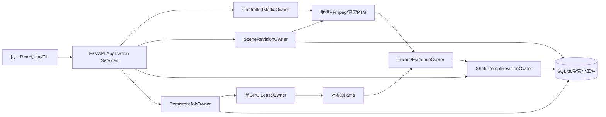

# 31｜V1总体与详细架构：镜头、证据、修订和任务

版本1.0，DESIGN_REVIEW。产品范围已批，接口候选尚未激活；[机器合同候选](../plans/v1-multishot-contract.json)。现有canonical OpenAPI/Schema/DDL及旧R1 packet保持字节不变，审核后由Codex发布版本化overlay和迁移；Claude不得在实现中自行决定公共字段或阈值。

## 总体结构

维持模块化单体；无新微服务/向量库/调度集群，Node仅构建。UI与CLI共享Application Service和编译器；浏览器不直连模型，不导入Comfy插件，不自建第二套shot。原整片四帧路径与单图路径继续兼容。

## 唯一owner与文件分工（待packet最终列准）

| Owner | 职责 | 计划实现位置/禁止越权 |
|---|---|---|
| ControlledMediaOwner | 上传界限、hash、受控引用与源不变 | 复用media.py/video_kernel.py；不复制每镜头整片 |
| SceneRevisionOwner | 检测候选、实际PTS映射、[start,end)边界校订、版本与etag | 新scenes.py/scene_repository.py；不得覆盖旧版本 |
| ShotRevisionOwner | shot绑定边界版本、人工稿head、immutable revision、显式采纳 | 新shots.py/revisions.py/repositories.py；model返回不写人工head |
| FrameEvidenceOwner | 每镜头实际1–4不同帧、帧引用、人物/场景/动作证据域、stale检查 | 新shot_analysis.py与现有provider/service；不伪造完整连续动作 |
| PersistentJobOwner | job/attempt/CAS、固定子清单、序列领取/取消/重试/重启 | 新jobs.py/job_repository.py；不以HTTP断开冒充物理释放 |
| LeaseOwner | 资源准入、运行采样、释放与本轮身份清理 | 复用resources/provider/runtime/native_runtime；不结束未知进程 |
| CompilerOwner | natural/image/edit/motion编译与缺译提示 | 纯CPU复用compiler；切输出不新增模型调用 |
| UI | 镜头列表/预览/版本冲突/stale标记/逐镜头草稿 | 现有frontend/src，不直接改DB，不串写不同镜头draft |

公共入口/DTO/迁移由Codex持有。worker只能在冻结允许清单实现；controller和repository拆分以边界为准，不能为了文件颗粒度再加一层平台。

## 实体、时间与存储

- MediaRef是原片受控引用与SHA；SceneRevision是该媒体边界的一版，不等于下游Narralens生产镜头权威。一个shot引用一个明确scene_revision；PromptRevision不可变，head移动用If-Match与同事务CAS。
- 时间保留source_pts、origin_pts、time_base_num/den。规范秒=(pts-origin)*num/den；VFR不以frame_index/avgfps冒充真实时间。范围[start,end)，内部边界映射真实源帧；全片末端允许使用经验证的容器终点。零长、越界、倒序/重叠拒绝；gap只有显式partial选择才允许，不得伪装全片覆盖。
- SceneRevision与ShotEvidence需要新版本字段与迁移。先backup，事务升级，FK/WAL/integrity检查；旧prompt_revision ID/hash不变。不得把baseline storage.sql每次启动整段重放。scene_revision最小子集从V2提前，不提前FTS/asset/recipe。
- Job/Attempt复用现有设计字段，父子关系仅提前最小子集。SQLite事务不包住解码/推理；模型I/O结束后以attempt/token/cancel_epoch和scene_revision_hash进行终结CAS。
- raw、机器建议、人工revision分存。边界变动令受影响机器结果stale，保留raw与已有人工稿；未受影响项依赖hash吻合才可复用。禁止把旧候选/跨run正例拼为本轮完整验收。

## 公开入口演进

优先扩展现有规划接口，不起平行/scenes2 API。/scenes/detect、/scenes、/scenes/{id}和/jobs/batch的V1有限子集在新overlay声明，原V2增强配置仍不开放。现有单图/jobs/analyze请求语义不变。

| 操作 | 请求与响应约束 |
|---|---|
| POST /api/v1/scenes/detect | Idempotency-Key；media_ref_id/profile；202返回segment job；CPU生成有界候选，不启动视觉推理 |
| GET /api/v1/scenes | 受控media_ref_id与version过滤，返回边界版本/状态/真实时间性质；无任意路径 |
| GET/PUT /api/v1/scenes/{id} | 返回SceneRevision；写入If-Match，创建新版本；无key428、旧etag412；事务校验全部受影响边界 |
| /api/v1/shots与/{id} | 原planned shot CRUD，绑定scene_revision，保存人工修订ETag/CAS；不得把scene覆盖成shot |
| POST /api/v1/jobs/batch | 固定scene_revision_ids/shot_ids与共同配置，max12；202父job+计划子清单；不能运行到一半缩分母 |
| GET /jobs/{id}，cancel，retry | 子状态逐项显式；父进度terminal_count/total。重试只新建失败子项attempt，不重复成功镜头 |
| 修订/export | 单镜头四目标与整体JSON/CSV清单，含source/boundary/config/raw refs和失败/未执行项；不能漏行 |

新增的AnalysisBinding必须绑定media SHA、scene_revision ID/hash、shot ID、config hash、attempt/cancel_epoch；只有当前绑定可显式采纳。规范对象在机器合同候选列出。错误统一已有envelope，新候选码SHOT_LIMIT_EXCEEDED、SCENE_TIME_UNVERIFIED、SCENE_REVISION_CONFLICT、ANALYSIS_STALE、BATCH_DEADLINE_EXCEEDED；具体HTTP映射Gate0固定，不能捕获后返回200。

## 内容分析职责

一镜头一次真实视觉调用，输入该段全部实际采样帧与时间，不混入别的镜头。人物只局部actor1/actor2、可见外观/数量/姿态；不识别姓名或跨镜头身份。动作每条引用同镜头frame indices，domain只能observation/inference，未知另列；至少两不同时间点才可提出动作变化推断，少帧只描述姿态。不存在的actor/越界帧引用/额外字段/无效JSON fail-closed，raw保留。

当前1.8仅外观Schema不能直接宣称已有动作识别；M1需要独立模板/响应Schema和真实质量验证。CPU像素差/注册只提供另行标注的低层变化证据，不能编造“走路/握手”等动作。人物动作归属冲突、遮挡、瞬时动作未采到应未知；全未知不可计为动作能力通过。

## 资源、状态与故障

最多12镜头、每镜头最多4帧；短段1帧明确警告，不复制。超过12候选先暂停模型调用，允许校正或显式selected-only；导出仍列未选项，不能显示整片完成。候选检测需流式有界解码，不缓存全片tensor；全片预览用同源受控媒体引用/时间窗，不暗加任意路径路由。

单worker、单GPU。每个子分析仍总限420s，准入free>=19047MiB；运行GPU<23552MiB/RAM>=2048MiB、OOM0，取消反馈<=1s、释放<=30s。父视频任务总deadline1800s，启动前显示选中镜头数/预计调用，deadline前检查每次send；届满取消活动项并把剩余项明确终结为未执行/截止失败，不悄悄延时。原全局授权预算优先，且要给清理留余量。

queued可直接取消；preparing取消需等解码线程/子进程清理；running取消需真实卸载并确认inventory空和显存回基线。父取消先阻止新领取，再终结待处理子项、取消活动lease；成功项保留。失败子项不回滚其他项；复试新attempt。进程重启running->interrupted、不自动发模型请求；stale与cancelled都不得晚到覆盖人工head。任何清理不明保留预算预约与诊断，不宣布成功。

候选DTO的可执行JSON Schema见[多镜头Schema](../contracts/v1-multishot.schema.json)，additionalProperties=false；跨字段/跨引用语义在x-semantic-invariants列准，由owner验证并测负例，不冒充JSON Schema单独能验证。GET /jobs/{id}继续返回原Job结构；新增受控GET /jobs/{id}/children返回固定分母BatchChildrenResponse，不在旧strict Job响应中偷偷追加字段。该新路由须连同原V2路由提前子集进入审核后的OpenAPI overlay。
