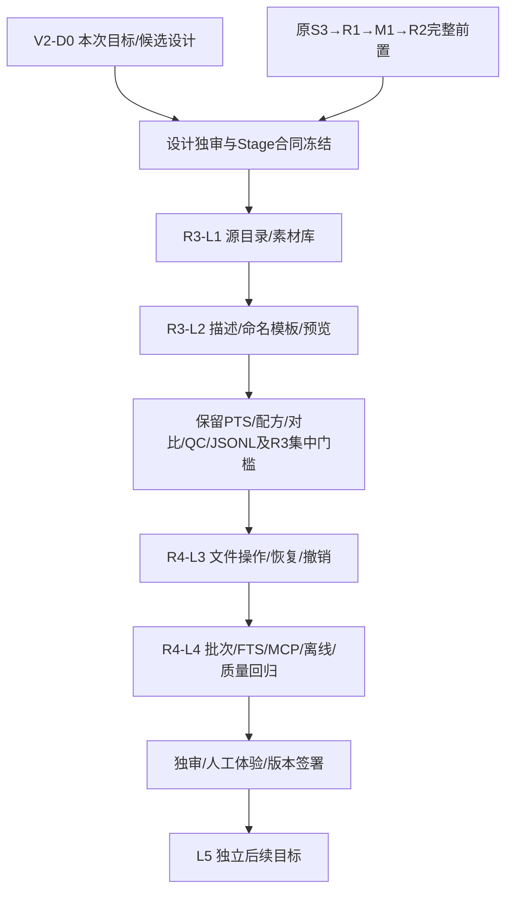

# 35｜V2 开发执行包、验收与人工门槛

设计候选0.1；本次DOCS_VALIDATED仅指文档/Schema/计划确定性检查，不是V2业务开工或产品PASS。数据目录尚未指定，真实素材路径null，模型/GPU/源文件写入授权none。现有V1母授权不能扩用至V2。

## 工作包依赖与原路线映射

| 包 | 修改owner、依赖与输出 | 原R3/R4对应义务 |
|---|---|---|
| V2-D0 | root串行设计/合同/验收；候选SQL/DTO/overlay/需求用例/覆盖/提示词/pilot；独审只读候选 | 不推进R3/R4产品子项，不激活V2 |
| R3-L1 | 最终V1 Storage/Job验收后；SourceRegistry、引用/分页扫描/缺失/重绑定、稳定ID、迁移与受限本地登记入口 | 扩展原R3资产/FTS子项；原真实PTS/切镜仍单独交付 |
| R3-L2 | L1；AssetDescriptor/LibrarySampling/NamingCompiler/RenamePlanner、描述锁定、纯CPU预览/导出/确认、DJ预设 | 扩展原资产、对比/QC/JSONL子项，保留配方和原A13/A14/A17/F06/X04/X06 |
| R4-L3 | L2/R3机器及必要人签；native文件能力pilot后才允许隔离fixture写；journal/不覆盖/同卷/恢复/撤销 | 新文件副作用义务，复用原R4任务/备份基础，不能用原batch PASS替代 |
| R4-L4 | L3；通用batch/取消/lease/恢复、FTS旧名、真实MCP、离线模型/人工、质量与累计56项 | 原R4 MCP/批量/备份/累计回归全部保留 |
| L5 | 新合同/样本/权限后才开；watch/auto apply/PDF/Office/更多容器/音频/跨卷 | 非核心门槛，不自动引入依赖 |

产品进度仍用execution-control旧R3/R4各0/4；L1–L4是工作包依赖而不是偷换已验分母。正式Stage packet将原子项与新增义务共同列入固定验收矩阵。V1仍29项，候选V2=旧38+RN18=56、V3=旧47+RN18=65；不改历史21/30/39和后来29/38/47收据，当前canonical gates未激活新增范围时不得称扩展V2_ACCEPTED。

## 固定候选用例与生产Oracle

机器用例含明确入口、negative、终态和清理证据：[候选用例](../plans/candidates/v2-library/acceptance_cases.json)。RN01引用与副本；RN02事实来源/锁定；RN03确定性/零模型调用；RN04名称边界；RN05目录/身份/并发拒绝；RN06大小写/环形/同卷；RN07故障与部分成功；RN08崩溃协调；RN09撤销；RN10通用批次幂等/取消；RN11稳定引用与旧名；RN12离线/人工/MCP越权；RN13千资产性能；RN14旧门禁回归；RN15大视频有界采样；RN16本地会话/精确确认；RN17迁移备份与外部文件协调；RN18独立DJ/通用质量。

边界均测exact和one-over；测试必须走共享服务和public入口，不只常量/文件/HTTP200。应用/撤销核对原始文件集合、每项物理身份及全文件hash、原目标占位者hash、old/temp/target最终位置、DB/events/FTS引用和无未登记临时件；发生ambiguity则保留隔离根，不清理掉问题证据。确定性模型计数由Provider账本/日志证明，不以模型Mock计数冒充真实零调用。无模型人工计划另用真实禁用Provider入口验证。

## 有界pilot与真实样本计划

现在不读取/扫描私人媒体。先设计30个不同授权真实样本ID，路径、许可、SHA、model_digest均待用户指定后绑定。开发18：D01–D12 DJ视频（含>256MiB、VFR、黑场、频闪、近似场景、缺身份）、D13–D15通用视频、D16–D18通用图片；独立留样12：H01–H08 DJ视频、H09–H10通用视频、H11–H12通用图片。至少D01/D02/H01/H02是>256MiB、<=2h/20GiB；实际分布待许可/媒体能力核验，不用虚构文件填分母。重复内容不同路径作为附加文件操作fixture，不代替30个不同质量样本。

独立标注先冻结可见事实、unknown/禁猜字段、允许摘要和缺值策略；按采样覆盖标注而非事后挑帧猜答案。实现者只看开发集，留样文件hash及密封标签由独立实例保管，首次正式运行前root仅核对manifest/分母。模板/模型调优不看留样答案；拒答/不支持/超时仍占固定分母，不换样、不拼运行。样本授权必须包含本地只读分析权限；可改名fixture是另一个明确范围。

pilot设计：隔离、非私有复制fixture，不触原件；选择4个开发样本（DJ短片/大视频/通用视频/图片），max24实际逐帧模型动作、自动重试0、单GPU、每资产分析<=420s/释放<=30s、整个批次候选<=3600s。CPU native文件原语probe用单独人工指定临时根，最多32新fixture、200次动作/600s、零模型，验证身份/no-replace/祖先替换/锁/仅大小写/环形/flush。**这些是提议预算，不是本次已获运行授权或已运行。** 任一越界/清理不明停止，真实固定30运行预算依据pilot实测再单独冻结，不能默取24槽或V1余额。

质量候选：建议可应用率>=90%，开发集与留样分别统计，18个开发样本至少17可用、12留样至少11可用且总体>=27/30（分别门槛更严格时同时满足）；事实编造=0。可应用定义为完整允许事实+合法模板+无未经确认身份字段+人工仅需接受或非语义格式微调；重写事实算失败。人工只判断不可机器化内容，不承担hash/回归/字段核对。安全覆盖/丢失/内容修改=0是不可豁免协议义务。

性能候选：目标Windows1000引用，page100，至少30次独立查询与30次1000项CPU预览，nearest-rank P95<=1s/2s；预热/冷缓存分别报告，排除首次完整hash、probe、解码、推理并分别计时/内存/I/O，不用排除项掩盖总耗时。所有数字状态为PROPOSED_PENDING_PILOT，不宣称已达标或已获新质量阈值批准；若pilot不支持，保留失败、修订提案后再冻结，不能降低旧硬门限或删除分母。

## 故障矩阵及执行顺序

离线合同负例→原生隔离文件能力pilot→受控故障fixture→代表性4素材pilot→冻结同候选完整矩阵/独立标签→正式固定分母checkpoint→隔离复算→人工体验→版本签署。Stage内L1/L2等连续小包只定向自检，Stage末一次集中检查，纠偏同根因统一汇总。独审不得直接修候选后签通过。

原生故障至少：文件锁、目录ACL撤销、磁盘满、目标并发创建、root/源文件/目标父替换、preview后改写/移动、镜像journal不可写、DB busy/commit失败、进程终止在intent后/临时后/目标后DB前、undo同样三边界。每种保留stable错误、实际磁盘/DB/sidecar快照和进程归属；测试仅终止自己创建并校验PID/birth的进程。无法安全制造的故障标BLOCKED，不以mock冒充对应native证据。

## 人工验收与当前停止条件

R3：同一正式React入口体验登记/缺失/重绑、描述来源与unknown/锁定、中英预览/修改/冲突/导出，手工无模型路径；不能要求用户学Comfy。R4：人工指定隔离样本根，核对计划及选中范围后体验apply/取消/部分成功/重启协调/撤销/旧名检索；原件实写单独授权，默认fixture。最终V2质量体验/版本发布签署分别记录并普通Git同步，不以文档、机器或独审替代。

实现提示词与独审提示词见候选目录 prompts.md；冻结packet必含候选/合同/样本/工具/hash、允许文件、固定分母、预算、原件scope、清理、退出和移交。任何429立即停止WAIT_BUDGET，不换账号/模型/Harness/Codex接手；本次V2文档任务不恢复当前V1 correction04。没有native能力/外部文件授权/留样/预算/独审，保持对应门槛未通过。
